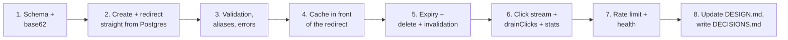
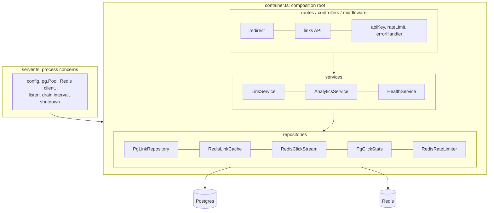
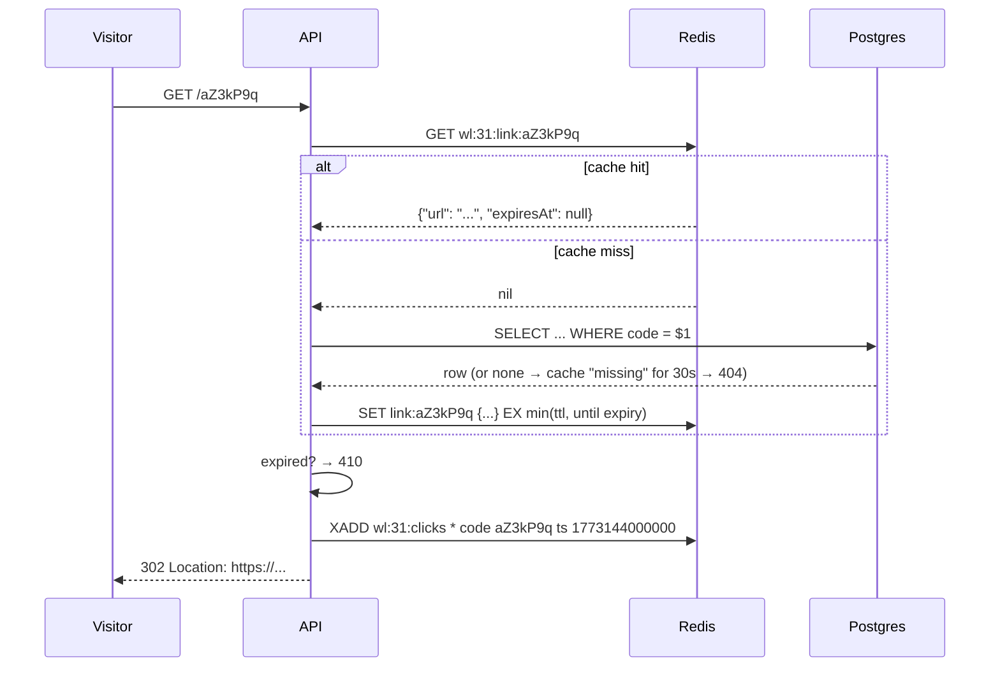
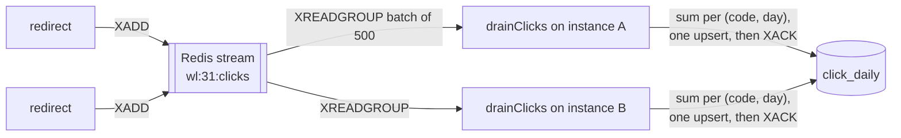

# 31 · Checkpoint: URL Shortener (end-to-end)

> In module 30 you designed systems on paper. Now you take one design all the way to working code: a design doc, a layered service on Postgres and Redis, a cached hot path, an asynchronous analytics pipeline, rate limits, health checks, and tests proving it all holds together. This is the kind of project you can walk an interviewer through from whiteboard to commit.

**Time:** ~10h · **Challenge:** 🛠️ Build (from a spec) · **Prereqs:** [30 · System Design](../30-system-design/README.md), [18 · Caching](../18-caching/README.md), [19 · Rate Limiting](../19-rate-limiting/README.md), [20 · Background Jobs](../20-background-jobs/README.md), [16 · Checkpoint: Postgres](../16-checkpoint-postgres/README.md) · **Services:** Postgres, Redis

## What you'll learn

- How to go from a **design doc to an implementation plan**, and keep the two in sync
- **Short-code generation**: base62, code-space math, collisions, and race-free aliases using the database
- A **cache-aside read path** that stays correct with expiry, deletion and negative caching
- **Asynchronous analytics** with Redis Streams and consumer groups: buffer on the hot path, aggregate in batches, at-least-once semantics
- **301 vs 302** and other HTTP details that matter for redirects
- Structuring a multi-dependency service around a **testable composition root**

This is a checkpoint: the lesson is shorter than usual and focuses on the decisions specific to this system. Everything else (layering, validation, Postgres from Node, caching, rate limiting, queues) you've already learned. Expect to reread bits of modules 06, 13, 18, 19 and 20.

---

## 1. From design to plan

Start by reading the worked example in [module 30's docs](../30-system-design/docs/worked-example-url-shortener.md). Then **write your own `DESIGN.md` first**, before writing code, using the template that's already in `challenge/`. It doesn't have to be perfect; it's a plan you'll revise. Writing it first forces the questions you'd otherwise discover halfway through the code: *What's cached? What happens to the cache when a link expires? Where do clicks go?*

Then turn the design into a build order. A good order delivers a working vertical slice early and adds one concern at a time, with tests going green as you go:



Notice that the cache comes **after** the uncached version works. Caching a broken read path just gives you fast wrong answers. [docs/build-plan.md](docs/build-plan.md) breaks each step down and maps it to the test files.

## 2. The shape of the code

The tests talk to your code through exactly one entry point, `createContainer()` in `src/container.ts`. Everything behind it is yours to design. That's deliberate: it's how real services are tested, and it gives you room to structure things well.



Why split `server.ts` and `container.ts`? `server.ts` owns things that only make sense in a real process: environment variables, opening connections, `listen()`, timers, signals. `container.ts` receives already-created infrastructure and a **clock**, and wires your classes together. The tests call `createContainer()` with an instrumented pool (to count queries) and a fake clock (to move time), and can build **two containers** sharing the same Redis and Postgres to simulate two instances behind a load balancer. If your design holds up under that, it holds up horizontally.

Rules of thumb for the layers (module 06):

- **Controllers** parse and validate input (zod), call one service method, and shape the response. No business rules, no SQL.
- **Services** hold the rules: reserved aliases, expiry, "cache, then database", "record the click after the expiry check". They depend on **interfaces** (`LinkRepository`, `LinkCache`, `ClickRecorder`), never on `pg` or `ioredis` directly.
- **Repositories** are the only code that knows SQL or Redis commands.
- **Domain errors** (`LinkNotFoundError`, `AliasTakenError`, ...) are thrown by services and mapped to HTTP in one error handler.

## 3. Short codes

### Base62

Codes use the 62 URL-safe characters `0-9A-Za-z`. Base62 is ordinary positional notation with 62 digits:

```ts
const ALPHABET = "0123456789ABCDEFGHIJKLMNOPQRSTUVWXYZabcdefghijklmnopqrstuvwxyz";

// 125 in base62: 125 = 2 × 62 + 1  → digits [2, 1] → "21"
function toBase62(n: bigint): string {
  if (n === 0n) return "0";
  let out = "";
  while (n > 0n) {
    out = ALPHABET[Number(n % 62n)] + out;
    n /= 62n;
  }
  return out;
}
```

Use `bigint`: 62^11 already exceeds `Number.MAX_SAFE_INTEGER`, and you want encode/decode to round-trip exactly.

### How long should a code be?

| Length | Codes | Enough for |
|---|---|---|
| 5 | 62^5 ≈ 916 million | a hobby project |
| 6 | 62^6 ≈ 57 billion | most companies |
| 7 | 62^7 ≈ 3.5 trillion | bit.ly scale, with room for random generation |

With **random** codes, length matters for collisions too. The chance that a new random code hits an existing one is (codes used) ÷ (code space). After 1 billion links, a 7-character space is ~0.03% full, so about 1 in 3,500 inserts needs a retry. That's cheap. With 6 characters it would be ~1.8%, still workable but getting worse as you grow.

### Generating codes: the options

| Strategy | Collisions | Guessable | Coordination |
|---|---|---|---|
| Sequence → base62 | none | yes: `/1`, `/2`... anyone can crawl every link | one DB sequence |
| Sequence → scramble → base62 | none | not obviously | one DB sequence |
| Hash(URL) → first 7 chars | possible | no | none, but same URL → same code, which conflicts with per-owner expiry |
| **Random (CSPRNG) + retry** | rare, handled | no | none |

The challenge requires 7 random-looking base62 characters; how you get them is your decision (record it in `DECISIONS.md`). Two implementation details matter:

- Use `crypto.randomInt(62)` (or rejection sampling). `crypto.randomBytes(1)[0] % 62` is biased: 256 isn't a multiple of 62, so the first 8 characters come up more often. `Math.random()` is predictable and not acceptable for unguessable ids.
- **Let the database decide uniqueness.** "Check whether the code exists, then insert" is a race: two requests for the alias `launch` can both see "free" and both insert. Instead:

```sql
INSERT INTO links (code, url, owner_id, created_at, expires_at)
VALUES ($1, $2, $3, $4, $5)
ON CONFLICT (code) DO NOTHING
RETURNING code, url, owner_id, created_at, expires_at;
```

A returned row means you won. No row means the code is taken: retry with a new random code, or return 409 for an alias. The primary key is the lock. The challenge fires 20 concurrent requests for one alias and expects exactly one 201. This is module 15's "unique constraints as concurrency control", applied.

## 4. The redirect path

This is the endpoint that gets ~100x the traffic of everything else, so it's where caching pays off.



### Caching correctly

Module 18 taught cache-aside. A URL shortener adds three twists you must get right:

1. **Expiry on hits.** If you cache only the URL, a link that expires at 13:00 keeps redirecting until the cache TTL runs out. Cache `expiresAt` with the URL and **check it on every hit**, and cap the Redis TTL at the time remaining until expiry so the entry also disappears on its own.
2. **Invalidate on delete, after the commit.** Delete the cache key after the database delete succeeds. If you invalidate first, a concurrent redirect can miss, read the still-present row, and re-cache it right before your delete commits.
3. **Negative caching, carefully.** Bots probe random codes. Caching "this code doesn't exist" for ~30 seconds protects Postgres. But if someone creates that code as an alias a second later, it must work immediately. Write the new link into the cache on create (**write-through**), which overwrites the negative entry.

And one robustness rule: **the cache is an accelerator, not a dependency**. Every Redis call on the redirect path should be wrapped so that an error behaves like a miss. If Redis is down, redirects get slower (served from Postgres) but keep working. The tests check this with an unreachable Redis client.

The tests also prove the cache works by counting calls on the pool: a repeated redirect must make **zero** Postgres calls, including from a second container instance. That second check makes sure the cache lives in Redis, not in a process-local `Map` that other instances can't see.

More on this, including the stampede case and an in-process layer for viral links, in [docs/redirect-path.md](docs/redirect-path.md).

### 301 or 302?

| | 301 Moved Permanently | 302 Found |
|---|---|---|
| Browser caching | cached, often indefinitely | not cached by default |
| Repeat visits reach you | no | yes |
| Click analytics | only first visits | every visit |
| Expire / delete a link | no effect for past visitors | immediate |
| Server load | lowest | every visit |

Both are accepted by the tests. Your `DECISIONS.md` must argue for one. (Hint: re-read your functional requirements.) Whatever you choose, think about `Cache-Control` too: a 302 with no caching headers might still be cached by some intermediaries if you send permissive headers elsewhere.

## 5. Click analytics: buffer, then aggregate

The naive approach writes a row per click: `INSERT INTO clicks (code, at) VALUES (...)` inside the redirect handler. At 5,000 redirects/s that's 5,000 Postgres writes/s on the hot path, and a slow database now slows every redirect. Analytics doesn't need that: per-day counts that are a few seconds late are fine.

So split it: the redirect does a cheap **append** to a buffer, and a background loop **aggregates** batches into Postgres.



### Why a Redis Stream?

You've used three async tools so far: Redis lists (module 17), BullMQ (module 20) and, coming in 32, Kafka. A **Redis Stream** sits between them: an append-only log inside Redis with **consumer groups**, which is exactly what this needs.

- `XADD key MAXLEN ~ 1000000 * code aZ3kP9q ts 1773144000000` appends an entry in O(1). `MAXLEN ~` caps memory if the aggregator stalls.
- `XGROUP CREATE key click-aggregator 0 MKSTREAM` creates a consumer group once (starting from the beginning, so clicks recorded before the group existed aren't lost).
- `XREADGROUP GROUP click-aggregator <consumer> COUNT 500 STREAMS key >` hands out entries **no other consumer in the group has received**. Two instances draining at once never get the same entry.
- Delivered entries stay **pending** until `XACK`. If a consumer crashes mid-batch, its entries aren't lost; `XAUTOCLAIM` lets another consumer take over entries that have been idle too long.

A BullMQ job per click would work but is heavyweight for a counter (each job is a hash plus events). Kafka would be the right tool at a much larger scale. The full command reference and the delivery semantics are in [docs/redis-streams.md](docs/redis-streams.md).

### Aggregating

`drainClicks()` loops: read a batch → **sum in memory** per `(code, UTC day)` → write all the sums in **one** upsert → acknowledge the batch → repeat until nothing is pending.

```sql
INSERT INTO click_daily (code, day, clicks)
SELECT v.code, v.day::date, v.clicks
FROM unnest($1::text[], $2::text[], $3::bigint[]) AS v(code, day, clicks)
ON CONFLICT (code, day) DO UPDATE SET clicks = click_daily.clicks + EXCLUDED.clicks;
```

Summing first matters twice over: a viral link's 500 clicks become one row update instead of 500, and Postgres refuses an `ON CONFLICT DO UPDATE` that would touch the same row twice in one statement.

Use the **click's own timestamp** (from the injected clock, recorded in the event) to choose the day, not the time of the drain. A click at 23:59 that's drained at 00:01 belongs to the earlier day.

### Delivery semantics

This pipeline is **at-least-once**. If an instance commits the upsert and dies before `XACK`, the batch is redelivered and counted twice. For analytics that's an acceptable, rare overcount. If counts were billing data, you'd store the last processed stream id in the same transaction as the counts and skip anything at or below it. Say this in your design: knowing your guarantees is the point.

Edge cases to handle:
- A link is deleted while its clicks are still in the stream. With a foreign key, the upsert would fail and **block the whole pipeline** on every retry. Filter those rows out (for example with `WHERE EXISTS (SELECT 1 FROM links ...)`).
- Clicks for unknown or expired links should never be recorded in the first place: record the click **after** the expiry check.

## 6. Rate limiting and health

**Rate limiting** link creation per API key is module 19 in miniature. A fixed window is enough here: key `wl:31:rl:create:{owner}:{windowStart}`, `INCR` it, set an expiry, reject when the count exceeds the limit with `429`, an error code of `RATE_LIMITED` and a `Retry-After` header in whole seconds. `INCR` is atomic, so ten concurrent requests across two instances get distinct counts and exactly `max` succeed. Compute the window from the **injected clock**, not `Date.now()`, so the tests can move time. Decide what happens when Redis is down (the reference fails open: creating links matters more than limiting them during an outage).

**Health** endpoints come from module 24:
- `/healthz` (liveness) answers 200 if the process can serve HTTP at all. It must not check dependencies, or a Redis blip would make the orchestrator restart every instance.
- `/readyz` (readiness) checks Postgres (`SELECT 1`) and Redis (`PING`) with a short timeout and returns 503 if either fails, so the load balancer stops sending traffic to an instance that can't serve.

## 7. API keys and ownership

Clients send `X-API-Key`. Valid keys come from config (`API_KEYS`). Two good habits:

- **Don't store raw keys** next to links. Store a hash (sha256 is fine for long random keys) as the owner id. If the database leaks, the keys don't.
- **Return 404, not 403, for other owners' links.** A 403 confirms the code exists; a 404 reveals nothing (module 22's IDOR lesson).

## Common mistakes

- **Check-then-insert for aliases** (`SELECT` then `INSERT`): races under concurrency. Use the unique constraint.
- **Caching only the URL**, so expired links keep redirecting from cache.
- **Process-local caches** (`new Map()`): invisible to other instances and never invalidated by a delete on another instance.
- **Letting Redis errors fail the redirect.** The cache and click recording are optional; the redirect isn't.
- **Writing clicks to Postgres on the redirect path**, or awaiting the aggregation inside the request.
- **Bucketing clicks by drain time** instead of click time.
- **Upserting unsummed batches**: `ON CONFLICT DO UPDATE command cannot affect row a second time`.
- **A foreign-key violation poisoning the drain**: one deleted link blocks every future batch.
- **`Date.now()` scattered around** instead of the injected clock: tests can't control expiry or windows, and neither can you when debugging.
- **`Math.random()` or `% 62` on random bytes** for codes: predictable or biased.
- **Accepting `javascript:` or `data:` URLs** as targets: your short links become an XSS and phishing tool. Allow only absolute `http:`/`https:`.

## In production

- **Real shorteners are mostly read caches.** bit.ly-style services serve the overwhelming majority of redirects from memory; the database matters for creates and cold links.
- **Abuse is the hardest operational problem.** Shorteners get used to hide phishing and malware links. Production systems scan targets asynchronously (Safe Browsing-style lists), block domains, rate limit hard, and can disable a link globally, which is another reason to keep redirects uncached by browsers (302).
- **Analytics usually leave the primary database.** At scale, click events go to Kafka and land in an analytics store (ClickHouse, BigQuery) where you can slice by country, referrer and device. The buffered, aggregated pattern you build here is the same idea at a smaller size.
- **Custom domains** (`go.yourbrand.com/sale`) add a domain column to the key and TLS certificate automation; the architecture doesn't change.

## Check yourself

1. Why is "SELECT to check the alias, then INSERT" wrong, and what replaces it?
   <details><summary>Answer</summary>Two concurrent requests can both see the alias as free and both insert (or one fails with an unhandled error). Let the primary key decide atomically: <code>INSERT ... ON CONFLICT (code) DO NOTHING RETURNING</code>; no row returned means taken → 409.</details>
2. A link expires at 13:00 and is cached with a 1-hour TTL at 12:30. What must your code do so it stops redirecting at 13:00?
   <details><summary>Answer</summary>Store <code>expiresAt</code> in the cached value and check it on every hit; also cap the Redis TTL at the time remaining until expiry (30 minutes here).</details>
3. Why does the redirect append to a stream instead of inserting a row in Postgres?
   <details><summary>Answer</summary>To keep the hot path fast and independent of Postgres. An O(1) Redis append costs ~0.2 ms; a background drain aggregates many clicks into a few upserts, so database writes scale with links × days, not with clicks.</details>
4. What does a consumer group give you that a plain <code>XRANGE</code> loop doesn't?
   <details><summary>Answer</summary>Each entry is delivered to only one consumer in the group, so several instances can drain concurrently without double counting; entries stay pending until acknowledged, so a crash means redelivery instead of loss; and the group tracks its position for you.</details>
5. When would 301 be the right redirect?
   <details><summary>Answer</summary>When the mapping is truly permanent and you don't need analytics or the ability to expire, delete or retarget the link, e.g. a permanent vanity URL. You trade control and visibility for less traffic.</details>

## Further reading

- Redis docs, Streams introduction: https://redis.io/docs/latest/develop/data-types/streams/
- Redis command reference, XREADGROUP: https://redis.io/docs/latest/commands/xreadgroup/
- PostgreSQL docs, INSERT ... ON CONFLICT: https://www.postgresql.org/docs/current/sql-insert.html
- MDN, HTTP redirections: https://developer.mozilla.org/en-US/docs/Web/HTTP/Redirections
- Node.js docs, crypto.randomInt: https://nodejs.org/api/crypto.html#cryptorandomintmin-max-callback
- Deep dives in this module: [docs/build-plan.md](docs/build-plan.md) · [docs/redirect-path.md](docs/redirect-path.md) · [docs/redis-streams.md](docs/redis-streams.md)

## ➡️ Next: [the challenge](CHALLENGE.md)
