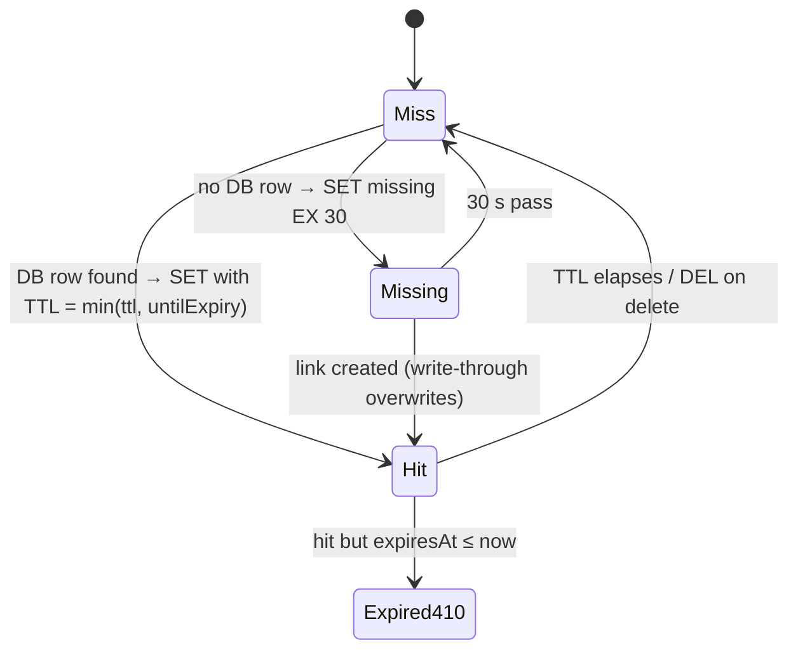

# The redirect path, in depth

The redirect is the one endpoint that has to be fast, cheap and available no matter what. This page collects the details that make it correct.

## Anatomy of a good redirect response

```http
HTTP/1.1 302 Found
Location: https://example.com/landing?utm_source=newsletter
Cache-Control: private, max-age=0
Content-Length: 0
```

- **`Location`** is the target exactly as stored. Express's `res.redirect()` percent-encodes characters that aren't valid in a URL but leaves valid URLs alone.
- **`Cache-Control: private, max-age=0`** stops shared caches (CDNs, corporate proxies) from storing the redirect and makes browsers revalidate. Combined with 302, every visit reaches you.
- No body is needed (Express adds a tiny HTML body, which is harmless).

### Status code options

| Code | Meaning | Cached by browsers | Method preserved |
|---|---|---|---|
| 301 | Moved Permanently | yes, often forever | GET usually (POST may become GET) |
| 302 | Found | no, unless headers say so | GET usually |
| 307 | Temporary Redirect | no | yes, guaranteed |
| 308 | Permanent Redirect | yes | yes, guaranteed |

For GET-only short links, 301 vs 302 is the real choice. 307/308 only matter when the original request has a body.

## Validating targets

A shortener turns any URL into an innocent-looking link, which makes it attractive to attackers. At creation:

- Parse with `new URL(value)` and accept only `http:` and `https:`. Reject `javascript:`, `data:`, `file:`, `vbscript:`: some clients follow redirects to them.
- Cap the length (2,048 characters is the common practical limit).
- Consider rejecting targets that point back at your own domain (redirect loops) and, in production, scanning targets against malware/phishing lists asynchronously.

## Cache-aside with expiry: the state machine



Rules:

1. **Cache what the decision needs**: URL and `expiresAt`, not just the URL.
2. **Decide expiry with the injected clock on every request**, cached or not.
3. **TTL never exceeds the link's remaining life**. Skip caching if it's already expired.
4. **Write-through on create**, so a code probed seconds earlier (and negatively cached) works at once.
5. **Delete from cache after deleting from the database.**

### The remaining race, and why we accept it

Even with "DB delete, then cache delete", a redirect can interleave: it misses the cache, reads the row *just before* the delete commits, and writes it back to the cache *just after* we deleted the key. The deleted link then redirects until the cache TTL expires. Fixes exist (versioned keys, a short "tombstone" entry written on delete, or a delete-then-delay-then-delete-again "double delete"), but the window is microseconds wide and the consequence is mild, so most systems accept it. A tombstone is the cheapest upgrade: on delete, `SET link:{code} {"missing":true} EX 30` instead of `DEL`.

## Stampedes and hot keys

- **Stampede**: when a popular key expires, many concurrent requests miss at once and all query Postgres. Module 18's request coalescing (one in-flight load per key per instance) or a small random TTL jitter spreads the reload out. For primary-key lookups that take ~1 ms, a short stampede is usually harmless, but it's worth knowing for expensive loads.
- **Hot key**: a viral link can get tens of thousands of requests per second, all landing on the one Redis node that owns its key. Redis can take ~100k simple ops/s, so this is rarely the first problem. If it is, add an **in-process LRU** in front of Redis with a TTL of a few seconds. The trade-off is that delete and expiry can lag by up to that TTL on each instance (expiry can still be checked per hit, since `expiresAt` is in the cached value).

## Failure behaviour

| Dependency state | Redirect behaviour |
|---|---|
| Redis down | every request reads Postgres; clicks dropped (fail-open); slower but correct |
| Redis slow | set a short command timeout on the client, otherwise a slow cache makes every redirect slow |
| Postgres down | cached links keep working; uncached ones return 500 |
| Both down | 500s; `/readyz` reports 503 so the load balancer can stop routing here |

ioredis tips: `maxRetriesPerRequest` controls how long a command keeps retrying while disconnected, and `enableOfflineQueue: false` makes commands fail immediately instead of queueing while disconnected. For a cache, failing fast is what you want.
