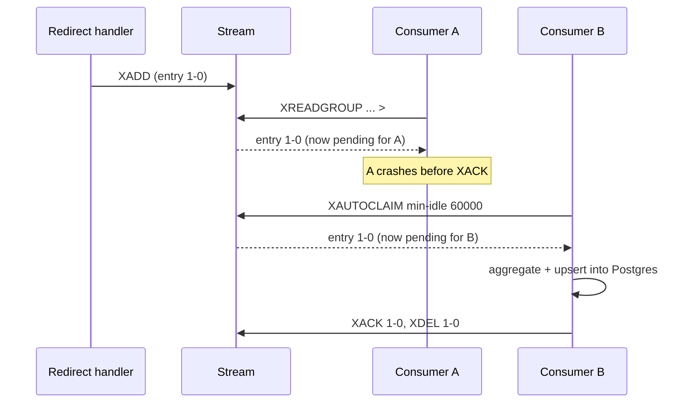

# Redis Streams and consumer groups

A Redis Stream is an append-only log stored in one Redis key. Each entry has an auto-generated id (`<ms timestamp>-<sequence>`, e.g. `1773144000000-0`) and a small set of field/value pairs. Consumer groups add Kafka-like "each entry to one consumer, tracked until acknowledged" semantics. See also the Redis cheat sheet at [../../docs/cheatsheets/redis.md](../../docs/cheatsheets/redis.md).

## Commands you need

```bash
# Append (O(1)). '*' = let Redis pick the id. MAXLEN ~ N trims old entries approximately (cheap).
XADD wl:31:clicks MAXLEN ~ 1000000 * code aZ3kP9q ts 1773144000000

# How long is it? What's in it?
XLEN wl:31:clicks
XRANGE wl:31:clicks - + COUNT 10

# Create a consumer group starting at the beginning ('0'), creating the stream if needed.
# Errors with BUSYGROUP if it exists: catch and ignore that error.
XGROUP CREATE wl:31:clicks click-aggregator 0 MKSTREAM

# Read NEW entries (never delivered to anyone in the group): id '>'
XREADGROUP GROUP click-aggregator consumer-a COUNT 500 STREAMS wl:31:clicks >

# Re-read MY pending entries (delivered to me, not yet acked): id '0'
XREADGROUP GROUP click-aggregator consumer-a COUNT 500 STREAMS wl:31:clicks 0

# Acknowledge (removes from the pending list), then optionally delete the entries
XACK wl:31:clicks click-aggregator 1773144000000-0 1773144000001-0
XDEL wl:31:clicks 1773144000000-0 1773144000001-0

# Inspect pending entries: count, oldest/newest id, per-consumer counts
XPENDING wl:31:clicks click-aggregator

# Take over entries idle > 60 s from any consumer (e.g. a crashed instance)
XAUTOCLAIM wl:31:clicks click-aggregator consumer-b 60000 0-0 COUNT 500

# Remove a consumer that's gone for good (its pending entries should be claimed first)
XGROUP DELCONSUMER wl:31:clicks click-aggregator consumer-a
```

## The lifecycle of one entry



## A drain loop in ioredis

```ts
type Entry = [id: string, fields: string[] | null];
type Reply = [stream: string, entries: Entry[]][] | null;

async function readBatch(redis: Redis, key: string, group: string, me: string, from: "0" | ">") {
  const reply = (await redis.xreadgroup("GROUP", group, me, "COUNT", 500, "STREAMS", key, from)) as Reply;
  return reply?.[0]?.[1] ?? [];
}
```

Fields come back as a flat array `["code", "aZ3kP9q", "ts", "1773144000000"]`; turn it into an object yourself. An entry can come back with `null` fields if it was deleted while pending, so handle that.

The loop, in words: ensure the group → (optionally) claim abandoned entries → read your own pending (`0`) → if none, read new (`>`) → if none, stop → process → `XACK` → repeat.

Don't use the `BLOCK` option in `drainClicks()`: it must return when there's nothing left so the caller (a timer, or a test) can continue.

## Choosing a consumer name

Each consumer in a group needs a name. Options:

- **Random per process** (`consumer-<uuid>`): simple; dead consumers accumulate in `XINFO CONSUMERS` until you delete them, and their pending entries are recovered by `XAUTOCLAIM`.
- **Stable per instance** (hostname or pod name): a restarted instance picks up its own pending entries immediately with id `0`.

## Delivery guarantees

| Failure point | Effect |
|---|---|
| Crash before XREADGROUP | nothing happened; entries wait |
| Crash after reading, before the DB commit | entries pending; redelivered (to you with `0`, or to others via `XAUTOCLAIM`) |
| Crash after the DB commit, before XACK | redelivered → **counted twice** |
| Crash after XACK | done |

That's **at-least-once**. To get effectively-once counting, record the highest processed entry id in Postgres in the same transaction as the counts, and skip entries at or below it on redelivery (works for a single consumer; with several consumers, track per consumer or deduplicate by entry id).

## Memory and retention

Streams live in RAM. Bound them:
- `MAXLEN ~ N` on `XADD` (approximate trimming is much cheaper than exact).
- `XDEL` after `XACK`, so processed entries don't wait for trimming.
- Alert on `XLEN` and on the age of the oldest pending entry: those are your "consumer lag" metrics.

## Streams vs the alternatives

| | Redis list (`LPUSH`/`BRPOP`) | Redis Stream | BullMQ | Kafka |
|---|---|---|---|---|
| Multiple consumers share work | yes (pop) | yes (groups) | yes | yes (groups, per partition) |
| Survives consumer crash mid-message | no (popped = gone, unless you use `LMOVE` patterns) | yes (pending until ack) | yes | yes (offset not committed) |
| Replay | no | yes, while retained | no | yes, by retention |
| Retries/backoff/DLQ built in | no | no | yes | no (build it) |
| Throughput | very high | very high | high | extremely high, horizontally scalable |
| Extra infrastructure | none | none | none (uses Redis) | a cluster |

For "lots of tiny events, aggregate them", a stream is the sweet spot. For "a unit of work with retries and backoff" (emails, thumbnails), BullMQ fits better. For event-driven systems with many independent consumers and long retention, Kafka (modules 32–33).
