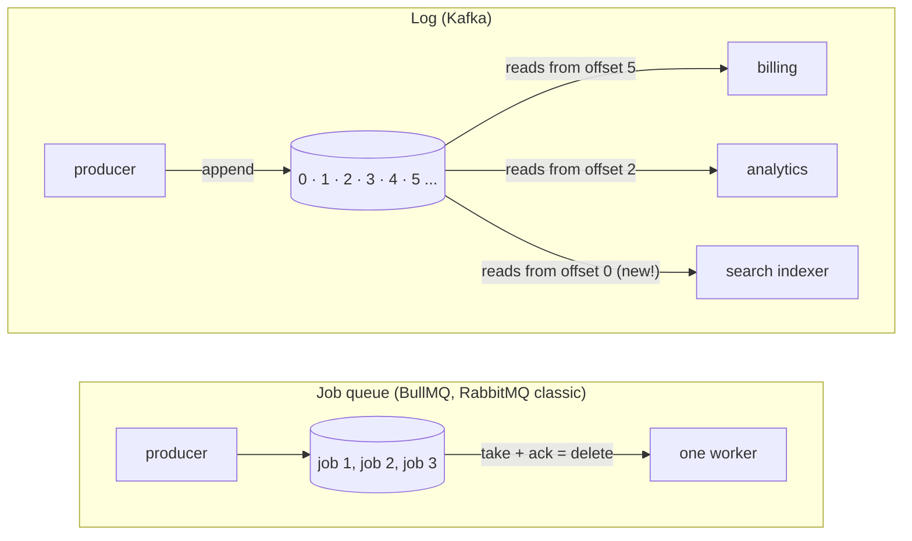
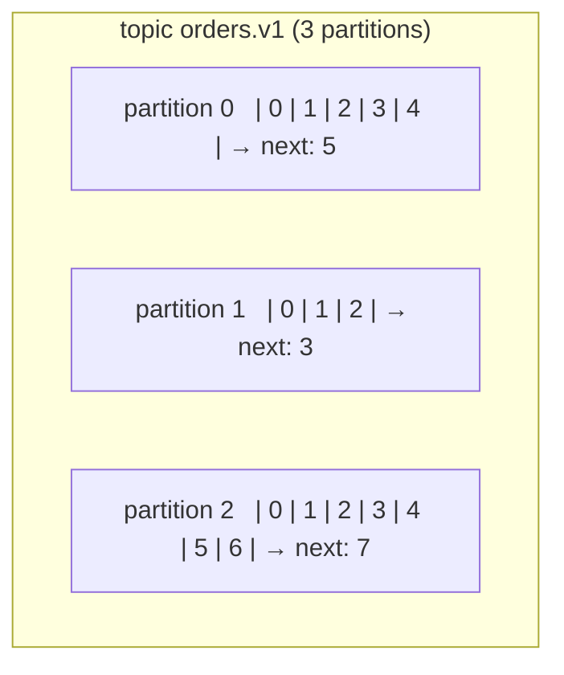
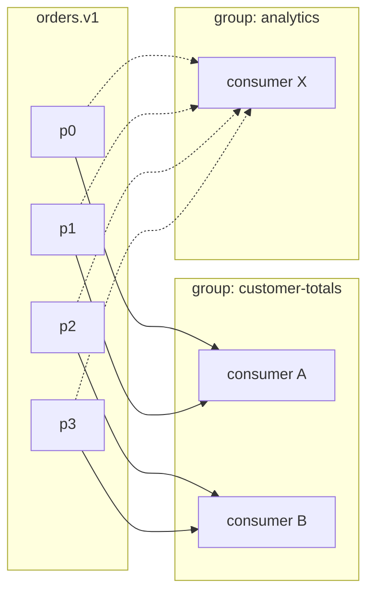
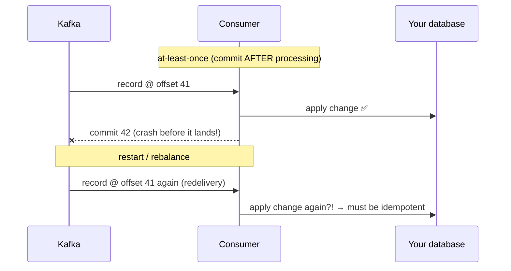
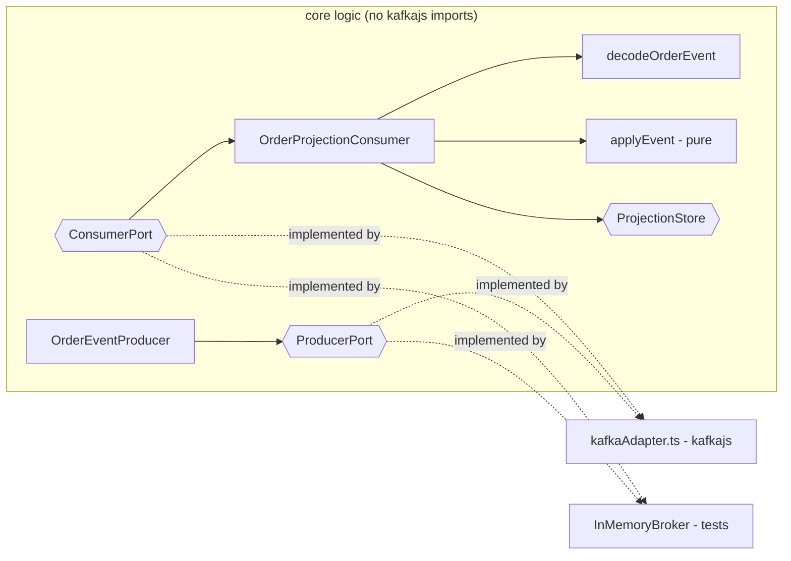

# 32 · Kafka Fundamentals

> Once a company has more than a handful of services, they stop calling each other for everything and start publishing **events** instead. Kafka is the backbone most of them use for that. If you can explain partitions, consumer groups and offset commits clearly, and you know what "at-least-once" means for your code, you're ahead of most candidates for backend and platform roles.

**Time:** ~7h · **Challenge:** 🧩 Scaffold · **Prereqs:** [20 · Background Jobs & Queues](../20-background-jobs/README.md), [06 · Layered Architecture](../06-layered-architecture/README.md) · **Services:** Kafka (KRaft, port 9092)

## What you'll learn

- Why a **log** is different from a **queue**, and why that difference changes how you design systems
- Topics, partitions, offsets, segments and retention, and how they fit together on disk
- Producers: how **keys** pick partitions, what `acks` buys you, the idempotent producer, batching
- Consumers and **consumer groups**: partition assignment, rebalancing, offset commits, lag
- Delivery semantics: at-most-once, at-least-once, and why "exactly-once" is mostly your job
- Ordering guarantees (per partition, never global) and how to choose a key
- Replication, ISR and KRaft at the level you need for interviews
- Compacted topics, and how Kafka compares to Redis Streams, BullMQ and RabbitMQ
- Using kafkajs behind small interfaces so your core logic is testable without a broker

---

## 1. Queues vs logs

In [module 20](../20-background-jobs/README.md) you used BullMQ, a **job queue**. A queue's model is simple: a producer adds a job, *one* worker takes it, and when the worker acknowledges it, the job is gone. The queue is a to-do list.

Kafka is a **log**: an append-only sequence of records, kept on disk for a configured time whether or not anyone has read them. Reading doesn't remove anything. Each reader just remembers *how far it has read*.



That one difference has big consequences:

| | Queue | Log |
|---|---|---|
| After a message is processed | deleted | still there until retention expires |
| Many independent readers | need one queue per reader (fan-out exchange) | free: each **consumer group** tracks its own position |
| New service joins next month | sees only new messages | can read the **whole history** from offset 0 |
| Bug in a consumer corrupted its data | messages are gone | fix the bug, **rewind the offset, replay** |
| Ordering | roughly FIFO, broken by retries and parallel workers | strict, **per partition** |
| Per-message features (delays, priorities, per-job retries) | yes | no; you build them yourself |

So the two tools answer different questions. A queue answers *"who does this piece of work?"* A log answers *"what happened, in what order?"* and lets any number of services react to it at their own pace. When the orders service publishes `OrderPlaced`, it doesn't know or care that billing, email, analytics and a fraud model all read it. That's the decoupling event-driven architectures are built on ([module 33](../33-event-driven-architecture/README.md)).

## 2. Topics, partitions, offsets

A **topic** is a named log, like `orders.v1`. A single log on a single machine would cap throughput, so a topic is split into **partitions**. Each partition is its own independent, ordered, append-only log, and the partitions of a topic are spread over the brokers in the cluster.



- An **offset** is a record's position *within its partition*: 0, 1, 2, ... Offsets are per partition, so "offset 3" means nothing without saying which partition. A record's address is `(topic, partition, offset)`.
- The **high watermark** (or end offset) is the offset the next record will get. In the picture, partition 0's is 5.
- A **record** has a key (optional), a value (bytes; we'll use JSON), headers (small key/value metadata) and a timestamp.

### Segments and retention

On disk, each partition is a directory of **segment** files (say, 1 GB each). New records are appended to the active segment. When it fills up, it's closed and a new one starts. That makes deleting old data cheap: the broker deletes *whole segments* once they're older than `retention.ms` (default 7 days) or the partition exceeds `retention.bytes`. Nothing is ever updated in place, which is a big part of why Kafka is fast: appends and sequential reads are the best case for both disks and the OS page cache.

Two consequences worth remembering:

- **Retention is independent of consumption.** A consumer that's down for 8 days on a 7-day topic comes back to find its position deleted. The oldest offset still available is the **low watermark**.
- **Kafka is not a database you query.** You can't ask "give me the record where orderId = 42". You can only read sequentially from an offset. If you need lookups, a consumer builds a **projection** (a read model) in Postgres or Redis. That's exactly what the challenge does.

## 3. Producers

### Keys decide the partition

When you send a record, the producer picks its partition:

1. If you set a partition explicitly, that's it (rare).
2. If the record has a **key**: `partition = toPositive(murmur2(keyBytes)) % numPartitions`.
3. No key: the producer spreads records over partitions (round-robin or "sticky" batches).

Rule 2 is the important one. **The same key always goes to the same partition** (as long as the partition count doesn't change), and a partition is strictly ordered. So all events with key `order-42` are stored, and later read, in the order they were produced. That's the *only* ordering Kafka gives you.

```ts
await producer.send({
  topic: "orders.v1",
  messages: [
    { key: "order-42", value: JSON.stringify({ type: "OrderPlaced", ... }) },
    { key: "order-42", value: JSON.stringify({ type: "OrderCancelled", ... }) }, // same partition, after the first
    { key: "order-7",  value: JSON.stringify({ type: "OrderPlaced", ... }) },    // probably another partition
  ],
});
```

You'll implement murmur2 in TODO 1 and test it against values from the Java client. Being byte-compatible matters in a polyglot company: a Java service and a Node service producing the same key must land on the same partition, or per-key ordering silently breaks. (kafkajs v2's `Partitioners.DefaultPartitioner` is the compatible one; the `LegacyPartitioner` isn't. See [docs/partitioning-and-ordering.md](docs/partitioning-and-ordering.md).)

### `acks`: when is a write "done"?

Each partition has one **leader** broker (which handles writes) and some **followers** that copy it. `acks` says how many must have the record before the producer gets a success:

| `acks` | Producer waits for | If the leader dies right after | Use for |
|---|---|---|---|
| `0` | nothing (fire and forget) | the record may never have existed | metrics you can afford to lose |
| `1` | the leader's write | lost if followers hadn't copied it yet | rarely worth it |
| `-1` / `all` | all **in-sync replicas** | safe (with `min.insync.replicas ≥ 2`) | business events: **the default you want** |

### The idempotent producer

Networks fail in the worst possible spot: the broker writes your batch, but the acknowledgement is lost. The producer times out and retries, and now the record is in the log **twice**. With `idempotent: true`, the producer gets an id and numbers every batch per partition. The broker remembers the last sequence number and silently drops a retried batch it already has. It costs almost nothing and requires `acks: -1`. Turn it on.

Note what it does *not* do: if your *application* calls `send()` twice (say, an HTTP retry from a client), those are two different records. Protecting against that is the consumer's job (dedupe by event id), and you'll build it in TODO 5.

### Batching

Every `send()` is a network round trip. Producers batch records per partition (in kafkajs, by passing many messages to one `send()`). In the Java client, `linger.ms` and `batch.size` tune this automatically. Batching plus compression is how Kafka moves millions of records per second. In the challenge, `publishMany()` must use a single `send()`.

## 4. Consumers and consumer groups

A consumer reads a partition sequentially from some offset. To scale reading, consumers join a **consumer group** (identified by `groupId`). Kafka's rule is:

> Within a group, **each partition is assigned to exactly one consumer**. Different groups are completely independent.



What follows from that rule:

- **Partitions are the unit of parallelism.** A group can't use more consumers than there are partitions. A 5th consumer on a 4-partition topic sits idle. Pick the partition count with future scale in mind.
- **Ordering survives scaling.** Since one partition has one reader at a time, events for `order-42` are still processed in order even with 10 consumers.
- **Fan-out is free.** The analytics group gets every record too, without affecting customer-totals.

### Rebalancing

When a consumer joins, leaves cleanly, or stops sending heartbeats (crash, or a handler so slow it exceeds the session timeout), the group **rebalances**: the group coordinator (a broker) reassigns partitions among the remaining members. During a classic rebalance, consumption pauses. Frequent rebalances ("rebalance storms") are a common production problem, usually caused by slow handlers or deploys that restart every pod at once.

### Offset commits

How does a new owner of partition 2 know where to start? The group stores a **committed offset** per partition in an internal topic (`__consumer_offsets`). The convention: the committed offset is **the next offset to read**, so after processing offset 41 you commit `42`. Forgetting the `+ 1` means reprocessing one record after every restart, which you'll test for in the challenge.

`fromBeginning` (in Java: `auto.offset.reset=earliest`) only matters when the group has **no** committed offset for a partition yet. After that, the committed offset always wins.

### When you commit decides your delivery semantics

This is the most important idea in the module. Processing a record and committing its offset are two separate steps, and the process can crash between them.



| Strategy | Crash between steps means | Name |
|---|---|---|
| Commit, then process | the record was never processed: **lost** | at-most-once |
| Process, then commit | the record is processed **again** | at-least-once |
| Process + record "done" atomically, then commit | redelivery is detected and skipped | effectively-once |

Almost every real system picks **at-least-once + idempotent processing**. Idempotent means applying the same event twice has the same effect as applying it once. Ways to get there:

- Natural idempotence: `SET status = 'shipped'` is safe to repeat. `balance = balance + 10` is not.
- **Dedupe by event id**: store the ids of processed events *in the same transaction* as the change, and skip ids you've seen. The challenge's `ProjectionStore.save(totals, eventId)` models this, and [module 33](../33-event-driven-architecture/README.md) builds it in Postgres as an *inbox* table.

kafkajs's default `autoCommit: true` commits periodically *after* `eachMessage` resolves, which is at-least-once too, but commits are batched and happen on a timer. In the challenge you turn it off and commit explicitly after each record, so the logic is visible and testable. (Committing per message costs a round trip each; at high volume you'd commit every N records or every few seconds. The guarantee is the same.)

[docs/delivery-semantics.md](docs/delivery-semantics.md) walks through every failure point in detail.

### Poison messages

If a handler throws, kafkajs retries that record, and **every later record of that partition waits behind it**. That's what preserves ordering, but it also means one malformed record can stall a partition forever (a *poison message*). The minimum defense: when a record can *never* succeed (invalid JSON, unknown schema version), log it with its coordinates and **skip it** by committing past it. The better defense, a **dead-letter topic** after N failures, comes in module 33. Transient errors (database down) are different: those you *want* to retry, so let them throw.

### Lag

**Consumer lag** = high watermark − committed offset, per partition. It's the single most useful health metric for a consumer: lag that keeps growing means consumers can't keep up (or are stuck on a poison message). You'll compute it in TODO 6, and you can see it with:

```bash
kafka-consumer-groups.sh --bootstrap-server localhost:9092 --describe --group customer-totals
# GROUP            TOPIC      PARTITION  CURRENT-OFFSET  LOG-END-OFFSET  LAG
# customer-totals  orders.v1  0          120             120             0
# customer-totals  orders.v1  1          98              143             45   ← falling behind
```

## 5. Ordering guarantees

Let's be precise, because interviewers will be:

- ✅ Records in **one partition** are stored and delivered in order.
- ✅ Therefore all records with the **same key** are ordered, as long as the partition count is unchanged.
- ❌ There is **no order across partitions**. `order-7`'s events may be processed before or after `order-42`'s, by different consumers, at the same time.
- ❌ Adding partitions **remaps keys** (`% numPartitions` changes). For a while, old events of a key sit in one partition and new ones in another. If ordering matters, create a new topic instead.
- ⚠️ Without the idempotent producer, a retry can reorder batches when several requests are in flight.

So choosing a key means answering: *"Which events must be processed in order relative to each other?"* Usually the answer is "all events about the same entity", so the key is the entity id (`orderId`, `accountId`). The trade-off: a hot entity (one huge customer) makes a **hot partition**, since one key can only ever use one partition. The challenge's `DECISIONS.md` asks you to make this call for the orders topic.

## 6. Replication, ISR and KRaft (concepts)

You won't operate a production cluster in this module, but you should be able to explain how Kafka stays available:

- Each partition has a **replication factor** (typically 3). One replica is the **leader**, the others are **followers** that fetch from it.
- The **ISR** (in-sync replicas) is the set of replicas that are caught up with the leader. A follower that falls too far behind is dropped from the ISR.
- With `acks=all`, a write succeeds once every ISR member has it. With `min.insync.replicas=2`, the broker *refuses* writes when fewer than 2 replicas are in sync, trading availability for not losing acknowledged data.
- If a leader dies, the controller elects a new leader **from the ISR**, so no acknowledged write is lost.
- The **controller** manages this metadata (which broker leads which partition, topic configs). Kafka used to rely on ZooKeeper for that. **KRaft** (Kafka Raft) replaces ZooKeeper with a quorum of Kafka controller nodes running the Raft consensus protocol. ZooKeeper mode was removed in Kafka 4.0. Our local setup is a single node acting as both broker and controller.

Locally we have one broker, so the replication factor is 1 and none of this protects you. That's fine for development and a terrible idea in production.

## 7. Compacted topics

Retention by time suits event streams ("what happened"). Some topics represent **current state** instead: the latest address per user, the latest config per service. For those, set `cleanup.policy=compact`: Kafka keeps **at least the latest record for every key** and eventually deletes older ones. A record with a `null` value (a **tombstone**) means "delete this key".

```
before compaction:  k1=A  k2=B  k1=C  k3=D  k2=null  k1=E
after compaction:   k3=D  k1=E          (k2 deleted by its tombstone)
```

A new consumer reading a compacted topic from the beginning rebuilds the full current state without replaying years of history. Kafka itself uses this for `__consumer_offsets`. In the challenge, your decoder treats a `null` value as something to skip, which is exactly what you'd do on a non-compacted topic.

## 8. Kafka vs Redis Streams vs BullMQ vs RabbitMQ

| | Kafka | Redis Streams | BullMQ (Redis) | RabbitMQ |
|---|---|---|---|---|
| Model | partitioned log | log (one stream = one ordered sequence) | job queue | message broker (queues + exchanges) |
| Retention / replay | days to forever, replay any time | bounded by memory (`MAXLEN`) | jobs removed when done | messages deleted on ack (streams plugin aside) |
| Consumer groups | yes, per-partition ownership | yes, per-message ack + pending list | workers on a queue | competing consumers per queue |
| Ordering | per partition | per stream | not guaranteed with concurrency | per queue, broken by redelivery |
| Throughput | very high (millions/s per cluster) | high, limited by RAM / one node per stream | moderate | high |
| Per-message features | none (no delays, priorities, per-message TTL) | minimal | delays, priorities, retries with backoff, cron | TTL, DLX, priorities, routing keys |
| Ops cost | highest (or use a managed service) | low if you already run Redis | low | medium |
| Pick it when | many services need the same events, history, replay, high volume | lightweight streams, already on Redis | background jobs for one app | flexible routing, task distribution, RPC-style messaging |

A common real-world setup uses **both**: Kafka for domain events between services, and a job queue inside each service for "send this email in 10 minutes with 3 retries".

## 9. kafkajs in practice

The full API is in the [Kafka cheat sheet](../docs/cheatsheets/kafka.md). The essentials:

```ts
import { Kafka, Partitioners, logLevel } from "kafkajs";

const kafka = new Kafka({ clientId: "orders-api", brokers: ["localhost:9092"], logLevel: logLevel.WARN });

// Producer: idempotent, Java-compatible partitioner
const producer = kafka.producer({ idempotent: true, createPartitioner: Partitioners.DefaultPartitioner });
await producer.connect();
await producer.send({ topic: "orders.v1", acks: -1, messages: [{ key: "order-42", value: "{...}", headers: { "event-type": "OrderPlaced" } }] });

// Consumer: manual commits after processing (at-least-once)
const consumer = kafka.consumer({ groupId: "customer-totals" });
await consumer.connect();
await consumer.subscribe({ topics: ["orders.v1"], fromBeginning: true });
await consumer.run({
  autoCommit: false,
  eachMessage: async ({ topic, partition, message }) => {
    await handle(message); // idempotent!
    await consumer.commitOffsets([{ topic, partition, offset: (BigInt(message.offset) + 1n).toString() }]);
  },
});

// Graceful shutdown: leave the group so partitions are reassigned immediately
process.once("SIGTERM", async () => { await consumer.disconnect(); await producer.disconnect(); });
```

Things that trip people up:

- Keys, values and header values arrive as **Buffers**. Call `.toString()`.
- Offsets are **strings** because they're 64-bit integers, and JavaScript numbers lose precision above 2^53. Use `BigInt` for arithmetic.
- `consumer.run()` returns once the consumer has *started*, not when it's finished. The loop runs in the background.
- Throwing from `eachMessage` makes kafkajs retry the record (and eventually restart the consumer). That's what you want for transient errors and the opposite of what you want for poison messages.
- Not calling `disconnect()` on shutdown means the group waits for the session timeout (30s by default) before reassigning your partitions.

### Local Kafka and the CLI

The challenge's `docker-compose.yml` runs `apache/kafka:3.9.0` as a single KRaft node on port 9092. The CLI tools live inside the container:

```bash
make up                 # start Kafka, wait for the healthcheck
make topics             # kafka-topics.sh --list
make produce            # publish sample order events
make dev                # run the projection worker
make groups             # describe the consumer group: offsets and lag
```

[docs/local-kafka-and-cli.md](docs/local-kafka-and-cli.md) explains every line of the compose file (listeners are the classic gotcha) and has a hands-on CLI lab.

## 10. Keeping Kafka at the edge of your code

Look at how the challenge is structured:



This is the ports-and-adapters idea from [module 06](../06-layered-architecture/README.md) applied to messaging. The producer and consumer depend on two tiny interfaces shaped like kafkajs (`send`, `subscribe`, `run`, `commitOffsets`), never on kafkajs itself. That gives you:

- **Fast, deterministic tests.** `InMemoryBroker` models partitions, key hashing, consumer groups, commits, rebalances and failure injection in memory. Read it, it's short. Tests call `await broker.drain()` instead of sleeping and hoping.
- **Testable failure modes.** "The commit fails after the save" is one line (`broker.failNextCommits(1)`). With a real broker it's nearly impossible to reproduce on demand.
- **Real-broker confidence where it matters.** `test/integration/` runs the same classes against a real Kafka through `kafkaAdapter.ts`. Those tests are skipped unless `KAFKA_BROKERS` is set; CI sets it.

The business rule itself, `applyEvent(totals, event) → totals`, is a pure function. Projections are folds over a stream, so keeping the fold pure makes replay safe and testing trivial.

## Common mistakes

- **Committing before processing** (or using auto-commit with fire-and-forget async work inside the handler): crashes silently lose messages.
- **Non-idempotent handlers**: `total += amount` without dedupe double-counts every redelivery. Redeliveries *will* happen: every deploy causes a rebalance.
- **Committing `message.offset` instead of `offset + 1`**: one record is reprocessed after every restart.
- **Expecting global ordering**, or keying by something random (or nothing) and then being surprised that `OrderCancelled` was processed before `OrderPlaced`.
- **Adding partitions to a live keyed topic** and breaking per-key ordering.
- **Letting a poison message throw forever**: the partition stalls and lag climbs while the other partitions look healthy.
- **More consumers than partitions**, then wondering why scaling did nothing.
- **Slow handlers** exceeding the session timeout, causing rebalance storms and redelivery loops.
- **Treating Kafka as a database**: trying to look up records by key instead of building a projection.
- **Number arithmetic on offsets**: precision loss past 2^53.

## In production

- **Managed Kafka** (Confluent Cloud, Amazon MSK, Aiven, Redpanda Cloud) is the norm. Few teams want to run brokers themselves.
- **Schemas** are enforced with a schema registry (Avro, Protobuf or JSON Schema) so a producer can't publish something consumers can't read. Our zod schemas + `event-version` header are the lightweight version. Module 33 covers evolution.
- **Lag-based alerting and autoscaling**: alert when lag grows for N minutes. KEDA can scale consumer pods on lag in Kubernetes (modules 34–35).
- **Partition counts** are chosen for peak consumer parallelism plus headroom. Changing them later is painful. Teams often start at 12–48 for important topics.
- **Retention** is often 7 days for event streams and "forever" (compacted) for state topics. Some companies keep raw events forever in cheaper tiered storage.
- **Exactly-once inside Kafka** (transactions: consume → produce → commit atomically) exists and powers Kafka Streams. The moment a database or an email is involved, you're back to idempotent consumers.
- **Cooperative rebalancing** (incremental, without stopping the world) and static group membership reduce rebalance pain on large groups.

## Check yourself

1. You have a topic with 6 partitions and start 8 consumers in one group. What happens?
   <details><summary>Answer</summary>6 consumers get one partition each and 2 sit idle. A partition is never shared within a group, so partitions cap a group's parallelism.</details>
2. Your consumer saves to Postgres, then commits. It crashes between the two. What happens on restart, and what must your code do about it?
   <details><summary>Answer</summary>The new owner resumes from the last committed offset, so the record is delivered again (at-least-once). The handler must be idempotent: for example, store processed event ids in the same transaction as the change and skip known ids.</details>
3. Why do all events of one order arrive in order, even with many consumers?
   <details><summary>Answer</summary>They share a key, so the partitioner puts them on the same partition. A partition is an ordered log, and within a group only one consumer reads it at a time.</details>
4. What does `acks: -1` guarantee, and what does the idempotent producer add?
   <details><summary>Answer</summary><code>acks: -1</code> means the write is acknowledged only after all in-sync replicas have it, so a leader failure doesn't lose it. The idempotent producer adds per-partition sequence numbers, so a retried batch that was already written is dropped by the broker instead of being duplicated.</details>
5. You just processed the record at offset 99. What offset do you commit, and why?
   <details><summary>Answer</summary>100. The committed offset is the next record to read; committing 99 would redeliver record 99 after every restart.</details>

## Further reading

- Apache Kafka documentation, Design section: https://kafka.apache.org/documentation/#design
- Apache Kafka documentation, KRaft: https://kafka.apache.org/documentation/#kraft
- KafkaJS documentation: https://kafka.js.org/docs/getting-started
- KafkaJS, Consuming messages: https://kafka.js.org/docs/consuming
- Deep dives in this module: [docs/delivery-semantics.md](docs/delivery-semantics.md) · [docs/partitioning-and-ordering.md](docs/partitioning-and-ordering.md) · [docs/local-kafka-and-cli.md](docs/local-kafka-and-cli.md) · [docs/kafka-fundamentals-cheatsheet.md](docs/kafka-fundamentals-cheatsheet.md)
- Repo cheat sheet: [Kafka](../docs/cheatsheets/kafka.md)

## ➡️ Next: [the challenge](CHALLENGE.md)
