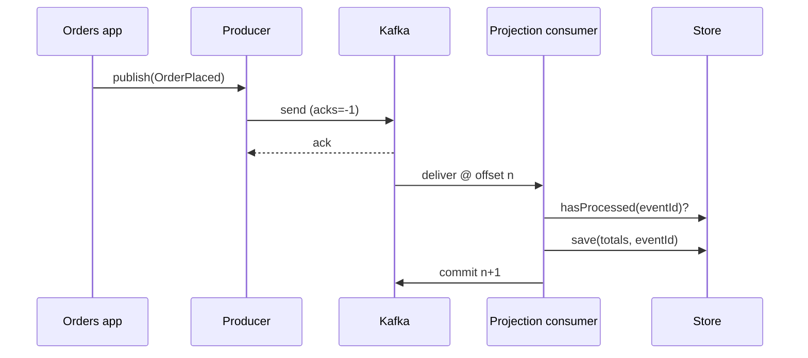

# Delivery semantics, failure by failure

"At-least-once" is easy to say. This page walks through *where* things can fail in a producer → Kafka → consumer → database pipeline, what each failure does, and which piece of the challenge defends against it.

## The pipeline



Number the failure points:

| # | Failure | Effect without protection | Protection |
|---|---|---|---|
| 1 | App crashes before calling `publish` (after writing its DB) | event never exists | transactional outbox (module 33) |
| 2 | `send` fails (broker down) | publish throws | caller retries, ideally with the **same eventId** |
| 3 | Broker writes the batch, ack is lost, producer retries | record written twice | **idempotent producer** |
| 4 | App calls `publish` twice for one fact (HTTP retry upstream) | two records, two event ids | upstream idempotency keys (module 15), or a deterministic eventId |
| 5 | Consumer crashes after `save`, before `commit` | redelivery → double count | **dedupe by eventId** (`hasProcessed`) |
| 6 | `commit` itself fails (rebalance in progress) | redelivery | same as 5 |
| 7 | Consumer commits *before* `save`, then crashes | event silently lost | **commit after processing** |
| 8 | `save` fails (database down) | must not commit; must retry | **let the error propagate** |
| 9 | Record can never be decoded | partition blocked forever | **skip + log** (DLQ in module 33) |

The challenge's tests reproduce 3/4 (`publish(event, event)`), 5/6 (`broker.failNextCommits`), 7/8 (`FlakyProjectionStore`) and 9 (raw garbage records).

## Why "save + remember the id" must be atomic

Consider a handler that does this:

```ts
await store.save(newTotals);          // step A
await store.markProcessed(eventId);   // step B
await commit();                       // step C
```

A crash between A and B means the totals changed but the id wasn't recorded. On redelivery, `hasProcessed` says no and the event is applied **again**. The id and the effect must be written in **one** atomic operation: one SQL transaction, or one Redis `MULTI`. That's why the challenge's store has a single `save(totals, eventId)` method.

```sql
BEGIN;
INSERT INTO processed_events (event_id) VALUES ($1);          -- fails with a unique violation on a duplicate
UPDATE customer_totals SET net_total_cents = net_total_cents + $2 WHERE customer_id = $3;
COMMIT;
```

With a unique constraint you don't even need the `hasProcessed` read: try the insert, and treat a unique violation as "already done". Module 33 builds this as an **inbox** table.

## Why not commit before processing and be done with it?

Because a crash between commit and processing loses the event *silently*. Nothing retries it, nothing logs it, and lag is 0, so dashboards look healthy. Duplicates are visible and fixable with dedupe; losses are invisible. That asymmetry is why at-least-once is the default almost everywhere.

At-most-once is fine for data where a loss doesn't matter and duplicates would be worse, such as some metrics or presence pings. It's a deliberate choice, not a default.

## "Exactly-once" in Kafka

Kafka has **transactions**: a producer can write records to several partitions *and* commit consumer offsets in one atomic transaction, and consumers with `isolation.level=read_committed` only see committed transactions. That gives real exactly-once for **Kafka → processing → Kafka** pipelines (it's how Kafka Streams works).

It doesn't extend to side effects outside Kafka. If your handler writes to Postgres or calls a payment API, Kafka's transaction can't include that. So "exactly-once" in a typical service means **at-least-once delivery + idempotent effects**. In an interview, say exactly that, and you'll sound more senior than someone who says "Kafka has exactly-once".

## Retries vs skips: classify your errors

| Error kind | Example | Retrying helps? | What to do |
|---|---|---|---|
| Transient | DB timeout, network blip, lock conflict | yes | throw → Kafka retries the record |
| Permanent, data | invalid JSON, schema mismatch, unknown version | never | skip + log (or dead-letter topic) |
| Permanent, code | a bug throws for every record of a shape | not until deployed | DLQ after N attempts, alert, fix, replay |

A handler that throws for a permanent error turns one bad record into an outage for its partition. A handler that swallows a transient error loses data. Classifying errors is most of the job.

## Commit frequency

Committing after every record is the clearest code, and it's what the challenge does. At high volume it costs a round trip per record, so production consumers often:

- commit every N records or every T seconds (kafkajs `autoCommitInterval` / `autoCommitThreshold`), or
- process with `eachBatch` and commit once per batch.

The guarantee doesn't change: anything processed but not yet committed may be redelivered. You just get more redeliveries after a crash. If your handler is idempotent, that's only a performance concern.
