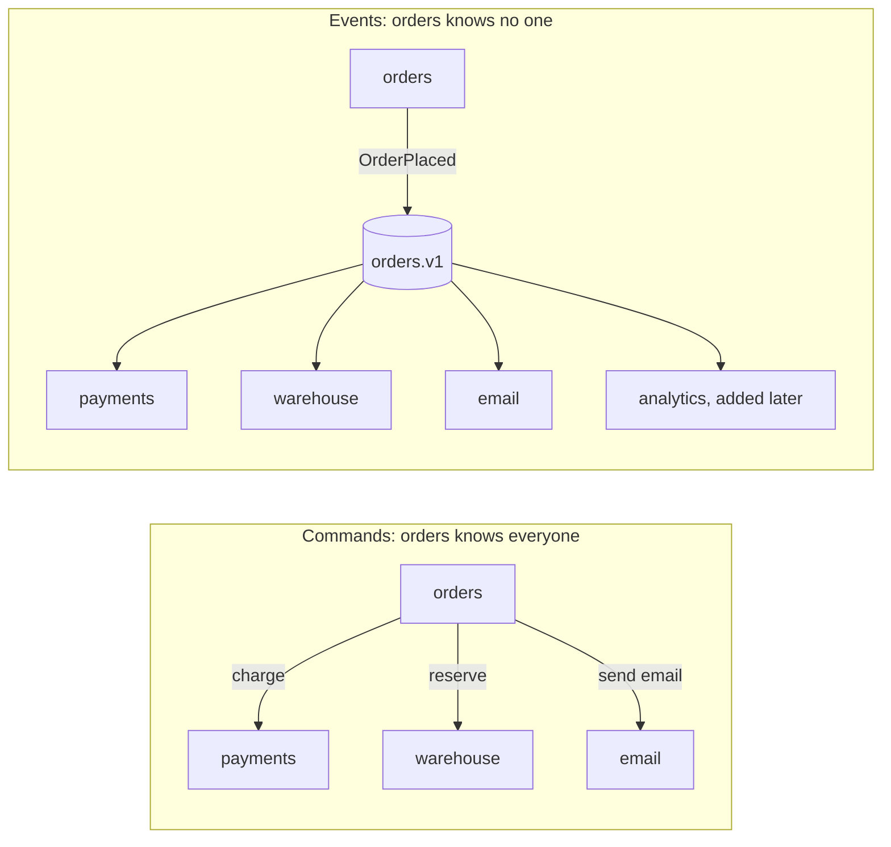
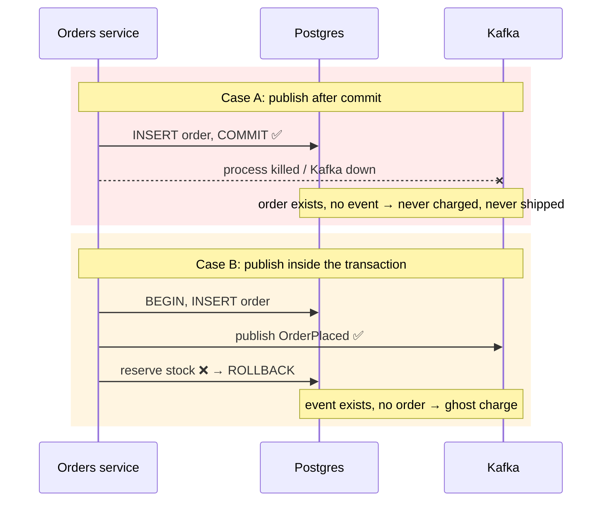
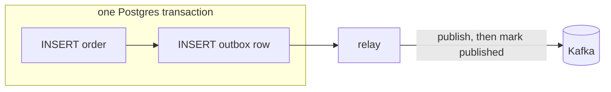
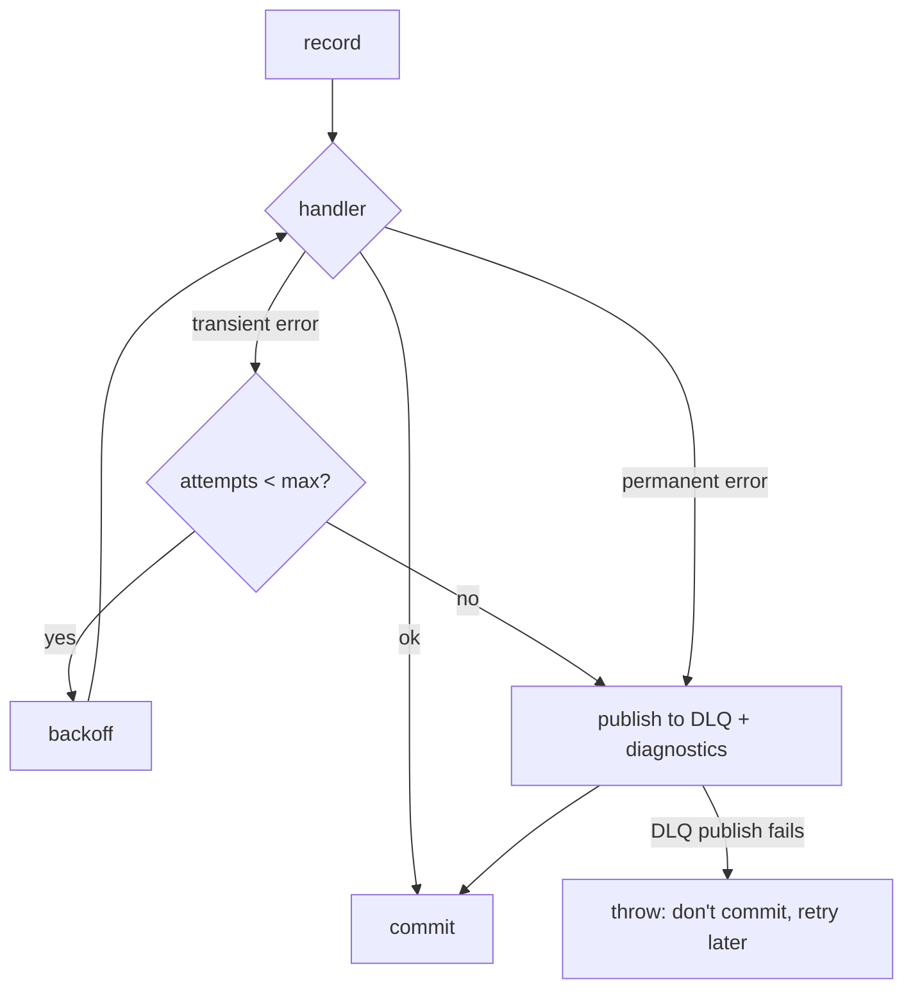
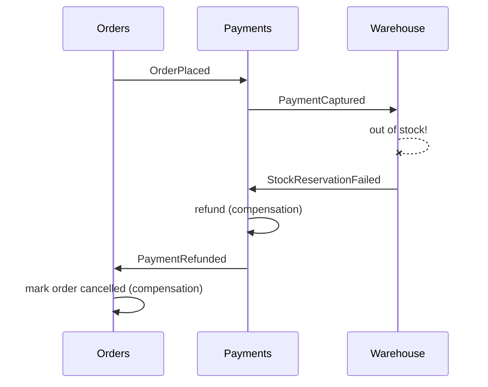
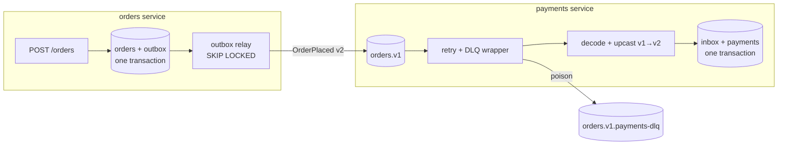

# 33 · Event-Driven Architecture

> Kafka gives you a reliable log. It does **not** make your system reliable. The hard bugs in event-driven systems happen at the edges: between your database and the broker, and between the broker and your side effects. This module is about those edges: the dual-write problem, outbox and inbox, sagas, dead letters and schema evolution. These patterns come up in nearly every senior backend interview and in every company that runs microservices.

**Time:** ~7h · **Challenge:** 🐛 Debug · **Prereqs:** [32 · Kafka Fundamentals](../32-kafka-fundamentals/README.md), [15 · Transactions & Concurrency](../15-transactions-concurrency/README.md) · **Services:** Postgres (5433), Kafka (9092)

## What you'll learn

- The difference between **events** and **commands**, and why it shapes coupling between services
- Why "write to the database, then publish to Kafka" is broken (the **dual-write problem**)
- The **transactional outbox** and its two relay styles: polling publisher vs CDC (Debezium)
- The **inbox / idempotent consumer** pattern, and why "exactly-once" is mostly a myth at service boundaries
- **Sagas**: multi-service workflows with compensations, orchestrated or choreographed
- **Dead-letter topics**, retries and replay
- **Schema evolution**: compatible changes, versioning, upcasters
- Designing UX for **eventual consistency**, and how event sourcing differs from event-driven

---

## 1. Events vs commands

Two kinds of messages flow between services, and mixing them up is the root of a lot of bad designs.

| | Command | Event |
|---|---|---|
| Meaning | "Please do X" | "X happened" |
| Tense | imperative: `ChargeCustomer`, `SendEmail` | past: `OrderPlaced`, `PaymentFailed` |
| Receivers | exactly one, which the sender knows | zero to many, unknown to the sender |
| Can be refused? | yes, the receiver may reject it | no, it's a fact; you can only react |
| Coupling | sender depends on the receiver's API | receivers depend on the sender's event schema |
| Typical transport | HTTP/gRPC call, job queue | Kafka topic |



With commands, the orders service must know about payments, the warehouse and email. Adding a loyalty-points service means changing orders. With events, orders publishes one fact, `OrderPlaced`, and anyone can subscribe. Analytics joins next quarter without anyone touching orders.

The price is **visibility and consistency**. No single piece of code shows the whole workflow anymore, and the services are briefly out of sync with each other (payments hasn't charged yet, the warehouse hasn't reserved yet). That's **eventual consistency**, and the rest of this module is about making it safe.

> 💡 Name events after **business facts** (`OrderPlaced`, `PaymentCaptured`), not CRUD (`OrderUpdated`). "Updated" forces every consumer to diff the payload to figure out what happened.

## 2. The dual-write problem

Here's the most natural code in the world, and it's subtly broken:

```ts
await db.query("INSERT INTO orders ...");          // write 1: Postgres
await kafka.send({ topic: "orders.v1", ... });     // write 2: Kafka
```

You're writing to **two systems that don't share a transaction**. Any failure between or during the two writes leaves them disagreeing:



Moving the publish around only chooses *which* failure you get:

- **After commit:** a crash or broker error after the commit loses the event. The order exists and nobody downstream ever hears about it.
- **Before or inside the transaction:** a rollback after the publish creates a **ghost event** for something that never happened. And your checkout now fails whenever Kafka is slow or down, because the request waits on the broker.
- **"Retry the publish a few times"**: helps with blips, not with a process that gets killed mid-request (deploys do that all the time).

There's no ordering of two independent writes that's safe. You need to turn them into **one** write.

## 3. The transactional outbox

The fix: write the event to an **outbox table in the same database transaction** as the business change. A separate process, the **relay**, moves outbox rows to Kafka afterwards.



```ts
await withTransaction(pool, async (tx) => {
  const order = await orders.insert(tx, ...);
  await stock.reserve(tx, ...);
  await outbox.enqueue(tx, "orders.v1", orderPlacedMessage(order));  // same tx!
});
```

Now the order and its event commit **together or not at all**. A rollback removes both. Kafka being down doesn't affect checkout at all: the row just waits in the outbox.

The outbox table looks roughly like this:

```sql
CREATE TABLE outbox (
  id            bigserial PRIMARY KEY,     -- publish order
  event_id      text NOT NULL UNIQUE,
  topic         text NOT NULL,
  message_key   text NOT NULL,             -- Kafka key (e.g. orderId)
  payload       jsonb NOT NULL,
  headers       jsonb NOT NULL DEFAULT '{}',
  created_at    timestamptz NOT NULL DEFAULT now(),
  published_at  timestamptz                -- NULL = pending
);
CREATE INDEX outbox_pending_idx ON outbox (id) WHERE published_at IS NULL;
```

### Relay option 1: polling publisher

A loop that runs every few hundred milliseconds:

```sql
BEGIN;
SELECT id, topic, message_key, payload, headers
  FROM outbox
 WHERE published_at IS NULL
 ORDER BY id
 LIMIT 100
   FOR UPDATE SKIP LOCKED;          -- lock these rows; skip rows another relay holds
-- publish each row to Kafka (await the ack)
UPDATE outbox SET published_at = now() WHERE id = ANY($ids);
COMMIT;
```

Why each part matters:

- **`FOR UPDATE`** locks the claimed rows until COMMIT, so a second relay can't publish them at the same time.
- **`SKIP LOCKED`** makes the second relay take the *next* unlocked rows instead of waiting. Without it, multiple relay instances (you'll run one per pod) serialize behind each other. You met `SKIP LOCKED` in [module 15](../15-transactions-concurrency/README.md); job queues built on Postgres use the same trick.
- **Mark after the broker acked.** If the relay crashes after publishing but before COMMIT, the rows are still pending and get published *again*. The outbox is **at-least-once**, and consumers must dedupe (section 4).
- **Stop at the first failure.** If row 7 fails and you carry on with row 8, then row 8's event can overtake row 7's. For events of the same order, that can mean `OrderCancelled` arrives before `OrderPlaced`.

### Relay option 2: change data capture (CDC)

Postgres already records every committed change in its write-ahead log (WAL). **Debezium** (usually running in Kafka Connect) reads the WAL through *logical replication* and turns inserts into the outbox table into Kafka records. Debezium even ships an "outbox event router" for exactly this.

| | Polling publisher | CDC (Debezium) |
|---|---|---|
| Latency | up to the poll interval (100 ms–1 s) | near real time |
| Load on the DB | small, constant queries | reads the WAL; no queries |
| Moving parts | a loop in your service | Kafka Connect cluster, connector config, replication slot |
| Failure mode to watch | relay stuck → outbox grows | replication slot lagging → Postgres keeps WAL → **disk fills up** |
| Testability | unit-test with a fake bus | needs the full stack |
| Good default for | small/medium teams, moderate volume | high volume, many outboxes, existing Connect infra |

Both are valid. The challenge builds a polling relay, and `DECISIONS.md` asks you to argue when you'd switch. [docs/outbox-and-inbox.md](docs/outbox-and-inbox.md) goes deeper, including outbox cleanup and monitoring.

> ⚠️ "Just use CDC on the `orders` table directly" (no outbox) couples every consumer to your internal table schema. Rename a column and you've broken three teams. The outbox table is your **public contract**, decoupled from your internal model.

## 4. The inbox: idempotent consumers

The outbox delivers at-least-once. Kafka consumers deliver at-least-once. Rebalances during deploys redeliver whatever wasn't committed yet. So your consumers **will** see duplicates, and a consumer that charges a credit card can't shrug that off.

An **idempotent consumer** records which events it has processed, **in the same transaction as the side effect**:

```ts
await withTransaction(pool, async (tx) => {
  const { rowCount } = await tx.query(
    "INSERT INTO inbox (consumer, event_id) VALUES ($1, $2) ON CONFLICT DO NOTHING",
    ["payments", event.eventId],
  );
  if (rowCount === 0) return;                 // seen it: skip
  await payments.insert(tx, { ... });          // the side effect
});
```

```sql
CREATE TABLE inbox (
  consumer     text NOT NULL,
  event_id     text NOT NULL,
  processed_at timestamptz NOT NULL DEFAULT now(),
  PRIMARY KEY (consumer, event_id)
);
```

Three details make this correct:

1. **Same transaction.** If the payment insert fails, the inbox row rolls back too, so the retry isn't wrongly skipped. If they were separate, a crash between them would either lose the charge or double it.
2. **The primary key does the work.** Two concurrent deliveries of the same event (it happens during rebalances) both try the INSERT. The second blocks on the first transaction's uncommitted row, then inserts nothing. A `SELECT ... then INSERT` check would race.
3. **`consumer` in the key.** Several consumers in the same database can each process the same event once.

What if the side effect isn't in your database, say a call to Stripe? Then you can't put it in the transaction. Use the provider's **idempotency key** (pass the event id) so their side dedupes too. That's the same idea as module 15's `Idempotency-Key` header, from the client's side.

### "Exactly-once" is a myth (at service boundaries)

You'll hear "Kafka supports exactly-once". It does, within Kafka: transactions let a stream processor read, write to other topics and commit offsets atomically. The moment your handler touches **anything outside Kafka** (a database, an email, a payment API), Kafka's transaction can't include it. What you actually build is:

> **at-least-once delivery + idempotent processing = effectively-once effects**

Say that sentence in an interview and you'll sound like someone who has run these systems.

## 5. When a message can't be processed: retries and dead letters

Recall from module 32: if a handler throws, Kafka redelivers the record, and **every later record in that partition waits**. That's great for a database blip that clears in two seconds, and disastrous for a record that will *never* succeed: a malformed payload, a version nobody understands, a bug for one specific shape of data. That's a **poison message**, and it silently freezes one partition while the others look healthy.



The rules:

- **Classify errors.** Transient errors (timeouts, deadlocks, broker unavailable) deserve retries with exponential backoff. Permanent errors (validation, unknown version) never succeed, so send them straight to the DLQ. The challenge uses a `PermanentError` class for this.
- **Bound the retries.** After N attempts, give up on *this record*, not the partition.
- **Dead-letter the original.** Publish the **unchanged** key, value and headers to a dead-letter topic (for example `orders.v1.payments-dlq`, one per consumer group) and add diagnostic headers: original topic, partition, offset, error message, attempt count, timestamp. Then commit, and the partition moves on.
- **Never drop silently.** If the DLQ publish fails, throw. Better to stall than to lose a payment.
- **Watch the DLQ.** A DLQ nobody looks at is a trash can. Alert when it receives anything, and build a small tool to inspect and **replay** messages back to the main topic once the bug is fixed.

### Retry topics vs in-place retries

Some systems move failed records to `orders.retry.1m`, `orders.retry.10m` topics so the main partition isn't held up during long backoffs. The cost is **ordering**: while order 42's `OrderPlaced` waits in a retry topic, its `OrderCancelled` can be processed first. Use retry topics only when the events are independent of each other. For state changes of one entity, retry in place (briefly) and dead-letter.

## 6. Schema evolution

Events outlive the code that wrote them. Topics keep 7, 30 or 365 days of data, consumers lag, and replays read from the beginning. So at any moment your consumer may see **every version of an event that's still retained**.

### Compatible vs breaking changes

| Change | Old consumers reading new events | New consumers reading old events |
|---|---|---|
| Add an optional field | ✅ ignore it | ✅ field missing → default |
| Add a required field | ✅ ignore it | ❌ old events don't have it |
| Remove a field | ❌ if they used it | ✅ |
| Rename a field | ❌ | ❌ |
| Change a type (`totalCents: number` → `total: {amountCents, currency}`) | ❌ | ❌ |
| Change the meaning (cents → euros) | 💥 silently wrong | 💥 silently wrong |

- **Backward compatible** = new consumers can read old data. Needed to deploy consumers first and to replay.
- **Forward compatible** = old consumers can read new data. Needed to deploy producers first.
- Schema registries (Confluent, Apicurio) enforce a chosen compatibility mode at publish time, with Avro or Protobuf schemas.

### Strategies for breaking changes

1. **Version the event** (an `event-version` header or a field) and teach consumers both versions **before** the producer switches. Consumers convert old versions to the current shape with an **upcaster**:

   ```ts
   function upcastOrderPlaced(version: string | undefined, payload: unknown): OrderPlacedV2 {
     switch (version) {
       case "1": { const v1 = V1.parse(payload); return { ...v1, total: { amountCents: v1.totalCents, currency: "EUR" } }; }
       case "2": return V2.parse(payload);
       default: throw new PermanentError(`unsupported version ${version}`);   // → DLQ, don't retry
     }
   }
   ```

   The rest of the consumer only knows the latest shape. Adding v3 later means one more `case`, a v2→v3 step, and nothing else changes.

2. **New topic** (`orders.v2`): the producer writes both topics during a migration window, consumers move over one by one, and the old topic is retired. It's heavier, but clean for big changes.

3. **Expand and contract**: add the new field next to the old one (v1.5 carries both), migrate consumers, then remove the old field. It's the same idea as zero-downtime database migrations ([module 12](../12-data-modeling/README.md)).

The challenge's bug #4 is the classic failure: the producer moved to v2, and the payments consumer only understands v2. But v1 events are still in the topic, so the first replay or lagging consumer crashes on them. [docs/schema-evolution.md](docs/schema-evolution.md) has the full playbook.

## 7. Sagas: workflows across services

Without distributed transactions (two-phase commit is slow, fragile and unsupported by Kafka and most cloud services), how do you do "charge the card, reserve stock, schedule shipping" atomically across three services? You don't. You use a **saga**: a sequence of local transactions, each publishing an event that triggers the next, plus **compensating actions** that undo earlier steps when a later one fails.



Compensations are **semantic undo**, not rollback: you can't un-send an email or un-charge a card, but you can send an apology and issue a refund. Some steps can't be compensated at all (shipping a parcel), so put them **last**, after everything that can fail.

### Choreography vs orchestration

| | Choreography | Orchestration |
|---|---|---|
| How | each service reacts to events and emits its own | a central orchestrator sends commands and tracks state |
| Workflow lives | spread across services | in one place (a state machine) |
| Coupling | low; services only know events | the orchestrator knows every participant |
| Visibility / debugging | hard: "where is order 42 stuck?" | easy: look at the saga's state |
| Good for | short flows, 2–4 steps | long or complex flows, timeouts, many branches |
| Tools | plain Kafka consumers | Temporal, AWS Step Functions, Camunda, a hand-rolled state table |

A useful rule: **choreograph until it hurts, then orchestrate**. When people start drawing the event flow on whiteboards to figure out what happens on failure, it's time for an orchestrator. [docs/sagas.md](docs/sagas.md) works through a full example with both styles, timeouts and the pitfalls (lost compensations, compensations that fail, concurrent sagas on one entity).

## 8. Replay

A log you can rewind is a superpower:

- **Fix a consumer bug, then rebuild its data**: reset the group's offsets to the earliest position and reprocess. Only safe if the consumer is idempotent and its effects are recomputable (projections, search indexes). Never blindly replay into a consumer that sends emails or charges cards. Those need their inbox, or a separate group that only rebuilds read models.
- **Bootstrap a new service** from history: subscribe with `fromBeginning` (if retention allows).
- **Re-drive dead letters** once the bug is fixed: copy DLQ messages back to the main topic, or into a dedicated retry consumer.

Replay is why upcasters matter: the day you replay 30 days of `orders.v1`, every old version comes back.

## 9. Eventual consistency and UX

After `POST /orders` returns 201, the payment hasn't happened yet. It will, in a few hundred milliseconds. Design for that:

- **Return a status, not a promise.** `201 { status: "pending_payment" }`, then the UI shows "Payment processing…" and polls `GET /orders/:id`, or gets a push via WebSocket or SSE ([module 28](../28-realtime/README.md)).
- **Read your own writes.** Right after placing an order, the user expects to see it in "My orders". Serve that page from the orders service's own database (which is consistent), not from a downstream projection that may lag.
- **Model the in-between states** explicitly (`pending_payment`, `paid`, `payment_failed`, `cancelled`). Hiding them leads to UI that lies.
- **Make lag visible to ops**: outbox age, consumer lag and DLQ size are your consistency SLOs.

## 10. Event sourcing is not the same thing

These terms get mixed up constantly:

- **Event-driven architecture**: services communicate through events. Each service still stores **current state** in its own database (an `orders` table). Events are notifications between services.
- **Event sourcing**: a service stores **only the events** as its source of truth (`OrderPlaced`, `ItemAdded`, `OrderPaid`), and current state is derived by replaying them (a fold, like module 32's `applyEvent`). You get a perfect audit log and time travel, and you pay with complexity: snapshots, projections for every query, schema evolution forever, and it's hard to correct mistakes.

You can do either without the other. Most companies do event-driven architecture with state-based services. Event sourcing fits domains where history *is* the product: ledgers, audit-heavy workflows, collaborative editing. Don't adopt it because it sounds elegant.

## How it fits together



That diagram is the challenge. Right now, every arrow in it is broken in a different way.

## Common mistakes

- **Dual writes** "with retries": still loses events when the process dies between the two writes.
- **Publishing inside the DB transaction**: ghost events on rollback, and checkout availability tied to the broker.
- **Outbox relay without row locks**: two pods publish everything twice. **Without `SKIP LOCKED`**: they serialize.
- **Marking outbox rows published before the broker acked**: lost events.
- **Inbox check and side effect in separate transactions**, or "SELECT then INSERT" instead of a unique constraint: duplicates under concurrency.
- **Infinite retries** on poison messages; or the opposite, **swallowing errors** and committing, which loses data silently.
- **DLQ that drops the original payload** (only logging the error), so nothing can be replayed.
- **Breaking schema changes without versioning**, and forgetting that old versions stay in the topic for the whole retention period.
- **Choreographed sagas with no owner**: nobody can say where an order is stuck, and compensations get forgotten.
- **Treating "eventually" as "never mind"** in the UI, showing "Paid!" before payment happened.

## In production

- The outbox + inbox pair is standard at companies running microservices on a relational database. Debezium's outbox router, Axon, NServiceBus and MassTransit all ship versions of it.
- **Monitor the edges**: oldest unpublished outbox row (age), consumer lag, DLQ message rate. An alert on "DLQ received anything" is cheap and catches real bugs.
- **Clean up**: delete published outbox rows and old inbox rows after a retention window (7–30 days, longer than the max redelivery window).
- **Schema governance**: a registry with compatibility checks in CI stops a producer from merging a breaking change. Event catalogs (AsyncAPI) document who publishes and consumes what.
- **Orchestration engines** like Temporal have become popular because they turn sagas into ordinary-looking code with durable state, retries and timeouts built in.
- **Ordering at scale**: a single global outbox order becomes a bottleneck. Larger systems partition the relay by key (several "lanes") so one stuck aggregate doesn't block the rest.

## Check yourself

1. Why can't you fix the dual-write problem by publishing after COMMIT and retrying on failure?
   <details><summary>Answer</summary>Retries don't survive a process crash, deploy or OOM between the commit and the publish: the order is committed and the event is gone. Two independent systems can't be written atomically by ordering the writes. The outbox turns it into one database write plus an asynchronous, retryable relay.</details>
2. What does `FOR UPDATE SKIP LOCKED` give a polling relay that `FOR UPDATE` alone doesn't?
   <details><summary>Answer</summary>Both prevent two relays from publishing the same row. With plain <code>FOR UPDATE</code> the second relay blocks until the first commits, so relays serialize. <code>SKIP LOCKED</code> makes it skip locked rows and claim the next ones, so several relays work in parallel on different rows.</details>
3. Why must the inbox insert and the side effect be in the same transaction?
   <details><summary>Answer</summary>So they succeed or fail together. If the effect fails, the inbox row rolls back and the retry is allowed. If the inbox row were committed separately, a crash in between would either skip an unprocessed event or double-process it.</details>
4. A consumer gets an event with `event-version: 3`, but it only knows versions 1 and 2. What should happen?
   <details><summary>Answer</summary>It's a permanent error: retrying won't help. Dead-letter it immediately with diagnostics so the partition keeps moving, and alert. The real fix is a process one: consumers must be deployed with v3 support before producers emit v3.</details>
5. When would you choose orchestration over choreography for a saga?
   <details><summary>Answer</summary>When the workflow is long, has many branches, timeouts or compensations, or needs clear visibility ("where is order 42?"). Choreography is fine for short flows with few participants.</details>

## Further reading

- Debezium documentation, Outbox Event Router: https://debezium.io/documentation/reference/stable/transformations/outbox-event-router.html
- PostgreSQL documentation, `SELECT ... FOR UPDATE SKIP LOCKED` (the locking clause): https://www.postgresql.org/docs/16/sql-select.html#SQL-FOR-UPDATE-SHARE
- PostgreSQL documentation, Logical Decoding: https://www.postgresql.org/docs/16/logicaldecoding.html
- Apache Kafka documentation, Design (delivery semantics): https://kafka.apache.org/documentation/#semantics
- Deep dives in this module: [docs/outbox-and-inbox.md](docs/outbox-and-inbox.md) · [docs/sagas.md](docs/sagas.md) · [docs/schema-evolution.md](docs/schema-evolution.md) · [docs/eda-cheatsheet.md](docs/eda-cheatsheet.md)
- Repo cheat sheet: [Kafka](../docs/cheatsheets/kafka.md)

## ➡️ Next: [the challenge](CHALLENGE.md)
