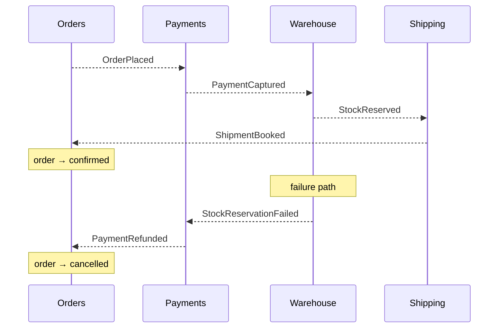
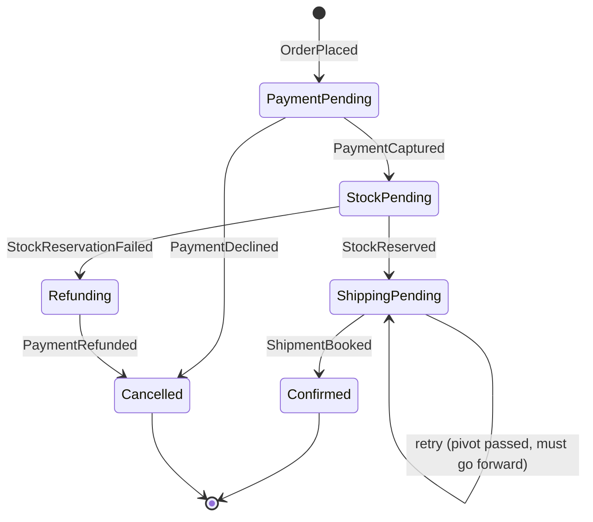

# Sagas: long-running workflows without distributed transactions

## The problem

Placing an order touches three services, each with its own database:

1. **Payments** captures the money.
2. **Warehouse** reserves stock.
3. **Shipping** books a courier.

You want all three or none. A distributed transaction (two-phase commit) would lock resources in three databases while a coordinator waits for everyone to vote. It's slow, a coordinator failure leaves participants stuck holding locks, and Kafka, most cloud databases and every third-party API simply don't support it.

A **saga** gives up atomicity and settles for **eventual all-or-nothing**: each step is a local transaction, and if a later step fails, earlier steps are undone by **compensating transactions**.

## Designing the steps

For every step, write down the action, its compensation, and whether it can fail:

| Step | Action | Compensation | Can it fail? |
|---|---|---|---|
| 1 | Create order (pending) | Mark order cancelled | rarely |
| 2 | Capture payment | Refund | yes (card declined) |
| 3 | Reserve stock | Release stock | yes (out of stock) |
| 4 | Book courier | none (a booked parcel can't be un-booked cheaply) | yes, but rarely |

Order the steps so that:

- **Steps likely to fail come early**, so there's less to compensate.
- **Steps that can't be compensated come last** (the "pivot"). After the pivot, the saga must go forward: retry until it succeeds.
- **Cheap, reversible reservations come before expensive, irreversible actions.** Many shops *authorize* the card first (a hold, cheap to release) and *capture* it only after stock is reserved.

Compensations are **semantic**, not a rollback. A refund is a new transaction that shows up on the customer's statement. The original charge still happened.

## Choreography

Each service listens for events and emits its own. No one is in charge.

**Pros:** loose coupling; each service owns its piece; no single point of failure; easy to add a listener.

**Cons:** the workflow exists only as an emergent property of several codebases. Questions like "what happens if shipping fails after stock was reserved?" need archaeology. Cyclic dependencies creep in (payments listens to warehouse, which listens to payments). Timeouts ("payment never answered") have no natural home.

## Orchestration

A **saga orchestrator** (often its own small service, or a module in the orders service) holds the workflow as an explicit state machine and sends **commands**:

The orchestrator persists the saga's state (`sagas` table: id, state, data, updated_at), and every transition is a local transaction that also writes the next command to an **outbox**. Yes, the outbox again: the orchestrator has the same dual-write problem as anyone else.

**Pros:** the workflow is readable in one place; easy to answer "where is order 42?"; timeouts are just a scheduled check ("sagas in PaymentPending for > 5 min → cancel"); compensations are explicit.

**Cons:** a central component that knows every participant; risk of putting business logic in the orchestrator that belongs in the services.

Workflow engines (Temporal, AWS Step Functions, Camunda) are orchestration with the persistence, retries and timers built in. Temporal in particular lets you write the saga as ordinary async code that survives process restarts.

## Pitfalls

- **Compensations must be idempotent and retryable.** A refund command may be delivered twice (inbox!), and the refund API may be down. Retry until it succeeds. A failed compensation needs an alert and a human, not a log line.
- **Lack of isolation.** Between steps, other requests see intermediate states: stock reserved for an order whose payment is about to be refunded. Use explicit states (`pending`, `reserved`) and design reads to handle them. Sometimes a "semantic lock" (a flag that says "this order is in a saga") prevents conflicting operations.
- **Concurrent sagas on one entity.** Two sagas modifying the same customer's credit balance need the usual concurrency control in the owning service (module 15).
- **Timeouts.** Every waiting state needs a deadline and a decision: retry, compensate, or escalate. Without one, a lost message leaves a saga waiting forever.
- **Out-of-order events.** `PaymentRefunded` may arrive before the orchestrator has processed `StockReservationFailed` if they come from different topics. Make transitions tolerant, or key everything for one saga to the same partition.

## Choosing

- 2–3 steps, few failure modes, teams that value autonomy → **choreography**.
- Many steps, branches, timeouts, compensations, a need for visibility, or a product manager asking "how many orders are stuck in payment?" → **orchestration**.
- Starting with choreography and introducing an orchestrator when the flow grows is common, and fine.
