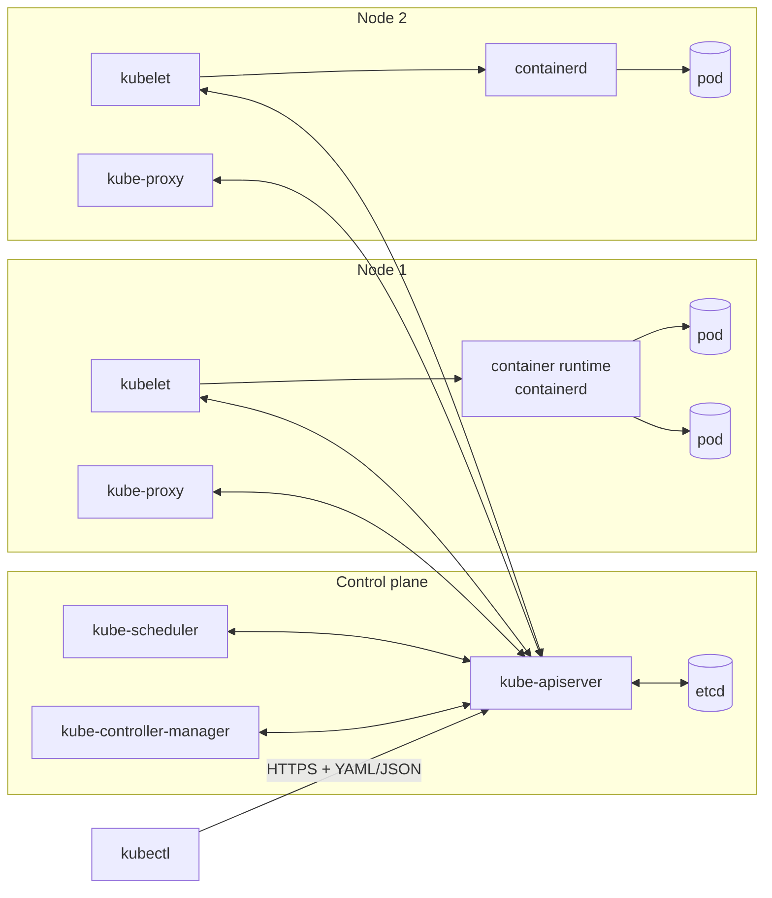
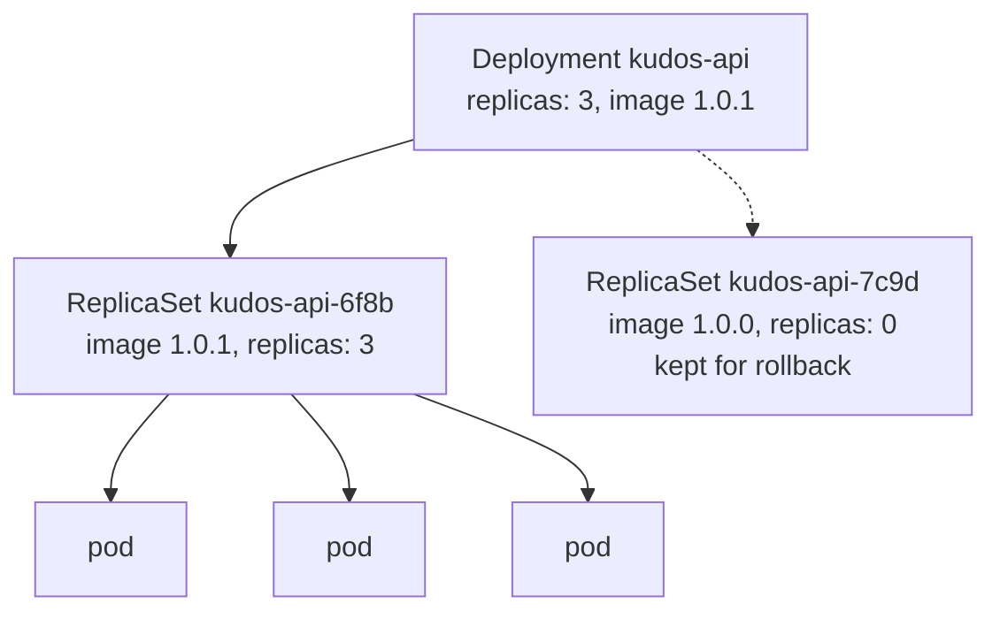
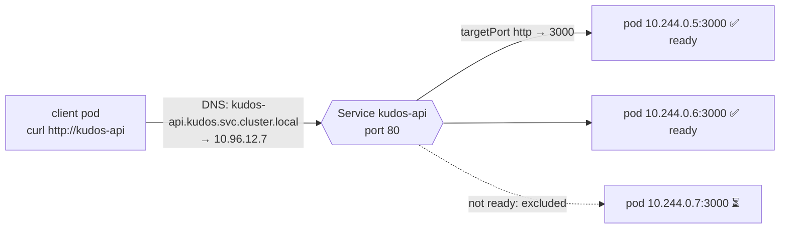
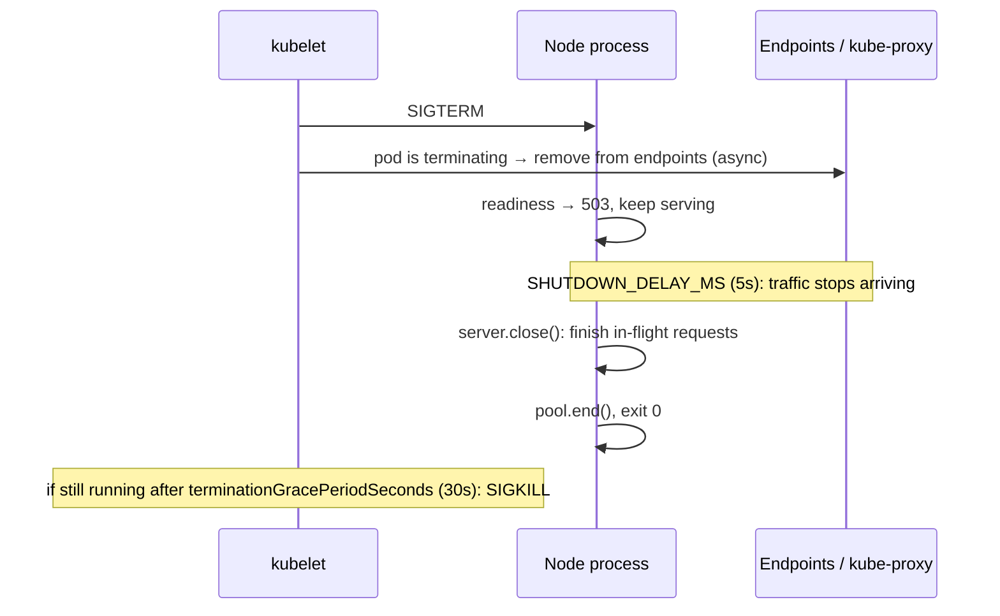

# 34 · Kubernetes Fundamentals

> In module 26 you packaged an API as an image and ran it with docker compose on one machine. Real systems run dozens of copies on a fleet of machines that fail, get patched and get replaced. Kubernetes is the system most companies use to keep "what should be running" and "what is running" the same. If you work on backend or infra, you'll read and write its YAML every week.

**Time:** ~7h · **Challenge:** 🛠️ Build · **Prereqs:** [26 · Docker, CI & Deployment](../26-docker-ci-deploy/README.md), [24 · Observability](../24-observability/README.md) (health checks) · **Services:** none (Postgres runs *inside* your cluster)

## What you'll learn

- Why orchestration exists and what problem Kubernetes actually solves
- The cluster architecture: API server, etcd, scheduler, controllers, kubelet, kube-proxy
- The declarative model: desired state, controllers and the reconciliation loop
- **Pods, ReplicaSets and Deployments**, and how they own each other
- **Labels and selectors**, the glue that holds everything together (and the #1 source of bugs)
- **Services**: ClusterIP, NodePort, LoadBalancer, headless, and cluster DNS
- **ConfigMaps and Secrets**, injected as env vars or files
- **Probes**: startup vs readiness vs liveness, and how they make zero-downtime deploys possible
- **Resource requests and limits**, QoS classes, CPU throttling vs OOMKill
- **Rolling updates and rollbacks**
- Namespaces, PersistentVolumeClaims, StatefulSets and Jobs (enough to run a database and migrations)
- kubectl essentials and running a real cluster on your laptop with **kind**
- How everything you know from docker compose maps onto Kubernetes

---

## 1. Why orchestration?

With docker compose you tell one Docker daemon on one machine "run these containers". That works until:

- **The machine dies.** Your containers die with it. Nobody restarts them anywhere else.
- **You need more capacity than one machine has.** Compose doesn't spread containers across machines.
- **You deploy a new version.** `docker compose up` stops the old container and starts the new one. In between, requests fail.
- **A container hangs** without exiting. Docker's restart policy only reacts to exits.
- **You run 40 services, each with 3–30 replicas.** Somebody has to decide which machine runs what, route traffic to whichever copies are healthy, and hand out config and secrets.

An **orchestrator** is a program that does all of that continuously. You describe the **desired state** ("3 copies of `kudos-api:1.0.0`, each with 128Mi of memory, reachable at the name `kudos-api`") and the orchestrator works to make reality match, forever. A node dies? Its pods get recreated elsewhere. A container stops answering its health check? It gets restarted. You change the image tag? Pods get replaced a few at a time, so traffic never stops.

That last word, *forever*, is the important part. Kubernetes isn't a deploy script that runs once. It's a set of control loops that never stop comparing desired state with actual state.

> 💡 Kubernetes (often "k8s": k, 8 letters, s) came out of Google's internal Borg system and is now maintained by the CNCF. Every major cloud sells a managed version: EKS (AWS), GKE (Google), AKS (Azure).

## 2. Cluster architecture

A cluster is a set of machines (**nodes**) plus a **control plane** that manages them.



| Component | Where | What it does |
|---|---|---|
| **kube-apiserver** | control plane | The front door. Every read and write goes through its REST API: kubectl, controllers, kubelets, everything. It validates objects and stores them in etcd. |
| **etcd** | control plane | A consistent key-value store holding every object. If etcd is gone, the cluster has amnesia, which is why managed services back it up for you. |
| **kube-scheduler** | control plane | Watches for pods with no node assigned and picks a node based on resource requests, affinity rules, taints and so on. It only *decides*; it doesn't start anything. |
| **kube-controller-manager** | control plane | Runs the built-in controllers: Deployment, ReplicaSet, Job, endpoints, node lifecycle... Each one watches some objects and acts to move reality toward the spec. |
| **kubelet** | every node | The node agent. Watches for pods assigned to its node, tells the container runtime to start them, runs the probes, and reports status back. |
| **container runtime** | every node | Actually runs containers (containerd or CRI-O). Docker images work because they're standard OCI images. |
| **kube-proxy** | every node | Programs the node's networking (iptables/IPVS rules) so a Service's virtual IP forwards to healthy pod IPs. |

Notice that **nothing talks to anything except through the API server**. The scheduler doesn't call the kubelet. It writes "this pod goes on node 2" into the pod object, and node 2's kubelet, which is watching, sees it and starts the container. That design makes the system resilient: any component can restart and pick up where it left off just by reading the current state.

## 3. The declarative model

Every Kubernetes object has the same skeleton:

```yaml
apiVersion: apps/v1          # API group + version; tells the server how to read the rest
kind: Deployment             # the type of object
metadata:
  name: kudos-api            # unique per kind per namespace
  namespace: kudos
  labels: { app: kudos-api } # key/value tags used for selection
spec:                        # DESIRED state: written by you
  replicas: 3
  # ...
status:                      # ACTUAL state: written by controllers, never by you
  readyReplicas: 2
```

You write `spec`. Controllers write `status`. A **controller** is a loop:

```
forever:
  desired = read spec
  actual  = observe the world
  if actual != desired: take one step toward desired
```

The Deployment controller sees `replicas: 3` and two pods and creates one more. That's **reconciliation**, and it's why `kubectl apply` is idempotent: applying the same file twice changes nothing, because desired state already equals actual state.

Compare with an imperative script ("start 3 containers"). Run it twice and you get 6. If a container dies, the script doesn't know. The declarative approach turns operations into a data problem: change the YAML, and the system figures out the steps.

> `kubectl apply -f file.yaml` sends your desired state to the API server and records what you applied, so it can compute a diff next time. Prefer it over `kubectl create` / `kubectl edit` for anything you want reproducible. Your manifests in git become the source of truth.

## 4. Pods

A **pod** is the smallest thing Kubernetes runs: one or more containers that share a network namespace (one IP, they can reach each other on `localhost`) and can share volumes. Most pods have one main container. Extra containers are for tightly coupled helpers: a log shipper, a proxy sidecar, or **init containers** that run to completion before the main container starts (the solution uses one to wait for Postgres).

Things to internalize about pods:

- **Pods are cattle, not pets.** They get a random name (`kudos-api-7c9d8b6f4-x2k9p`) and a new IP every time they're recreated. Never depend on a specific pod existing.
- **You almost never create pods directly.** A bare pod that dies stays dead. You create a *controller* (Deployment, StatefulSet, Job) that creates pods from a **pod template** and replaces them.
- **Pods are ephemeral, including their filesystem.** Anything written inside the container is lost when it's replaced. State goes in a database or on a PersistentVolume.

A pod moves through phases: `Pending` (accepted, waiting to be scheduled or for images to pull) → `Running` → `Succeeded` / `Failed`. The `STATUS` column of `kubectl get pods` shows more specific reasons like `ContainerCreating`, `CrashLoopBackOff` or `ImagePullBackOff`. Module 35 is about decoding those.

## 5. ReplicaSets and Deployments



- A **ReplicaSet** keeps N identical pods running. It finds "its" pods with a label selector and creates or deletes pods to hit the count.
- A **Deployment** manages ReplicaSets. Every time you change the pod template (new image, new env var), it creates a **new ReplicaSet** and gradually shifts replicas from old to new. That's a rolling update. The old ReplicaSet is kept at 0 replicas, which is what makes `kubectl rollout undo` instant.

You work with Deployments. You'll *see* ReplicaSets in `kubectl get rs`, and you should understand them, but you rarely touch them.

```yaml
apiVersion: apps/v1
kind: Deployment
metadata: { name: kudos-api, namespace: kudos }
spec:
  replicas: 3
  selector:
    matchLabels: { app: kudos-api }       # which pods belong to me
  template:                                # the pod template: what each pod looks like
    metadata:
      labels: { app: kudos-api }           # MUST satisfy the selector above
    spec:
      containers:
        - name: api
          image: wl-kudos-api:1.0.0
          ports: [{ name: http, containerPort: 3000 }]
```

Deployments are for **stateless** workloads: any pod can serve any request, and pods are interchangeable. Your API is stateless because all its state lives in Postgres. That's the payoff of everything you've done since module 06.

## 6. Labels and selectors

Labels are arbitrary key/value pairs on objects. **Selectors** query them. This loose coupling is how almost every relationship in Kubernetes works:

| Who | Selects | Using |
|---|---|---|
| Deployment / ReplicaSet | its pods | `spec.selector.matchLabels` |
| Service | pods to route traffic to | `spec.selector` |
| NetworkPolicy, PodDisruptionBudget (module 35) | pods | `podSelector` / `selector` |
| You | anything | `kubectl get pods -l app=kudos-api` |

Nothing references pods by name, only by labels. That's powerful, and it's also dangerous because **nothing checks that a selector matches anything**. A Service whose selector has a typo applies fine, then routes traffic to zero pods. Two failure modes to watch for:

1. **Selector matches nothing.** Service has no endpoints and requests fail. Check with `kubectl get endpoints <service>`.
2. **Selector matches too much.** If your API pods and your Postgres pod both carry only `app: kudos`, the API Service load-balances HTTP requests onto Postgres's pod too. Give each workload a distinguishing label.

> ⚠️ A Deployment's `spec.selector` is **immutable** after creation. Get it right the first time, or delete and recreate the Deployment.

A common convention is Kubernetes' recommended labels: `app.kubernetes.io/name`, `app.kubernetes.io/instance`, `app.kubernetes.io/component`, `app.kubernetes.io/part-of`. The challenge uses the shorter `app: kudos-api` for readability. Either works as long as you're consistent.

## 7. Services and cluster networking

Pods come and go and change IPs. A **Service** gives a set of pods one stable virtual IP and DNS name, and load-balances across the pods that are **ready**.



The endpoints controller keeps a list of `podIP:port` for pods that match the selector **and pass their readiness probe** (stored as EndpointSlice objects; `kubectl get endpoints <svc>` still works and is the quickest check, though recent versions print a deprecation warning pointing you to `kubectl get endpointslices -l kubernetes.io/service-name=<svc>`). kube-proxy turns that list into forwarding rules on every node. This is the mechanism that makes readiness probes matter (section 9).

### Three port numbers

This confuses everybody once:

| Field | Where | Meaning |
|---|---|---|
| `containerPort` | pod spec | The port your process listens on inside the container (`PORT=3000`). Mostly documentation, but naming it (`name: http`) lets others refer to it by name. |
| `port` | Service | The port clients use to reach the Service (`http://kudos-api:80`). |
| `targetPort` | Service | Where the Service forwards to on the pod. A number or a container port **name**. Must match what the process actually listens on. |

Using a named port (`targetPort: http`) means you can change the container's port in one place.

### Service types

| Type | Reachable from | Use for |
|---|---|---|
| `ClusterIP` (default) | inside the cluster only | service-to-service traffic. Reach it from your laptop with `kubectl port-forward`. |
| `NodePort` | every node's IP on a port in 30000–32767 | quick demos, bare-metal setups. Rarely used directly in production. |
| `LoadBalancer` | the internet / VPC, through a cloud load balancer | exposing one service publicly on a cloud. One cloud LB per Service gets expensive fast; that's why Ingress exists (module 35). |
| Headless (`clusterIP: None`) | inside the cluster | no virtual IP: DNS returns the pod IPs directly. Used with StatefulSets to give each pod a stable name (`postgres-0.postgres`). |

### DNS

Every Service gets a DNS name: `<service>.<namespace>.svc.cluster.local`. From a pod in the same namespace, just `<service>` works, because the pod's DNS search path includes its own namespace. So your API connects to Postgres with `DB_HOST=postgres`. From another namespace it would be `postgres.kudos`.

## 8. Configuration: ConfigMaps and Secrets

The app from module 07 onward reads config from environment variables, parsed once in `config.ts`. Kubernetes supplies those variables from two kinds of objects:

- **ConfigMap**: non-sensitive key/value config (`DB_HOST`, `LOG_LEVEL`).
- **Secret**: sensitive values (`DB_PASSWORD`, API keys). Same shape, different handling: RBAC can restrict who reads them, they aren't printed by `kubectl describe`, and they can be encrypted at rest.

```yaml
apiVersion: v1
kind: ConfigMap
metadata: { name: kudos-config, namespace: kudos }
data:
  DB_HOST: "postgres"
  DB_PORT: "5432"          # values MUST be strings: quote numbers and booleans
---
apiVersion: v1
kind: Secret
metadata: { name: kudos-db, namespace: kudos }
type: Opaque
stringData:                # plain text in, the API server stores it base64-encoded under `data`
  DB_PASSWORD: "local-dev-only"
```

Two ways to inject them into a container:

```yaml
containers:
  - name: api
    envFrom:                       # every key becomes an env var
      - configMapRef: { name: kudos-config }
    env:                           # or one variable at a time, possibly renamed
      - name: DB_PASSWORD
        valueFrom:
          secretKeyRef: { name: kudos-db, key: DB_PASSWORD }
```

`envFrom` is concise. Per-key `valueFrom` is explicit and lets you rename (Postgres wants `POSTGRES_PASSWORD`, the API wants `DB_PASSWORD`, and both can read the *same* Secret key so they can never disagree). You can also mount a ConfigMap or Secret **as files** via a volume, which suits config files and TLS certificates, and mounted files update in place when the object changes (env vars don't).

Things that bite:

- **Base64 is not encryption.** Anyone who can `kubectl get secret -o yaml` can decode it. Real clusters enable encryption at rest and keep secret values out of git with tools like Sealed Secrets, SOPS or the External Secrets Operator (syncing from AWS Secrets Manager, Vault...). The Secret in this challenge is a throwaway local password, and the file says so.
- **Env vars are read at container start.** Change a ConfigMap and running pods keep the old values until they restart: `kubectl rollout restart deployment/kudos-api`.
- **A missing key is fatal at start.** Reference a key that doesn't exist and the pod sits in `CreateContainerConfigError`.
- **A misspelled variable name is silent.** If you set `DB_HOSTNAME` but the app reads `DB_HOST`, the app uses its default (`localhost`) and fails to connect. That's why the tests compare your manifests against `EnvSchema` in `src/config.ts`.

## 9. Probes: startup, readiness, liveness

The kubelet can probe each container in three ways: an HTTP GET (2xx/3xx = success), a TCP connect, or an `exec` command (exit 0 = success). There are three probe *roles*, and mixing them up causes outages:

| Probe | Question | On failure | Should check |
|---|---|---|---|
| **startupProbe** | "Has it finished booting?" | keep waiting; after `failureThreshold` failures, restart | the process is up. Liveness and readiness don't run until it passes. |
| **readinessProbe** | "Should it get traffic right now?" | **removed from Service endpoints** (not restarted) | dependencies it can't serve without (the DB), and "am I shutting down?" |
| **livenessProbe** | "Is it wedged beyond repair?" | **container restarted** | only the process itself: event loop responsive. **Never** dependencies. |

Why must liveness not check the database? Picture Postgres being unavailable for 20 seconds. If `/healthz` checked the DB, every API pod would fail liveness at the same moment and the kubelet would restart all of them. Now you have a database blip *plus* every pod cold-starting at once, with zero capacity while they boot. With the split, the pods just go unready, the Service stops routing to them, and they come back by themselves when the DB returns. The provided app already does this: `/healthz` returns 200 unconditionally and `/readyz` checks the DB.

```yaml
startupProbe:
  httpGet: { path: /healthz, port: http }
  periodSeconds: 2
  failureThreshold: 30        # up to 60s to boot
readinessProbe:
  httpGet: { path: /readyz, port: http }
  periodSeconds: 5
  failureThreshold: 2
livenessProbe:
  httpGet: { path: /healthz, port: http }
  periodSeconds: 10
  failureThreshold: 3
```

### Readiness and graceful shutdown

When a pod is deleted (during a rolling update, a scale-down or a node drain), two things happen **in parallel**: the kubelet sends SIGTERM to your process, and the endpoints controller removes the pod from the Service. The second takes a moment to reach every node's kube-proxy and every ingress controller. If your process exits immediately on SIGTERM, requests that were already routed to it fail.



That's exactly what the provided `src/server.ts` does. Your job in the manifest is to keep `terminationGracePeriodSeconds` longer than the delay plus the drain timeout. See [docs/pod-lifecycle-and-shutdown.md](docs/pod-lifecycle-and-shutdown.md) for the details.

> Docker's `HEALTHCHECK` instruction is **ignored** by Kubernetes. Probes replace it, which is why this module's Dockerfile doesn't have one.

## 10. Resources: requests, limits and QoS

```yaml
resources:
  requests: { cpu: 100m, memory: 128Mi }   # what the scheduler reserves for you
  limits:   { cpu: 500m, memory: 256Mi }   # the hard ceiling
```

Units: CPU in cores, where `100m` means 100 millicores (a tenth of a core). Memory in bytes with binary suffixes: `Mi` = 2²⁰ bytes, `Gi` = 2³⁰. (`M` is 10⁶, which is slightly different. Use `Mi`.)

- **Requests** are for **scheduling**. The scheduler only places a pod on a node with enough *unrequested* capacity. They're also your guaranteed share under contention. No requests means the scheduler packs pods blindly.
- **Limits** are **enforced at runtime**, and CPU and memory behave very differently:
  - Over the **CPU** limit → the container is **throttled**: it simply gets less CPU time. Latency goes up, but nothing dies.
  - Over the **memory** limit → the kernel **OOM-kills** the container (exit code 137, reason `OOMKilled`) and the kubelet restarts it. Repeated, that becomes `CrashLoopBackOff`.

A Node.js process uses 40–60 MiB just to boot and grows with heap and buffers, so a 64Mi limit is a crash loop waiting to happen. Start around 128Mi request / 256Mi limit for a small API, then tune with real metrics (`kubectl top pods`, or Prometheus from module 24). Node's heap limit isn't automatically aware of the container limit in older versions; recent Node versions do respect cgroup limits, but setting `--max-old-space-size` a bit below the limit is still a common practice.

The combination determines the pod's **QoS class**, which decides who gets evicted first when a node runs out of memory:

| QoS | Condition | Evicted |
|---|---|---|
| `Guaranteed` | every container has requests == limits for CPU and memory | last |
| `Burstable` | at least one request or limit set, but not Guaranteed | middle |
| `BestEffort` | nothing set | first |

> Many teams set a memory limit but **no CPU limit**, because CPU throttling causes hard-to-diagnose latency spikes and CPU is compressible anyway. The challenge asks for both so you learn the fields; the trade-off is a good interview topic.

## 11. Rolling updates and rollbacks

Change anything in a Deployment's pod template and it rolls out a new ReplicaSet. The `RollingUpdate` strategy has two knobs:

- `maxSurge`: how many pods *above* `replicas` may exist during the rollout.
- `maxUnavailable`: how many pods *below* `replicas` may be unready during the rollout.

With `replicas: 3, maxSurge: 1, maxUnavailable: 0` the controller creates 1 new pod, waits until it's **ready** (readiness probe!), then terminates 1 old pod, and repeats. Capacity never drops below 3. A new version that never becomes ready simply stalls the rollout with the old pods still serving, which is why a good readiness probe is your deploy safety net. (Setting both to 0 is invalid: nothing could ever move.)

```bash
kubectl -n kudos set image deployment/kudos-api api=wl-kudos-api:1.0.1   # trigger a rollout
kubectl -n kudos rollout status deployment/kudos-api                    # block until done (or failed)
kubectl -n kudos rollout history deployment/kudos-api                   # revisions
kubectl -n kudos rollout undo deployment/kudos-api                      # back to the previous ReplicaSet
kubectl -n kudos rollout restart deployment/kudos-api                   # same spec, fresh pods
```

The alternative strategy, `Recreate`, kills all old pods before starting new ones. That means downtime, but it's what you want when two versions must never run at once, or when pods share a ReadWriteOnce volume.

> **Migrations and rolling updates.** During a rollout, old and new versions run side by side against the same database. That's why schema changes must be backward compatible (expand/contract, [module 12](../12-data-modeling/README.md)), and why migrations run as a separate step (a **Job**) before the new pods roll out, instead of on app startup where 3 replicas would race.

## 12. Namespaces

A **namespace** is a scope for names and a unit for access control and quotas. `kudos-api` in namespace `kudos` and `kudos-api` in namespace `staging` are different objects. Typical uses: one namespace per team or per app per environment. Every namespaced object should say which namespace it's in (`metadata.namespace`), or it lands in whatever your kubectl context defaults to, usually `default`.

Some objects are cluster-scoped: Nodes, Namespaces themselves, PersistentVolumes, StorageClasses. `kubectl api-resources --namespaced=false` lists them.

Deleting a namespace deletes everything in it. That's handy for cleanup, and dangerous for the same reason.

## 13. State: volumes, PVCs, StatefulSets and Jobs

Stateless apps are easy. Databases need storage that outlives pods.

- A **PersistentVolumeClaim (PVC)** is a request: "I need 1Gi, ReadWriteOnce". A **StorageClass** says how to provision it (EBS on AWS, a persistent disk on GCP, a host directory on kind via the local-path provisioner). The PVC gets **bound** to a **PersistentVolume**, which the pod mounts.
- `ReadWriteOnce` means one *node* can mount it read-write. So two pods of a database on different nodes can't share it, and running a database as a multi-replica Deployment with one PVC is a mistake.
- A **StatefulSet** is like a Deployment for pods that need identity: stable names (`postgres-0`, `postgres-1`), started and stopped in order, and each with **its own** PVC created from `volumeClaimTemplates`. Delete `postgres-0` and it comes back as `postgres-0`, reattached to the same volume. It pairs with a **headless Service** that provides the stable DNS names.

```yaml
kind: StatefulSet
spec:
  serviceName: postgres          # the headless Service
  replicas: 1
  template: { ... }
  volumeClaimTemplates:
    - metadata: { name: data }   # creates PVC "data-postgres-0"
      spec:
        accessModes: ["ReadWriteOnce"]
        resources: { requests: { storage: 1Gi } }
```

Running Postgres in a StatefulSet is perfect for local development. Production is another conversation (backups, failover, upgrades), and that's what the challenge's `DECISIONS.md` asks you to reason about.

A **Job** runs pods **to completion** instead of forever. If the container exits 0 the Job is `Complete`. If it fails, the Job retries with exponential backoff up to `backoffLimit`. A Job is the natural home for database migrations: same image as the app, different command (`node dist/db/migrateCli.js`). A **CronJob** creates Jobs on a schedule (module 35).

## 14. kubectl essentials

kubectl is a client for the API server. It reads `~/.kube/config` to know which cluster (context) and namespace to talk to.

```bash
kubectl config get-contexts                      # which clusters do I know? (* = current)
kubectl get pods -n kudos -o wide                # list, with node and IP
kubectl get deploy,rs,svc,endpoints -n kudos     # several kinds at once
kubectl describe pod <name> -n kudos             # details + EVENTS at the bottom: read these first
kubectl logs <pod> -n kudos [-f] [--previous]    # stdout/stderr of a container
kubectl exec -it <pod> -n kudos -- sh            # shell inside a container (if it has one)
kubectl port-forward svc/kudos-api 8080:80 -n kudos
kubectl apply -f k8s/                            # create/update to match the files
kubectl diff -f k8s/                             # what apply would change
kubectl delete -f k8s/
kubectl explain deployment.spec.strategy         # built-in API docs, offline-friendly
kubectl get deploy kudos-api -n kudos -o yaml    # the live object, including status
```

`kubectl explain` is underrated: it documents every field of every kind for the exact version of your cluster. Full reference in [docs/kubectl-cheatsheet.md](docs/kubectl-cheatsheet.md) and the repo-wide [kubectl cheat sheet](../docs/cheatsheets/kubectl.md).

## 15. Local clusters: kind, minikube, k3d

You don't need a cloud account to learn Kubernetes.

| Tool | How it works | Notes |
|---|---|---|
| **kind** (Kubernetes IN Docker) | each "node" is a Docker container running kubelet + containerd | fast, disposable, what Kubernetes itself uses for CI. **We use this.** |
| minikube | a VM or container with a single-node cluster | lots of addons (`minikube addons enable ingress`), friendly dashboard |
| k3d | runs k3s (a lightweight distribution) in Docker | very light, built-in load balancer |
| Docker Desktop | built-in single-node cluster toggle | zero setup, less control |

The one kind-specific thing to remember: **the kind node has its own image store**. After `docker build`, run `kind load docker-image <image> --name <cluster>`, use a specific tag, and set `imagePullPolicy: IfNotPresent`. Otherwise the kubelet tries to pull `wl-kudos-api` from Docker Hub and you get `ImagePullBackOff`. (The `:latest` tag implicitly means `imagePullPolicy: Always`, another reason to avoid it.)

## 16. From docker compose to Kubernetes

You already know most of the concepts. They're just split into more objects:

| docker compose | Kubernetes |
|---|---|
| a service's `image`, `command`, `environment` | container in a Deployment's pod template |
| `deploy.replicas` / `--scale` | `spec.replicas` (or an HPA, module 35) |
| service name as hostname on the compose network | a Service + cluster DNS |
| `ports: ["8080:3000"]` | Service (`port`/`targetPort`) + `port-forward`, NodePort, LoadBalancer or Ingress |
| `environment:` / `env_file:` | ConfigMap + Secret via `env` / `envFrom` |
| `healthcheck:` | readiness/liveness/startup probes, and they actually change routing and restarts |
| `depends_on: condition: service_healthy` | no direct equivalent. Apps retry and use readiness; init containers or Jobs for ordering. |
| named volume | PersistentVolumeClaim (+ StatefulSet for databases) |
| `restart: unless-stopped` | built in: controllers always reconcile |
| one-off `migrate` service | a Job |
| `docker compose up` | `kubectl apply -f k8s/` |

The biggest mindset change is the `depends_on` row. Kubernetes deliberately has no "start A after B" for long-running services. Everything starts at once and **converges**: the API starts, its readiness fails until Postgres answers, and then it gets traffic. Apps must tolerate their dependencies being temporarily down, which they have to anyway in production. More in [docs/compose-to-kubernetes.md](docs/compose-to-kubernetes.md).

## Common mistakes

- **Selector/label mismatch.** The Service selects nothing (no endpoints) or selects the wrong pods. Always check `kubectl get endpoints`.
- **Liveness probe checks the database**, so a DB blip restarts every pod at once.
- **No readiness probe**, so traffic hits pods that are still booting or already shutting down, and rolling updates drop requests.
- **Unquoted numbers in a ConfigMap** (`DB_PORT: 5432`). ConfigMap values must be strings and the API server rejects the object. Same for `"true"`, `"yes"`, `"on"`.
- **`:latest` and a locally built image** on kind: `ImagePullBackOff`.
- **Memory limit too low for Node** (OOMKilled, CrashLoopBackOff), or no limits at all, so one leaky pod starves the node.
- **`runAsNonRoot: true` with an image whose USER is a name**, which gives `CreateContainerConfigError`. Add a numeric `runAsUser`.
- **Forgetting `metadata.namespace`**, so objects land in `default` and can't find each other's ConfigMaps.
- **Committing real Secrets** to git because "they're encoded".
- **Running migrations on app startup** with 3 replicas racing each other during every rollout.
- **Changing a ConfigMap and expecting pods to notice.** They read env at start: `rollout restart`.
- **`kubectl edit` in production** and then the next `apply` from git reverts it. Change the files.

## In production

- **Managed control planes.** On EKS/GKE/AKS you don't run etcd or the API server; you manage node pools and workloads. Many companies go further and run on a platform team's internal tooling built on top of Kubernetes, so your daily interface might be a Helm chart or a `service.yaml` in a template repo. The objects underneath are exactly the ones in this lesson.
- **Manifests come from templates.** Raw YAML doesn't scale to 40 services × 3 environments. Teams use Helm or Kustomize, and GitOps tools (Argo CD, Flux) that continuously apply what's in git. That's module 35.
- **Security baselines.** Pod Security Admission (the `restricted` profile) rejects pods that run as root, allow privilege escalation or keep capabilities. The securityContext you write in this challenge gets you nearly there; add `seccompProfile: { type: RuntimeDefault }` (the reference solution does) and the API pods pass it. Add NetworkPolicies to control which pods can talk to which, and RBAC so a compromised pod's service account can't read every Secret.
- **Resource management is a cost lever.** Requests decide how many nodes you pay for. Over-requesting wastes money; under-requesting causes noisy-neighbour problems and evictions. Platform teams watch the gap between requests and actual usage.
- **Zero-downtime deploys need all of it together**: readiness probes, `maxUnavailable: 0`, graceful shutdown with a pre-stop delay, backward-compatible migrations, and PodDisruptionBudgets (module 35) for node maintenance.
- **Observability**: logs go to stdout and are collected per node (Fluent Bit, Vector); Prometheus scrapes pods discovered through the API; `kubectl` is for debugging, not for monitoring.

## Check yourself

1. You `kubectl delete` one of the three `kudos-api` pods. What happens, and which component makes it happen?
   <details><summary>Answer</summary>The ReplicaSet controller (in kube-controller-manager) sees 2 pods where its spec says 3 and creates a new pod. The scheduler assigns it to a node and that node's kubelet starts it. Once its readiness probe passes, the endpoints controller adds it to the Service.</details>
2. Your Service applied without errors but `curl` through it hangs or is refused. What's the first command you run?
   <details><summary>Answer</summary><code>kubectl get endpoints &lt;service&gt;</code>. If it's empty, the selector doesn't match the pod labels or no pod is ready. If it lists IPs, check that <code>targetPort</code> matches the port the process listens on.</details>
3. Why does `/healthz` (liveness) not check the database while `/readyz` (readiness) does?
   <details><summary>Answer</summary>Liveness failure restarts the container, and restarting doesn't fix a database outage; it would restart every pod at once. Readiness failure only removes the pod from load balancing, which is the correct reaction to "I can't serve right now".</details>
4. A container exceeds its CPU limit, another exceeds its memory limit. What happens to each?
   <details><summary>Answer</summary>The CPU one is throttled (slower, but alive). The memory one is OOM-killed (exit 137) and restarted, which turns into CrashLoopBackOff if it keeps happening.</details>
5. With `replicas: 3`, `maxSurge: 1`, `maxUnavailable: 0`, the new image crashes on start. What does the cluster look like?
   <details><summary>Answer</summary>3 old pods still ready and serving, plus 1 new pod crash-looping. The rollout is stuck (<code>rollout status</code> eventually reports it exceeded its progress deadline). Run <code>kubectl rollout undo</code> and nobody notices.</details>

## Further reading

- Kubernetes concepts overview: https://kubernetes.io/docs/concepts/overview/
- Cluster components: https://kubernetes.io/docs/concepts/overview/components/
- Deployments: https://kubernetes.io/docs/concepts/workloads/controllers/deployment/
- Services: https://kubernetes.io/docs/concepts/services-networking/service/
- Liveness, readiness and startup probes: https://kubernetes.io/docs/tasks/configure-pod-container/configure-liveness-readiness-startup-probes/
- Resource management for pods and containers: https://kubernetes.io/docs/concepts/configuration/manage-resources-containers/
- Pod lifecycle and termination: https://kubernetes.io/docs/concepts/workloads/pods/pod-lifecycle/
- kind quick start: https://kind.sigs.k8s.io/docs/user/quick-start/
- Deep dives in this module: [docs/kubectl-cheatsheet.md](docs/kubectl-cheatsheet.md) · [docs/yaml-gotchas.md](docs/yaml-gotchas.md) · [docs/compose-to-kubernetes.md](docs/compose-to-kubernetes.md) · [docs/pod-lifecycle-and-shutdown.md](docs/pod-lifecycle-and-shutdown.md)

## ➡️ Next: [the challenge](CHALLENGE.md)
