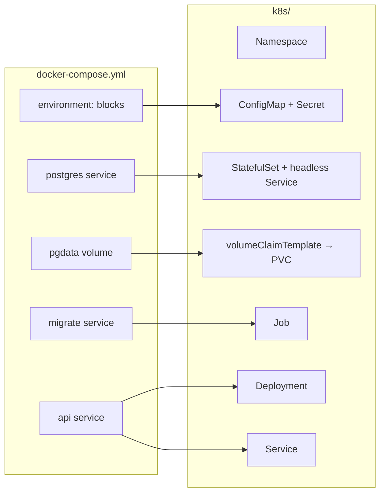

# From docker compose to Kubernetes: a worked translation

Here's a compose file in the style of module 26, and the Kubernetes objects each part becomes. Read them side by side.

```yaml
# docker-compose.yml
services:
  postgres:
    image: postgres:16-alpine
    environment:
      POSTGRES_USER: kudos
      POSTGRES_DB: kudos
      POSTGRES_PASSWORD: local-dev
    volumes: [pgdata:/var/lib/postgresql/data]
    healthcheck:
      test: ["CMD-SHELL", "pg_isready -U kudos"]
  migrate:
    image: wl-kudos-api:1.0.0
    command: ["node", "dist/db/migrateCli.js"]
    environment: { DB_HOST: postgres, DB_PORT: "5432", DB_USER: kudos, DB_NAME: kudos, DB_PASSWORD: local-dev }
    depends_on: { postgres: { condition: service_healthy } }
  api:
    image: wl-kudos-api:1.0.0
    environment: { DB_HOST: postgres, DB_PORT: "5432", DB_USER: kudos, DB_NAME: kudos, DB_PASSWORD: local-dev }
    ports: ["8080:3000"]
    depends_on: { migrate: { condition: service_completed_successfully } }
    deploy: { replicas: 3 }
volumes:
  pgdata:
```

## Object by object



| Compose concept | Kubernetes | Notes |
|---|---|---|
| the project (`name:`) | a **Namespace** | isolates names; delete it to clean up everything |
| `environment:` repeated in two services | one **ConfigMap** + one **Secret**, referenced by both | removes duplication and splits secret from non-secret |
| `postgres` service + named volume | **StatefulSet** with a `volumeClaimTemplate` + a **headless Service** | the Service is what makes the hostname `postgres` resolve |
| `healthcheck:` | `readinessProbe` (+ `livenessProbe`) | in k8s the result actually controls routing and restarts |
| `migrate` one-off service | a **Job** | runs to completion; retries on failure up to `backoffLimit` |
| `api` service with `deploy.replicas` | a **Deployment** | plus probes, resources and securityContext you never bothered with in compose |
| `ports: ["8080:3000"]` | a **Service** (`port: 80`, `targetPort: 3000`), then `kubectl port-forward svc/kudos-api 8080:80` | inside the cluster nobody needs host ports |
| implicit compose network + service DNS | cluster DNS: `<service>.<namespace>.svc.cluster.local` | same idea, cluster-wide |

## What has no direct equivalent

### `depends_on`

Compose can order startup. Kubernetes deliberately doesn't for long-running workloads: it applies everything at once and lets the system **converge**.

- The API starts immediately. Its `/readyz` returns 503 until Postgres answers, so it gets no traffic, and it isn't restarted either, because liveness doesn't check the DB.
- The migration Job may fail its first attempt if Postgres isn't up. The Job retries with backoff. The reference solution adds an **init container** that waits for `pg_isready`, so retries aren't wasted.
- New API code that needs the new schema? Make migrations backward compatible (expand/contract), or have your pipeline run `kubectl wait --for=condition=complete job/kudos-migrate` before updating the Deployment.

This feels worse at first. It's actually better, because in production dependencies go away *after* startup too, and an app that tolerates that at boot also tolerates it at 3am.

### `restart: always`

Built in, and stronger: controllers recreate pods on *other nodes* if a node dies, and liveness probes restart containers that hang without exiting.

### Bind mounts for live code reload

Not a thing in a cluster. For the inner dev loop keep using `npm run dev` (or compose). Tools like Tilt or Skaffold rebuild and redeploy into a cluster on save if you really want to develop against Kubernetes.

## What Kubernetes adds that compose never asked you about

- **Resources**: requests for scheduling, limits for safety. Compose rarely sets them.
- **Security context**: non-root, read-only root filesystem, dropped capabilities. Many clusters enforce this through Pod Security Admission and reject pods that don't comply.
- **Rollout strategy**: `maxSurge` / `maxUnavailable` and rollback history.
- **Graceful termination budget**: `terminationGracePeriodSeconds` and the race between SIGTERM and endpoint removal.

## Tools that convert for you (and why you shouldn't rely on them)

`kompose convert` turns a compose file into manifests. It's a reasonable first draft, but it can't know your probes, resources, secrets handling or which service is stateful. Use it to save typing, then review every line as if a junior wrote it.
