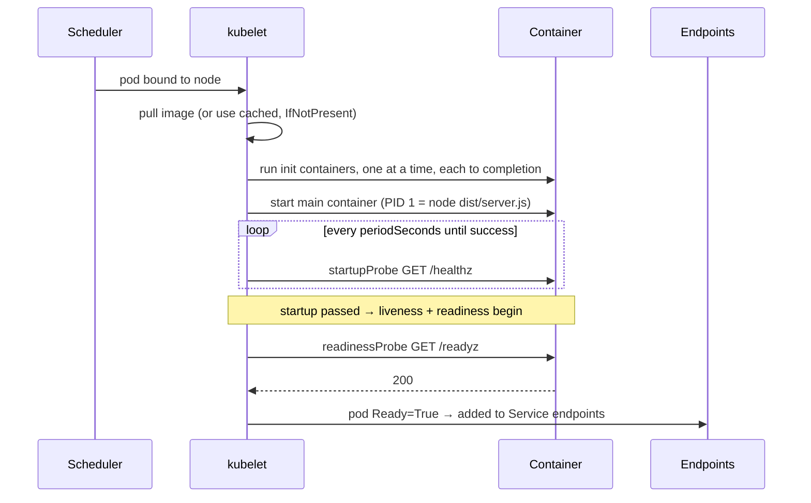
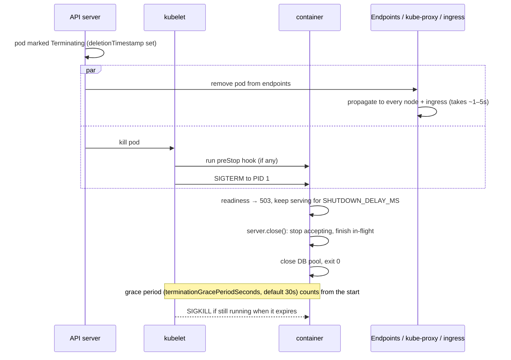

# Pod lifecycle, probes and graceful shutdown in detail

This is the part of Kubernetes that decides whether your deploys drop requests. The lesson gave you the rules. This page shows the timeline.

## Startup

Notes:

- **Init containers** run sequentially before the main container and must exit 0. If one fails, the kubelet retries it (per the pod's `restartPolicy`). The migration Job in the solution uses one to wait for Postgres.
- Until the **startupProbe** succeeds, liveness and readiness don't run. That's how you give slow starters (JVM apps, apps warming caches) time without a huge `initialDelaySeconds` on liveness that would also delay detecting real hangs later.
- The pod only gets traffic when **readiness** passes. Before that, `kubectl get pods` shows `0/1 Running`.

### Probe timing knobs

| Field | Default | Meaning |
|---|---|---|
| `initialDelaySeconds` | 0 | wait before the first probe |
| `periodSeconds` | 10 | how often |
| `timeoutSeconds` | 1 | how long one attempt may take. Node under load can exceed 1s, so 2–3s is common. |
| `failureThreshold` | 3 | consecutive failures before acting |
| `successThreshold` | 1 | consecutive successes to be considered OK again (must be 1 for liveness/startup) |

Time to detect a failure ≈ `periodSeconds × failureThreshold`. For readiness you usually want that short (10s); for liveness, longer (30s) so a GC pause or a burst doesn't cause a restart.

## Shutdown

Pods are terminated during rolling updates, scale-downs, node drains, evictions and `kubectl delete pod`. The sequence:

The key fact: **endpoint removal and SIGTERM happen in parallel**, and propagation isn't instant. If the app exits the moment it gets SIGTERM, a node whose iptables rules haven't updated yet will still send it new connections, and they get refused. That's the source of the classic "every deploy causes a few 502s" problem.

### Three ways to handle it

1. **Delay in the app** (what the provided `server.ts` does): on SIGTERM, flip readiness to 503, sleep a few seconds while serving normally, then close. Self-contained and testable.
2. **`preStop` sleep hook**: `lifecycle: { preStop: { sleep: { seconds: 5 } } }` (the native `sleep` action is newer; older clusters use `exec: { command: ["sleep", "5"] }`, which needs a `sleep` binary in the image). The kubelet waits before sending SIGTERM, so the app can keep a naive shutdown.
3. **Both**: belt and braces. Common in production.

Whatever you choose: `terminationGracePeriodSeconds` must be longer than preStop + delay + drain timeout, or the kubelet SIGKILLs mid-drain. For this app: 5s delay + up to 10s drain = 15s < 30s.

### PID 1 and signals

SIGTERM goes to PID 1 in the container. If PID 1 is `npm` or `sh -c "node server.js"`, the signal may never reach Node, so the app gets SIGKILLed after 30 seconds without cleanup. That's why the Dockerfile uses exec-form `CMD ["node", "dist/server.js"]` (module 26). Node as PID 1 also has no default signal handlers, which is another reason to register `process.on("SIGTERM")` explicitly.

## Restart behaviour and CrashLoopBackOff

For Deployments (`restartPolicy: Always`), the kubelet restarts a container that exits or fails liveness, with exponential backoff: 10s, 20s, 40s... capped at 5 minutes, reset after 10 minutes of running fine. While waiting, the status shows `CrashLoopBackOff`. That status isn't the problem, it's the symptom. Find the cause with `kubectl logs <pod> --previous` and the Events in `kubectl describe pod`.

For Jobs, `restartPolicy: Never` creates a **new pod** for each retry (you can read each failed attempt's logs), while `OnFailure` restarts the container in the same pod. `backoffLimit` counts failures either way.

## Exit codes worth recognizing

| Code | Meaning |
|---|---|
| 0 | clean exit |
| 1 | app error (uncaught exception, `process.exitCode = 1`) |
| 137 | 128 + 9: SIGKILL. With reason `OOMKilled` → memory limit. Otherwise grace period expired or a failed liveness probe. |
| 143 | 128 + 15: SIGTERM and the process exited because of it without handling it |
| 126 / 127 | command not executable / not found: wrong `command`, missing binary in the image |
