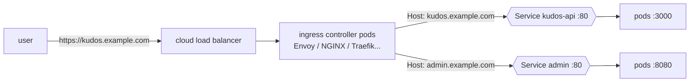
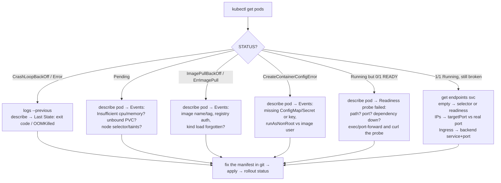
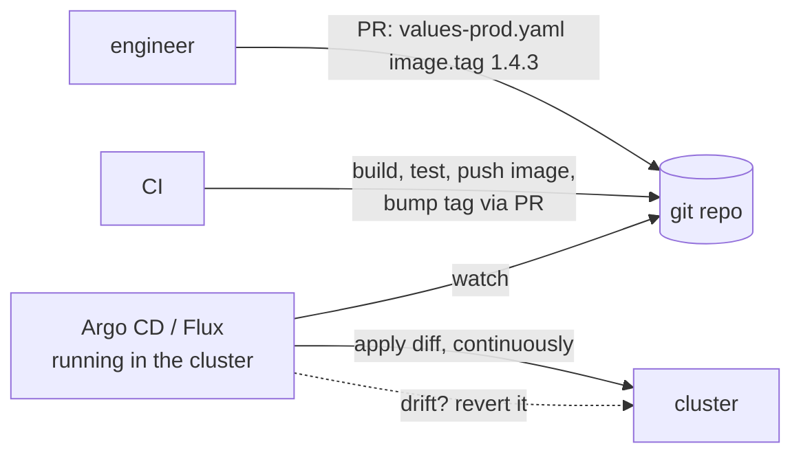

# 35 · Kubernetes in Practice

> In module 34 you got an app running on Kubernetes. This module covers what happens next: exposing it to users, scaling it with load, surviving node maintenance, packaging it for several environments, and, most of all, working out why it's broken when `kubectl get pods` says `CrashLoopBackOff` and you're the one on call.

**Time:** ~7h · **Challenge:** 🐛 Debug (+ build a Helm chart) · **Prereqs:** [34 · Kubernetes Fundamentals](../34-kubernetes-fundamentals/README.md) · **Services:** none (your own kind cluster for the runbook)

## What you'll learn

- **Ingress** and ingress controllers, and where the Gateway API fits in
- **HorizontalPodAutoscaler**: metrics-server, how the utilization maths works, CPU vs custom metrics
- **PodDisruptionBudgets**: voluntary vs involuntary disruptions, and how drains respect budgets
- **StatefulSets vs managed databases**: the real trade-off
- **Jobs and CronJobs** for batch work
- **Helm**: charts, values, templates, helpers, releases, upgrades and rollbacks
- **Kustomize** in one page, and when to choose it over Helm
- A repeatable **debugging workflow**: `get` → `describe` → events → `logs --previous` → endpoints → `exec` / `port-forward`
- The **common failure states** (`CrashLoopBackOff`, `ImagePullBackOff`, `Pending`, `OOMKilled`, `CreateContainerConfigError`, `0/1 Running`) and what each one usually means
- Observability in Kubernetes, and a **GitOps** overview

---

## 1. Getting traffic in: Ingress

In module 34 you reached your Service with `kubectl port-forward`. Real users can't do that. The options:

| Approach | How | Downside |
|---|---|---|
| `Service type: LoadBalancer` | the cloud creates one load balancer per Service | one LB (and one bill, one IP) per service; L4 only, so no host/path routing or TLS termination in one place |
| `NodePort` | every node listens on a high port | awkward ports, you build the LB yourself |
| **Ingress** | one entry point routes HTTP(S) by host and path to many Services | needs an ingress controller |
| **Gateway API** | Ingress's successor: richer routing, role separation | newer; needs a controller that implements it |

An **Ingress** is a set of HTTP routing rules:

```yaml
apiVersion: networking.k8s.io/v1
kind: Ingress
metadata: { name: kudos-api, namespace: kudos }
spec:
  ingressClassName: nginx            # which controller should implement this (omit = default class)
  tls:
    - hosts: [kudos.example.com]
      secretName: kudos-tls          # cert + key, often issued by cert-manager
  rules:
    - host: kudos.example.com
      http:
        paths:
          - path: /
            pathType: Prefix         # Prefix | Exact | ImplementationSpecific
            backend:
              service:
                name: kudos-api
                port:
                  number: 80         # the SERVICE port, not the container port
```



The Ingress object by itself does **nothing**. An **ingress controller** (a Deployment running a proxy) watches Ingress objects and configures itself to match. Usually it sits behind one `LoadBalancer` Service. `ingressClassName` picks which controller handles an Ingress when there are several; an IngressClass marked as default handles Ingresses that don't name one.

Two facts about the ecosystem you should know as of late 2026:

- **ingress-nginx** (the community controller most tutorials used for years) was **retired by the Kubernetes project in March 2026**. It no longer gets releases or security fixes. Existing installs keep working but should migrate. (F5's separate "NGINX Ingress Controller" product is a different project.)
- The **Gateway API** (`Gateway`, `HTTPRoute`, ...) is the designated successor. It separates the platform team's concern (a `Gateway`: listeners, TLS, which namespaces may attach) from the app team's concern (an `HTTPRoute`: hosts, paths, backends, weights for canaries). Envoy Gateway, Istio, Cilium, Traefik, Contour, NGINX Gateway Fabric and the cloud load balancer controllers implement it. The Ingress API itself is stable and still widely used, so you'll meet both.

Locally, recent versions of **cloud-provider-kind** give your kind cluster LoadBalancer IPs and a built-in Ingress implementation (translated to Gateway API under the hood) registered as the default class. That's what the runbook uses, so the challenge's Ingress has no `ingressClassName`.

> The bug that bites everyone once: `backend.service.port` must be a port the **Service** exposes (`80` or its name `http`), not the container's `3000`. The controller can't find a matching Service port and responds 503.

## 2. Scaling with load: the HorizontalPodAutoscaler

An HPA changes a Deployment's replica count based on metrics.

```yaml
apiVersion: autoscaling/v2
kind: HorizontalPodAutoscaler
metadata: { name: kudos-api, namespace: kudos }
spec:
  scaleTargetRef: { apiVersion: apps/v1, kind: Deployment, name: kudos-api }
  minReplicas: 2
  maxReplicas: 10
  metrics:
    - type: Resource
      resource:
        name: cpu
        target: { type: Utilization, averageUtilization: 70 }
  behavior:
    scaleDown: { stabilizationWindowSeconds: 300 }   # avoid flapping
```

How it works:

1. **metrics-server** scrapes CPU and memory usage from every kubelet and serves it through the Metrics API (that's also what `kubectl top` reads). No metrics-server, no CPU-based HPA: the HPA shows `<unknown>/70%`.
2. Every 15 seconds the HPA controller computes **utilization = current usage ÷ request**, averaged over pods. With a 100m request, a pod using 85m is at 85%.
3. It computes `desired = ceil(current × currentUtilization / target)`. Three pods at 140% with a 70% target → `ceil(3 × 140/70)` = 6 pods. The result is clamped to `[minReplicas, maxReplicas]` and smoothed by the `behavior` rules.

Consequences you need to internalize:

- **The pod must have a CPU request**, or utilization is undefined and the HPA does nothing.
- **Requests drive scaling.** Request 50m and the HPA scales out early; request 1 core and it barely ever does. Tune requests from real usage first, then the target.
- **Remove `spec.replicas` from the Deployment manifest** once an HPA manages it. Otherwise every `kubectl apply` (or Helm upgrade, or GitOps sync) resets the count the HPA chose, possibly scaling you down in the middle of a traffic spike. With client-side `kubectl apply`, simply deleting the field also briefly resets to 1, which is why the docs (and the challenge runbook) use `kubectl apply edit-last-applied` to remove it from the last-applied record first.
- **CPU is a proxy.** It works well for CPU-bound services. For I/O-bound Node services waiting on a database, CPU may stay low while latency climbs. Then scale on **custom metrics** (requests per second, in-flight requests via Prometheus Adapter) or **external metrics** (queue length, Kafka consumer lag). **KEDA** is the common tool for event-driven scaling, including scaling workers to zero.
- Scaling pods doesn't help if there's no room on the nodes: new pods sit `Pending`. The **Cluster Autoscaler** or **Karpenter** add nodes when pods can't be scheduled.
- **VerticalPodAutoscaler** adjusts requests instead of replica counts. Don't let VPA and HPA both act on CPU for the same workload.

## 3. Surviving maintenance: PodDisruptionBudgets

Disruptions come in two kinds:

- **Involuntary**: a node crashes, the kernel OOM-kills a pod, a VM is reclaimed. Nothing can prevent these; replicas spread across nodes are your only defence.
- **Voluntary**: someone or something *chooses* to evict pods: `kubectl drain` before a node upgrade, the cluster autoscaler removing an underused node, a managed cluster's automatic upgrade.

A **PodDisruptionBudget** limits voluntary disruptions. Drains and autoscalers use the **Eviction API**, which refuses an eviction that would violate a budget; the drain waits and retries.

```yaml
apiVersion: policy/v1
kind: PodDisruptionBudget
metadata: { name: kudos-api, namespace: kudos }
spec:
  minAvailable: 1              # or maxUnavailable: 1 (exactly one of the two)
  selector:
    matchLabels: { app: kudos-api }
```

Choose the number with the HPA's minimum in mind. With `minReplicas: 2`:

| PDB | Allowed disruptions at 2 pods | Effect |
|---|---|---|
| `minAvailable: 1` | 1 | drains proceed one pod at a time ✅ |
| `maxUnavailable: 1` | 1 | same, and it scales naturally as replicas grow ✅ |
| `minAvailable: 2` | 0 | **every drain blocks forever** until someone intervenes ❌ |
| none | 2 | a drain can take both pods down at once ❌ |

`kubectl get pdb` shows `ALLOWED DISRUPTIONS`; a permanent 0 is a red flag. Platform teams often alert on it, because a blocked drain stalls a whole cluster upgrade.

A PDB doesn't stop `kubectl delete pod`, Deployment rollouts (those use `maxUnavailable`) or node crashes. It only governs evictions.

## 4. State: StatefulSets vs managed databases

Module 34 ran Postgres as a StatefulSet. Should production do that?

| | StatefulSet (DIY) | Operator (CloudNativePG, Zalando, Strimzi for Kafka) | Managed (RDS, Cloud SQL, Azure DB, Neon) |
|---|---|---|---|
| Setup | YAML you write | install operator, declare a `Cluster` resource | console/Terraform |
| Backups, PITR | you build it | operator ships them to object storage | built in |
| Failover | you build it | automated | automated, multi-AZ |
| Upgrades | you | operator-assisted | provider (in a maintenance window) |
| Storage performance | depends on your volumes and nodes | same | tuned by provider |
| Cost | cheapest in money, most expensive in time | middle | highest per GB, lowest in people-time |
| Portability | high | high | low |

For most product teams the answer is: **stateless apps in Kubernetes, databases managed**. The app doesn't care either way: it reads `DB_HOST` and a password from config, which is why module 34's API needed no changes for this module, where Postgres is "external" (`local/postgres.yaml` stands in for it). Teams that run many databases, or need to be cloud-agnostic, and have the skills, run operators. Plain hand-written StatefulSets for production databases are rare.

## 5. Batch work: Jobs and CronJobs

A **Job** runs pods until a given number complete successfully (module 34's migration Job). Knobs worth knowing: `backoffLimit` (retries), `activeDeadlineSeconds` (total time limit), `ttlSecondsAfterFinished` (auto-cleanup), `completions` + `parallelism` (fan out work across pods), and `restartPolicy: Never | OnFailure`.

A **CronJob** creates Jobs on a schedule:

```yaml
apiVersion: batch/v1
kind: CronJob
metadata: { name: kudos-weekly-digest, namespace: kudos }
spec:
  schedule: "0 8 * * 1"              # Mondays 08:00
  timeZone: "Europe/Berlin"          # without it: the controller's time zone (usually UTC)
  concurrencyPolicy: Forbid          # Allow | Forbid | Replace: what if the last run is still going?
  startingDeadlineSeconds: 600       # skip a run that couldn't start within 10 minutes
  successfulJobsHistoryLimit: 3
  failedJobsHistoryLimit: 3
  jobTemplate:
    spec:
      backoffLimit: 2
      template:
        spec:
          restartPolicy: Never
          containers:
            - name: digest
              image: wl-kudos-api:1.0.0
              command: ["node", "dist/jobs/weeklyDigest.js"]
```

Rules of thumb: CronJobs give **at-least-once** semantics at best (a run can be missed or, rarely, happen twice), so make the work idempotent, exactly as with queue consumers in [module 20](../20-background-jobs/README.md). Use `concurrencyPolicy: Forbid` for anything that must not overlap. And test a CronJob manually with `kubectl create job --from=cronjob/kudos-weekly-digest manual-run-1`.

## 6. Packaging: Helm

Raw YAML doesn't scale to one app × several environments, let alone 40 apps. **Helm** is Kubernetes' package manager: a **chart** is a directory of templated manifests plus default values; installing it with specific values creates a **release**.

```
chart/
  Chart.yaml          # name, chart version, appVersion
  values.yaml         # defaults; override with -f values-prod.yaml or --set key=value
  templates/
    _helpers.tpl      # named templates (no output by itself)
    deployment.yaml   # Go templates that render to manifests
    service.yaml
    ingress.yaml
    hpa.yaml
    pdb.yaml
    NOTES.txt         # printed after install
```

### Templates

Templates are Go's `text/template` plus the Sprig function library. Everything between `{{ }}` is evaluated; everything else is copied as-is.

```yaml
apiVersion: apps/v1
kind: Deployment
metadata:
  name: {{ include "kudos-api.fullname" . }}            # call a named template from _helpers.tpl
  labels:
    {{- include "kudos-api.labels" . | nindent 4 }}     # pipe into nindent: newline + indent 4
spec:
  {{- if not .Values.autoscaling.enabled }}             # conditionals
  replicas: {{ .Values.replicaCount }}
  {{- end }}
  template:
    spec:
      containers:
        - name: api
          image: "{{ .Values.image.repository }}:{{ .Values.image.tag | default .Chart.AppVersion }}"
          resources:
            {{- toYaml .Values.resources | nindent 12 }}  # dump a whole values subtree as YAML
```

The things to know:

| Syntax | Meaning |
|---|---|
| `.Values.x.y` | from values.yaml merged with `-f` files and `--set` flags |
| `.Release.Name`, `.Release.Namespace` | the release being installed |
| `.Chart.Name`, `.Chart.Version`, `.Chart.AppVersion` | from Chart.yaml |
| `{{- ... }}` / `{{ ... -}}` | trim whitespace (including newlines) on the left / right |
| `include "name" .` | render a `define`d template; pipe-able (unlike `template`) |
| `toYaml`, `nindent N`, `quote`, `default`, `required "msg"` | the everyday Sprig functions |
| `if` / `else` / `end`, `range`, `with` | control flow. Inside `range` and `with`, `.` changes, so use `$` for the root (`$.Values...`) |

Whitespace is the classic source of broken charts: a missing `-` leaves blank lines (harmless) or a wrong `nindent` puts a block at the wrong level (not harmless). Always look at the output: `helm template` renders locally without a cluster, and `helm lint` catches structural problems.

### Values and environments

```bash
helm upgrade --install kudos-api ./chart -n kudos \
  -f values-staging.yaml \
  --set image.tag=1.4.2
```

Later sources override earlier ones: chart `values.yaml` < `-f` files (in order) < `--set`. Keep environment differences in small values files in git; use `--set` for the one thing that changes every deploy (the image tag), typically from CI.

### Releases, upgrades, rollback

`helm upgrade --install` is idempotent: install if missing, upgrade if present. Each upgrade is a new **revision** stored in the cluster (as a Secret in the release namespace). `helm history` lists them; `helm rollback kudos-api 3` re-applies revision 3's manifests. That's coarser than `kubectl rollout undo`: it rolls back *everything* in the chart, ConfigMaps included.

### Patterns worth copying

- **Config checksum annotation**: `checksum/config: {{ include (print $.Template.BasePath "/configmap.yaml") . | sha256sum }}` on the pod template. Changing a config value changes the hash, which changes the pod template, which triggers a rollout. Without it, pods keep stale env vars.
- **Don't manage replicas when an HPA does**: `{{- if not .Values.autoscaling.enabled }} replicas: ... {{- end }}`.
- **Reference secrets, don't create them**: `database.existingSecret` keeps passwords out of values files.
- **Selector labels must be stable**: never put the chart version in `spec.selector` (it's immutable); `helm create`'s `selectorLabels` helper exists for exactly this.
- **Hooks** (`helm.sh/hook: pre-upgrade`) run Jobs at points in the release lifecycle, for example migrations. Gotcha: a `pre-install` hook runs before the chart's ConfigMaps and Secrets exist, so the hook Job must not depend on them (or they must be hooks too, with a lower weight).

> Helm 4 was released in late 2025. Charts with `apiVersion: v2` and the commands used here work the same in Helm 3 and 4.

## 7. Kustomize in one page

Kustomize takes the opposite approach: **no templates**. You keep plain YAML as a base and write overlays that patch it.

```
k8s/
  base/
    kustomization.yaml     # resources: [deployment.yaml, service.yaml]
    deployment.yaml
    service.yaml
  overlays/
    prod/
      kustomization.yaml   # resources: [../../base]; patches; images; replicas
```

```yaml
# overlays/prod/kustomization.yaml
apiVersion: kustomize.config.k8s.io/v1beta1
kind: Kustomization
namespace: kudos-prod
resources: [../../base]
images:
  - name: wl-kudos-api
    newTag: "1.4.2"
patches:
  - target: { kind: Deployment, name: kudos-api }
    patch: |
      - op: replace
        path: /spec/template/spec/containers/0/resources/limits/memory
        value: 512Mi
```

`kubectl apply -k overlays/prod` (Kustomize is built into kubectl) or `kubectl kustomize overlays/prod` to just render.

| | Helm | Kustomize |
|---|---|---|
| Model | templates + values | plain YAML + patches |
| Learning curve | Go templates, whitespace | patches, generators |
| Packaging/versioning, sharing | ✅ charts, repositories, OCI registries | ❌ (just directories) |
| Release history, rollback | ✅ | ❌ (rely on git / GitOps) |
| Third-party software | almost always shipped as Helm charts | rarely |
| Readability of what gets applied | must render to see | base is real YAML |

Many teams use both: Helm for third-party software, Kustomize (or Helm) for their own apps. GitOps tools support both.

## 8. A debugging workflow that always works

When something's wrong, resist the urge to guess and edit. Go top-down; each step narrows the search:



The commands, in the order you'll use them:

```bash
kubectl get pods -n kudos -o wide                   # what state, how many restarts, which node
kubectl describe pod <pod> -n kudos                 # config as the kubelet sees it + EVENTS (read bottom first)
kubectl get events -n kudos --sort-by=.lastTimestamp
kubectl logs <pod> -n kudos --previous              # the crashed container's last words
kubectl get endpoints <svc> -n kudos                # does the Service have backends?
kubectl get pods -n kudos --show-labels             # compare with the Service selector
kubectl exec -it <pod> -n kudos -- sh               # look from inside: wget localhost:3000/readyz, env, nslookup
kubectl run debug -n kudos --rm -it --restart=Never --image=busybox -- sh   # a clean client inside the cluster
kubectl port-forward pod/<pod> 8080:3000 -n kudos   # bypass Service and Ingress entirely
kubectl debug -it <pod> -n kudos --image=busybox --target=api   # ephemeral debug container for distroless images
```

Bisect the network path: pod IP:port directly → Service name → Ingress. Whichever hop fails first is where the bug is. The challenge's `symptoms/06-debug-pod.txt` is a textbook example: Service refused, pod IP on 8080 refused, pod IP on 3000 works → the Service targets the wrong port.

## 9. Failure states decoded

| Status / symptom | What it means | Usual causes | Look at |
|---|---|---|---|
| `Pending` | not scheduled yet (or volumes not ready) | requests bigger than any node's free capacity; PVC unbound; nodeSelector/affinity/taints | `describe pod` Events (`FailedScheduling: 0/3 nodes are available: Insufficient memory`) |
| `ErrImagePull` → `ImagePullBackOff` | kubelet can't get the image | typo in name/tag; private registry without `imagePullSecrets`; on kind: image not loaded; `:latest` + `Always` | Events |
| `CreateContainerConfigError` | pod spec can't be turned into a container config | referenced ConfigMap/Secret **or key** missing; `runAsNonRoot` with a non-numeric image user | Events: `couldn't find key X in Secret ns/name` |
| `RunContainerError` / `StartError` | runtime couldn't start the process | wrong `command` (exit 127/126), read-only FS where the entrypoint writes | Events, `describe` Last State |
| `CrashLoopBackOff` | container keeps exiting, kubelet backs off (10s → 5min) | app crashes on boot (bad config, can't reach DB and exits), OOM, liveness kills it | `logs --previous`, Last State exit code |
| `OOMKilled` (exit 137) | exceeded memory limit | limit too low (Node needs 50–60Mi just to boot), memory leak, unbounded cache | `describe pod` Last State, `kubectl top pod` |
| `Running` but `0/1` | readiness failing: no traffic | wrong probe path/port, dependency down, still warming up | Events `Readiness probe failed: HTTP probe failed with statuscode: 404` |
| Liveness restarts every N seconds | liveness failing | probe too strict, checks a dependency, event loop blocked | Events `Liveness probe failed`, restart count |
| `Terminating` forever | finalizers or a node that's gone | stuck finalizer (often PVC/namespace), unreachable node | `get -o yaml` → `metadata.finalizers` |
| Service has no endpoints | nothing matches + ready | selector/label typo, all pods unready | `get endpoints`, `--show-labels` |
| Connection refused via Service | endpoints exist, port wrong | `targetPort` ≠ the port the process listens on | `get endpoints` (shows ports), debug pod |
| Ingress 404 | no rule matched | host header mismatch, wrong `ingressClassName`, path type | `describe ingress`, controller logs |
| Ingress 502/503 | rule matched, backend unusable | backend Service/port doesn't exist, no ready endpoints | controller logs, `get endpoints` |

Notice how many rows say "Events". `kubectl describe` is the single most useful debugging command. Events are only retained for about an hour by default, so capture them early in an incident.

## 10. Observability in Kubernetes

- **Logs**: write JSON to stdout ([module 24](../24-observability/README.md)). The kubelet stores container logs on the node; a DaemonSet agent (Fluent Bit, Vector, the OpenTelemetry Collector) ships them to Loki, Elasticsearch or a vendor, enriched with pod/namespace/labels. `kubectl logs` only shows what's still on the node.
- **Metrics**: Prometheus discovers pods through the API (ServiceMonitor/PodMonitor with the Prometheus Operator) and scrapes `/metrics`. Add **kube-state-metrics** for object state (desired vs ready replicas, restarts, PDB disruptions allowed) and node exporters for machines.
- **Alerts worth having**: pods restarting repeatedly, Deployment replicas unavailable, HPA at max for a long time, PDB with 0 allowed disruptions, OOMKills, PVCs nearly full, plus your RED/SLO alerts from module 24.
- **Traces**: unchanged from module 24. The OpenTelemetry Collector often runs as a DaemonSet or sidecar, and resource attributes add `k8s.pod.name`, `k8s.namespace.name`, etc.
- **Events** are data too: export them (kubernetes-event-exporter) so they outlive the one-hour retention.

## 11. GitOps

The incident in this module's challenge happened partly because people fixed things with `kubectl edit` and never committed the fixes, so the next deploy brought the bugs back. **GitOps** removes that whole class of problem:



- **Git is the source of truth.** The desired state of every environment lives in a repo (raw YAML, Kustomize or Helm values).
- **An agent in the cluster pulls and applies** (Argo CD or Flux), continuously reconciling, the same idea as Kubernetes controllers applied one level up. CI never needs cluster credentials.
- **Drift is visible and reverted**: a manual `kubectl edit` shows up as "OutOfSync" and gets undone (self-heal), or at least flagged.
- **Deploy = merge, rollback = revert.** Audit trail for free.

GitOps doesn't replace Helm or Kustomize; it's how their output gets to the cluster. Secrets need special handling (Sealed Secrets, SOPS, External Secrets Operator), since plain Secrets can't live in git.

## Common mistakes

- `backend.service.port` in an Ingress set to the container port instead of the Service port.
- HPA on a Deployment whose pods have no CPU request (`<unknown>` targets, never scales).
- Keeping `spec.replicas` in a manifest that an HPA manages, so every apply fights the autoscaler.
- `minAvailable` equal to the replica count, which blocks every node drain.
- Fixing incidents with `kubectl edit` and never committing, so the next deploy reintroduces the bug.
- Helm: using `.Values` inside `range`/`with` (the dot changed; use `$.Values`), wrong `nindent`, and putting changing labels (chart version) in selectors.
- Hard-coding `namespace:` in chart templates instead of letting `helm install -n` decide.
- Creating Secrets from Helm values committed to git.
- Debugging by guessing: editing three things at once instead of reading Events and logs first.
- Reading `kubectl logs` of the *current* container when the evidence is in `--previous`.
- Running a production database as a hand-rolled StatefulSet without backups or a restore drill.
- CronJobs that aren't idempotent, or overlap because `concurrencyPolicy` was left at `Allow`.

## In production

- **Platform teams own the cluster add-ons** (ingress or gateway controllers, cert-manager, external-dns, metrics-server, Prometheus, policy engines like Kyverno or Gatekeeper). App teams own their chart or Kustomize overlay and their SLOs. Knowing where that line sits in your company saves a lot of confusion.
- **Policy as code** blocks many of this module's bugs before they reach a cluster: required probes, resources and labels, no `:latest`, non-root. Tools: Kyverno, OPA Gatekeeper, and CI checks like kubeconform, `helm lint`, kube-linter or Polaris.
- **Progressive delivery** (Argo Rollouts, Flagger) builds canaries and blue/green on top of the primitives here: shift 5% of traffic, watch error rates, continue or abort automatically.
- **Capacity**: HPA scales pods, Cluster Autoscaler/Karpenter scale nodes, PDBs keep both safe. Requests are the input to all of it, so getting them right is a recurring task, not a one-off.
- **Incident hygiene**: capture `describe`/events/logs first (they expire), mitigate with `rollout undo` or `helm rollback`, then fix forward through git. Write the postmortem.

## Check yourself

1. Your Ingress returns 503 but `kubectl get pods` shows everything `1/1 Running`. Name two things to check.
   <details><summary>Answer</summary>That the Ingress backend references an existing Service and one of its ports (not the container port), and that the Service has endpoints (<code>kubectl get endpoints</code>): a selector mismatch leaves it empty even though pods are healthy. Then the controller's logs.</details>
2. An HPA targets 70% CPU. Pods request 200m and use 280m on average across 4 replicas. How many replicas does it want?
   <details><summary>Answer</summary>Utilization is 280/200 = 140%. desired = ceil(4 × 140 / 70) = 8 (within min/max).</details>
3. Why does `minAvailable: 2` with an HPA `minReplicas: 2` cause trouble?
   <details><summary>Answer</summary>At 2 replicas the PDB allows 0 disruptions, so <code>kubectl drain</code> and the cluster autoscaler can never evict those pods. Node upgrades block until someone intervenes.</details>
4. A pod shows `CrashLoopBackOff`. `kubectl logs` prints nothing. What next?
   <details><summary>Answer</summary><code>kubectl logs --previous</code> for the crashed container, and <code>kubectl describe pod</code> for Last State: an exit code 137 with reason OOMKilled means the memory limit is too low and the process died before logging anything.</details>
5. In a Helm chart, why is the replica count wrapped in `if not .Values.autoscaling.enabled`, and what's the checksum annotation for?
   <details><summary>Answer</summary>So Helm doesn't overwrite the HPA's replica count on every upgrade. The checksum of the rendered ConfigMap changes the pod template whenever config changes, which forces a rollout so pods pick up the new env vars.</details>

## Further reading

- Ingress: https://kubernetes.io/docs/concepts/services-networking/ingress/
- Gateway API: https://gateway-api.sigs.k8s.io/
- Ingress NGINX retirement announcement: https://kubernetes.io/blog/2025/11/11/ingress-nginx-retirement/
- Horizontal Pod Autoscaling: https://kubernetes.io/docs/tasks/run-application/horizontal-pod-autoscale/
- Disruptions and PodDisruptionBudgets: https://kubernetes.io/docs/concepts/workloads/pods/disruptions/
- CronJob: https://kubernetes.io/docs/concepts/workloads/controllers/cron-jobs/
- Debugging pods: https://kubernetes.io/docs/tasks/debug/debug-application/debug-pods/
- Helm docs (chart template guide): https://helm.sh/docs/chart_template_guide/
- Kustomize: https://kubectl.docs.kubernetes.io/references/kustomize/
- kind + cloud-provider-kind (LoadBalancer/Ingress): https://kind.sigs.k8s.io/docs/user/ingress/
- Deep dives in this module: [docs/debugging-playbook.md](docs/debugging-playbook.md) · [docs/helm-cheatsheet.md](docs/helm-cheatsheet.md) · [docs/kustomize-and-gitops.md](docs/kustomize-and-gitops.md)

## ➡️ Next: [the challenge](CHALLENGE.md)
