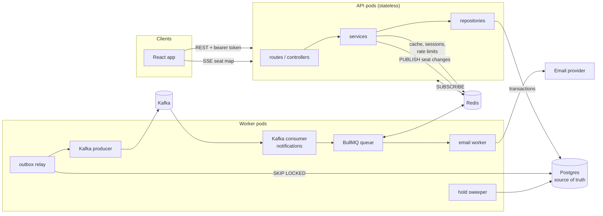
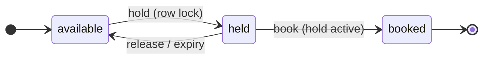

# 36 · Capstone: Event Ticketing Platform

> Selling concert tickets looks like CRUD until 50,000 people click the same seat in the same second. This capstone has you build the whole system: correctness under contention, idempotent writes, caching, rate limits, events, realtime updates, deployment and a design doc. It's the project you'll talk about in every interview.

**Time:** ~35h · **Challenge:** 🛠️ Build · **Prereqs:** everything up to [35 · Kubernetes in Practice](../35-kubernetes-in-practice/README.md), plus [R2 · React + Your API](../R2-react-data/README.md) for M7 · **Services:** Postgres, Redis, Kafka

## What you'll learn

- How to break a big, vague project into milestones that each end in something working and tested
- How to turn a product brief into a domain model, an API contract and a list of invariants
- How the pieces from 35 modules fit together in one codebase without turning into a ball of mud
- How to keep the critical path (hold → book) small, transactional and provably correct
- How to push everything slow or unreliable (Kafka, email, broadcasts) off the request path
- How to explain your own design: the trade-offs you made, how it fails, and how it would scale

---

## 1. The product

You're building the backend (and a small frontend) for a ticketing site, the kind that sells seats for concerts and theatre shows.

- **Organizers** create events: a name, a venue, a start time, a price, and a seat grid (rows A, B, C... with seats 1..N).
- **Fans** browse upcoming events and open a **seat map** that updates live as other people grab seats.
- A fan picks up to six seats and gets a **hold**: the seats are reserved for them for ten minutes while they decide.
- While the hold is active they **book** it. The seats become theirs, and a confirmation email goes out.
- Holds can be released early, and they **expire** on their own.
- Organizers see live **sales numbers**.

That's the whole feature list. It's short on purpose: the difficulty isn't the number of features, it's that every one of them has to stay correct when thousands of people use it at once.

### The two invariants

Write these on a sticky note. Every design decision in this project exists to protect them:

1. **A seat is sold at most once**, no matter how many requests race for it.
2. **Retrying a booking request never creates a second booking**, no matter where the network dropped it.

Everything else (caching, rate limits, live updates, emails) is allowed to be a bit late, a bit stale, or briefly unavailable. These two are not.

> 💡 This is how real systems are designed: find the few things that must never be wrong, protect them with the strongest tools you have (transactions, constraints, locks), and let everything else be "eventually fine". Module [30](../30-system-design/README.md) calls this separating the consistency-critical core from the rest.

## 2. The architecture at a glance



Two processes, one codebase, one Docker image:

- **The API** handles HTTP. Its critical path touches only Postgres (and Redis for auth). It never waits on Kafka or an email provider.
- **The worker** does everything that can happen later: relaying the outbox to Kafka, consuming events to send emails, sweeping expired holds.

Each box maps to a module you've already done:

| Piece | Where you learned it |
|---|---|
| Layered Express app, composition root, DI | [06](../06-layered-architecture/README.md), [07](../07-validation-errors-config/README.md), [08](../08-typescript-for-backends/README.md) |
| Schema, constraints, migrations | [12](../12-data-modeling/README.md), [13](../13-node-postgres/README.md) |
| Row locks, isolation, idempotency keys | [15](../15-transactions-concurrency/README.md), [16](../16-checkpoint-postgres/README.md) |
| Cache-aside, invalidation, coalescing | [18](../18-caching/README.md) |
| Rate limiting in Redis | [19](../19-rate-limiting/README.md) |
| BullMQ queue, retries, idempotent jobs | [20](../20-background-jobs/README.md) |
| Sessions, password hashing, authorization | [22](../22-auth/README.md) |
| Error format, idempotency, resource design | [23](../23-api-design/README.md) |
| Metrics, health vs readiness | [24](../24-observability/README.md) |
| Dockerfile, graceful shutdown | [26](../26-docker-ci-deploy/README.md) |
| SSE, Redis pub/sub fan-out | [28](../28-realtime/README.md) |
| Design doc structure | [30](../30-system-design/README.md), [31](../31-checkpoint-url-shortener/README.md) |
| Kafka producers/consumers, keys and ordering | [32](../32-kafka-fundamentals/README.md) |
| Outbox, at-least-once, idempotent consumers | [33](../33-event-driven-architecture/README.md) |
| Deployments, probes, Jobs, HPA, PDB | [34](../34-kubernetes-fundamentals/README.md), [35](../35-kubernetes-in-practice/README.md) |
| React app with an API client layer | [R1](../R1-react-fundamentals/README.md), [R2](../R2-react-data/README.md) |

The full component reference is in [docs/architecture.md](docs/architecture.md). The exact API contract and business rules are in [docs/domain-spec.md](docs/domain-spec.md).

## 3. How to approach a big project

This is the first project in the course where nobody hands you TODOs. Thirty-five hours is long enough to get lost. Here's how experienced engineers keep a project like this moving.

### 3.1 Start from the invariants and the contract, not the code

Before writing a line, read [docs/domain-spec.md](docs/domain-spec.md) end to end and answer on paper:

- What are the **entities** (user, event, seat, hold, booking) and their **states**? A hold is `active → converted | released | expired`. A seat is `available → held → booked`, or back to `available`.
- Which **transitions** can race? (Two holds on one seat. Two bookings of one hold. A booking and the sweeper on the same expired hold.)
- What does the **database** guarantee, and what must the **application** guarantee?

Draw the state machines. Ten minutes with a pen saves hours of debugging.



### 3.2 Build a walking skeleton first

A **walking skeleton** is the thinnest end-to-end slice that runs: config → container → app → one route → one table → one test passing. On day one, get `GET /healthz` and `POST /auth/register` working through every layer, with a migration and a passing test. After that, every feature is "add a route, a service method, a repository method", and you're never more than an hour away from green tests.

The milestones are ordered so each one builds on the last and ends in a tested, demoable state:

| | Milestone | Ends with | Est. |
|---|---|---|---|
| M1 | Core API + auth | register/login, events with seat grids, seat map | 6h |
| M2 | Holds & bookings | race-free holds, idempotent bookings, 50-way concurrency test green | 7h |
| M3 | Caching & rate limiting | cached event reads with invalidation, login and hold limits | 3h |
| M4 | Events & notifications | outbox + relay behind `EventPublisher`, BullMQ emails, `worker.ts` | 5h |
| M5 | Realtime seat map | SSE stream, Redis fan-out, hold sweeper | 4h |
| M6 | Ship it | `/metrics`, Dockerfile, Kubernetes manifests | 4h |
| M7 | Frontend | React seat map with live updates, hold → book flow | 4h |
| M8 | Design doc | DESIGN.md and DECISIONS.md you could defend in an interview | 2h |

Checklists for each milestone are in [docs/milestone-checklists.md](docs/milestone-checklists.md).

### 3.3 Let the tests drive, one file at a time

The acceptance tests in `challenge/api/test/` are named by milestone (`m1-auth.test.ts`, `m2-holds.test.ts`, ...). Run only the one you're on:

```bash
npx vitest api/test/m1-auth.test.ts      # watch mode, one file
```

Read a test before implementing it. Tests are the most precise part of the spec: they tell you the exact status codes, JSON shapes and error codes.

### 3.4 Keep a decision log as you go

Every time you pick between two reasonable options (locks vs conditional update, cookies vs bearer tokens, SSE vs WebSockets), write three lines in `DECISIONS.md` immediately. You'll forget the reasoning within a week, and the reasoning is exactly what interviewers ask about. M8 is much easier if you've been doing this since M1.

### 3.5 Timebox, then simplify

If something takes twice as long as the estimate, stop and ask: is there a simpler design that keeps the invariants? Often there is. For example, hold expiry doesn't need a scheduler at all if every query treats `held_until <= now` as available (more on that below). Ship the simple version, write down what you'd improve, move on.

### 3.6 Commit small, on a branch

Work on `module/36-capstone-ticketing` and commit at every green test. Open the PR early and push often; CI runs the module's tests, and a reviewer (human or Claude) can comment on M1 while you work on M2.

## 4. The critical path: holds and bookings

This is the heart of the project, so here are the ideas you'll need. The exact rules are in the domain spec.

### 4.1 One transaction, rows locked in a fixed order

When fan A and fan B both ask for seat A5 at the same instant, you need one of them to wait for the other and then see the seat as taken. You learned the tools in [module 15](../15-transactions-concurrency/README.md):

```ts
// inside withTransaction(pool, async (tx) => { ... })
const { rows } = await tx.query(
  `SELECT label, status, held_until FROM seats
   WHERE event_id = $1 AND label = ANY($2)
   ORDER BY label          -- same order everywhere: no deadlocks
   FOR UPDATE`,            -- concurrent holders queue here
  [eventId, labels],
);
// check every row is free (or its hold expired), else throw SeatUnavailableError
// insert the hold, mark the seats held, COMMIT
```

```mermaid
sequenceDiagram
  participant A as Fan A
  participant B as Fan B
  participant DB as Postgres
  A->>DB: BEGIN; SELECT A5 FOR UPDATE
  B->>DB: BEGIN; SELECT A5 FOR UPDATE
  Note over B,DB: B waits for A's row lock
  A->>DB: A5 available -> INSERT hold, UPDATE A5 held; COMMIT
  DB-->>B: lock granted, re-reads A5: held
  B->>DB: ROLLBACK -> 409 SEAT_UNAVAILABLE
```

Why `ORDER BY label`? Fan A holds `[A1, A2]` while fan B holds `[A2, A1]`. If A locks A1 and B locks A2, each waits for the other forever: a deadlock. If everyone locks in the same order, B queues behind A on A1 and the cycle can't form. One of the tests fires 30 overlapping holds in mixed orders to catch exactly this.

### 4.2 Expiry is a rule, not a job

A hold expires after `HOLD_TTL_SECONDS` according to the **injected clock**. The tempting design is a cron job that flips expired seats back to available every few seconds. The problem: correctness now depends on the job running on time.

The robust design applies expiry wherever it matters:

- the seat map reports `held` seats with `held_until <= now` as `available`
- a new hold may take a seat whose hold has expired
- booking an expired hold fails with `HOLD_EXPIRED`

A background **sweeper** (M5) still exists, but only to tidy up and to tell live seat maps that seats came back. If it stops, nothing breaks.

And because "now" comes from `clock.now()` instead of `new Date()` or SQL `now()`, the tests move time forward instantly: `clock.advance(600_001)` and the hold is expired. (Pass the clock's time into SQL as a parameter; never mix in the database's `now()` for business rules.)

### 4.3 Idempotent bookings

The booking request is the one where a timeout really hurts: did it go through or not? The client sends an `Idempotency-Key` it generated once for this hold, and the server guarantees the same key gives the same result ([module 23](../23-api-design/README.md) and [15](../15-transactions-concurrency/README.md)).

The cleanest implementation claims the key **inside the booking transaction**:

```sql
INSERT INTO idempotency_keys (user_id, key, request_hash, created_at)
VALUES ($1, $2, $3, $4)
ON CONFLICT (user_id, key) DO NOTHING
```

If another transaction is mid-flight with the same key, Postgres makes this insert **wait** until that transaction ends. If it committed, you get "0 rows", read its stored response and replay it. If it rolled back, your insert goes through and you proceed as the first attempt. The stored response is written in the same transaction as the booking, so they commit or vanish together.

### 4.4 Belt and braces: constraints

Application logic has bugs. Let the database catch the ones that matter most:

```sql
hold_id uuid NOT NULL UNIQUE REFERENCES holds (id)   -- one booking per hold, ever
CONSTRAINT seats_held_consistent CHECK ((status = 'held') = (hold_id IS NOT NULL AND held_until IS NOT NULL))
```

## 5. Off the critical path: events, emails, broadcasts

### 5.1 The outbox

After a booking commits, the rest of the company wants to know (emails now, analytics later) via Kafka. Producing to Kafka inside the request is the **dual-write problem** from [module 33](../33-event-driven-architecture/README.md): crash after commit but before produce and the event is lost; produce before commit and you may announce a booking that rolled back.

The fix: write the event to an `outbox` table **in the booking transaction**, and let a relay publish it later.

```mermaid
sequenceDiagram
  participant API
  participant PG as Postgres
  participant W as Worker relay
  participant K as Kafka
  API->>PG: BEGIN; booking + seats + hold + INSERT outbox; COMMIT
  loop every 500ms
    W->>PG: BEGIN; SELECT ... FROM outbox WHERE published_at IS NULL<br/>ORDER BY id LIMIT 100 FOR UPDATE SKIP LOCKED
    W->>K: produce batch (key = event id)
    W->>PG: UPDATE outbox SET published_at = now; COMMIT
  end
```

Kafka is hidden behind the `EventPublisher` port (given in `api/src/messaging/eventPublisher.ts`). The tests pass an in-memory fake that can simulate an outage; `worker.ts` passes a kafkajs adapter. That's separation of concerns paying off: the core doesn't know Kafka exists.

The relay gives **at-least-once** delivery (a crash between produce and `UPDATE` publishes again), so every consumer must de-duplicate by event id.

### 5.2 Notifications through a queue

The notifications consumer reads `booking.confirmed` events and enqueues a BullMQ job ([module 20](../20-background-jobs/README.md)). Using the **event id as the job id** makes a redelivered event a no-op. The email worker retries with exponential backoff when the provider fails.

### 5.3 Live seat map

The seat map stream is **Server-Sent Events** ([module 28](../28-realtime/README.md)): one-way, plain HTTP, and EventSource reconnects by itself. Each API pod subscribes to a Redis channel per event; whichever pod handles a hold publishes the change, and every pod forwards it to its own SSE clients. On connect, a client gets a full **snapshot**, then **changes**. Subscribe before reading the snapshot, so nothing slips through the gap.

Broadcasts are best effort. A lost message means a browser is briefly out of date, never that a seat is sold twice, because the database decides.

## 6. Caching and rate limiting: what (not) to cache

[Module 18](../18-caching/README.md) taught cache-aside. Here the important skill is choosing **what** to cache:

| Data | Cache? | Why |
|---|---|---|
| Event details (`GET /events/:id`) | ✅ TTL + delete on update | Read constantly, changes rarely |
| Upcoming list (`GET /events`) | ✅ but filter "already started" on every read | The query is the expensive part; filtering is cheap and must use the current clock |
| Seat availability | ❌ never | Changes every second during an on-sale; stale availability is worse than none, and SSE already removes most polling |

Rate limits ([module 19](../19-rate-limiting/README.md)) protect the two endpoints attackers and bots love: login (per IP + email, against credential stuffing) and holds (per user, against seat hoarding). Compute the window from the injected clock so tests can step across it.

## Common mistakes

- **Read-then-write without a lock.** `SELECT status` → check in JS → `UPDATE` is the classic oversell. The 50-way test will catch it.
- **Locking seats in request order.** Works in every manual test, deadlocks under load. Always lock in a canonical order.
- **Using SQL `now()` or `new Date()` for hold expiry.** Tests can't control it, and two clocks disagree. Use the injected clock everywhere.
- **Calling the publisher (Kafka) from the booking request.** That's the dual write. The outbox test checks the publisher is never called on the request path.
- **Storing the idempotency response outside the booking transaction.** A crash in between leaves a booking without a key (retry books twice) or a key without a booking.
- **Caching seat maps "for a few seconds".** During an on-sale that's thousands of fans clicking seats that are already gone.
- **A Redis key without the `wl:36:` prefix**, including BullMQ's (pass `prefix`). A test checks every key.
- **Building everything before testing anything.** Get one milestone green before starting the next.
- **Letting the container grow into a god object that services import.** Services receive what they need through constructors; only `container.ts` knows the concrete classes.

## In production

- **Ticketmaster-style on-sales** add a **virtual waiting room** in front of the hold endpoint so only N fans per second reach seat selection. Your rate limiter is a tiny version of that idea.
- **Holds with a payment step** are the norm: hold → payment intent → booking on payment success, with the hold TTL covering the payment window. The outbox pattern carries payment events too.
- **Hot rows** are the scaling limit of this design: everyone wants the front rows. Real systems shard seats by event, release seats in waves, or offer "best available" allocation so fans don't all fight for the same rows.
- **Outbox lag** (oldest unpublished row's age) is one of the first metrics to alert on in event-driven systems, alongside consumer lag in Kafka.
- **SSE at scale** usually moves to dedicated streaming pods or a managed pub/sub service, with changes coalesced into small batches per event to bound the fan-out.

## Check yourself

1. Why does the hold transaction lock seat rows `ORDER BY label` instead of in the order the client sent them?
   <details><summary>Answer</summary>Two transactions that lock overlapping seats in different orders can each hold one lock and wait for the other: a deadlock. A single global order means they always contend on the same first row, so one simply waits for the other.</details>
2. The hold sweeper crashed an hour ago. What breaks?
   <details><summary>Answer</summary>Nothing about correctness: expiry is applied on every seat-map read, every new hold and every booking. Only live seat maps miss the "seat came back" message until clients refresh or reconnect.</details>
3. Twenty retries with the same Idempotency-Key arrive at once. Walk through what happens.
   <details><summary>Answer</summary>The first transaction inserts the key row. The other nineteen block on the unique index. When the first commits (booking + stored response), each blocked insert becomes a no-op, reads the stored response and replays it with <code>Idempotent-Replayed: true</code>. One booking exists.</details>
4. Kafka is down for ten minutes during an on-sale. What do fans notice?
   <details><summary>Answer</summary>Nothing at booking time: bookings only write to Postgres, including the outbox row. Confirmation emails are delayed until the relay can publish again.</details>
5. Why is it fine that seat-change broadcasts are "at most once"?
   <details><summary>Answer</summary>They're a UI hint, not the source of truth. A missed message makes a seat look free when it isn't (the hold attempt returns 409) or taken when it isn't (fixed at the next snapshot). The database still guarantees no double booking.</details>

## Further reading

- PostgreSQL docs, explicit locking (row-level locks, `FOR UPDATE`, `SKIP LOCKED`): https://www.postgresql.org/docs/current/explicit-locking.html
- PostgreSQL docs, transaction isolation: https://www.postgresql.org/docs/current/transaction-iso.html
- PostgreSQL docs, `INSERT ... ON CONFLICT`: https://www.postgresql.org/docs/current/sql-insert.html
- MDN, using Server-Sent Events: https://developer.mozilla.org/en-US/docs/Web/API/Server-sent_events/Using_server-sent_events
- Redis docs, pub/sub: https://redis.io/docs/latest/develop/interact/pubsub/
- BullMQ docs: https://docs.bullmq.io/
- KafkaJS docs: https://kafka.js.org/docs/getting-started
- Kubernetes docs, configure liveness, readiness and startup probes: https://kubernetes.io/docs/tasks/configure-pod-container/configure-liveness-readiness-startup-probes/
- Deep dives in this module: [docs/architecture.md](docs/architecture.md) · [docs/domain-spec.md](docs/domain-spec.md) · [docs/milestone-checklists.md](docs/milestone-checklists.md)

## ➡️ Next: [the challenge](CHALLENGE.md)
