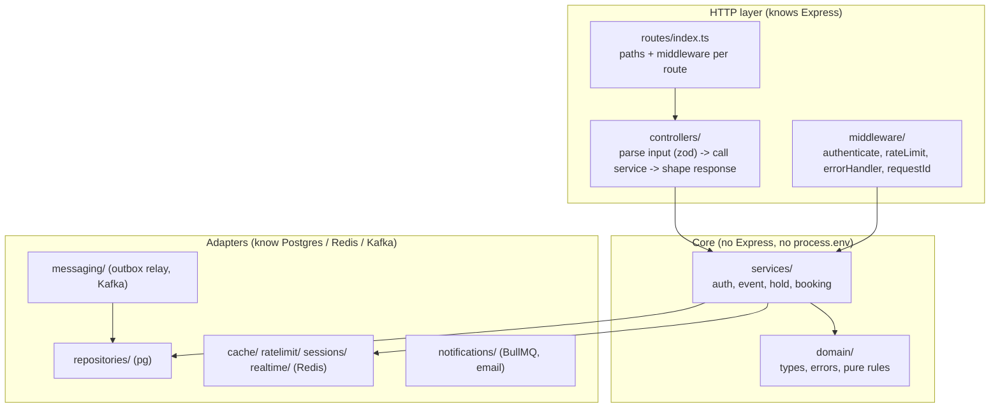

# Architecture reference

How the reference solution is organized, and why. You don't have to copy it: the tests only touch `buildContainer()`, `createApp()` and the members listed in the `Container` interface. But if you're unsure where something goes, this is a layout that stays clean all the way to M8.

## 1. Processes

| Process | Entry point | Does | Scales by |
|---|---|---|---|
| API | `api/src/server.ts` | HTTP: REST + SSE | CPU and open SSE connections (HPA on CPU) |
| Worker | `api/src/worker.ts` | outbox relay loop, hold sweeper loop, Kafka consumer → BullMQ → email worker | outbox lag / queue depth |
| Migrate | `api/src/db/runMigrations.ts` | apply SQL migrations, then exit | runs once per deploy (Kubernetes Job) |

All three share one image and one `buildContainer()`. That's the payoff of a composition root: each process wires the same core with different adapters (the API gets a publisher it never uses, the worker gets the Kafka one, tests get fakes).

## 2. Layers



Rules the solution follows:

- **Dependencies point inward.** Controllers import services; services import domain types and ports; nothing in `services/` imports Express.
- **Services own transactions.** A use case like "book a hold" is one service method that opens one transaction and passes the transaction client to the repositories it needs (`new PgHoldRepository(tx)`). Repositories accept a `Queryable` (pool or transaction client) and never decide transaction boundaries.
- **Domain errors, one mapping.** Services throw `SeatUnavailableError`, `HoldExpiredError`, ...; `middleware/errorHandler.ts` is the only place that knows those become 409.
- **Ports for everything slow or external.** `Clock`, `EventPublisher`, `EmailSender`, `SeatUpdates`, `SessionStore`, `RateLimiter`. Tests swap the first three for fakes; the rest run against real Redis.
- **`config.ts` is the only reader of `process.env`**, and `container.ts` is the only place that picks concrete classes.

## 3. Folder layout (reference solution)

```
api/src/
├── app.ts                    createApp(container): middleware order = request lifecycle
├── server.ts                 API composition root (+ graceful shutdown incl. SSE)
├── worker.ts                 worker composition root (loops + consumer + email worker)
├── container.ts              buildContainer(deps): the wiring diagram in code
├── config.ts                 env -> typed Config
├── domain/
│   ├── types.ts              User, TicketedEvent, Seat, Hold, Booking, SeatUpdate ...
│   ├── errors.ts             DomainError subclasses with machine-readable codes
│   └── rules.ts              seatLabels(), effectiveHoldStatus(), sortSeatLabels()
├── services/                 AuthService, EventService, HoldService, BookingService
├── repositories/             PgUser/Event/Seat/Hold/Booking/Idempotency/OutboxRepository
├── controllers/              thin HTTP adapters + schemas.ts (zod) + seatStreamController (SSE)
├── routes/index.ts           every path in one readable file
├── middleware/               authenticate/requireAuth, rateLimit, requestId, errorHandler
├── cache/jsonCache.ts        cache-aside + jitter + request coalescing, fail-open
├── ratelimit/                FixedWindowLimiter (Redis MULTI, clock-based windows)
├── sessions/                 RedisSessionStore (hashed opaque tokens)
├── realtime/seatUpdates.ts   Redis pub/sub fan-out, one subscriber connection per process
├── messaging/                eventPublisher.ts (port), outboxRelay.ts, kafkaEventPublisher.ts, kafkaEventConsumer.ts
├── notifications/            emailSender.ts (port), notificationService.ts (BullMQ), templates.ts
├── observability/metrics.ts  prom-client Registry per container + HTTP histogram
└── lib/                      clock, password (scrypt), validate (zod -> ValidationError), logger (pino)
```

## 4. The request path, layer by layer

`POST /bookings` in the reference solution:

1. `requestId` → `metrics` → `express.json()` → `authenticate` (bearer token → Redis session → user → `res.locals.actor`).
2. Route: `requireAuth`, then `bookingController.create`.
3. Controller: reads `Idempotency-Key` (400 if missing), validates `{ holdId }` with zod, calls `bookingService.book(actor, holdId, key)`, sets `Idempotent-Replayed` if needed, sends 201.
4. Service, in **one** transaction: claim key → lock hold → load event price → insert booking → convert seats → hold `converted` → append outbox event → store response. After commit: publish `{seats: booked}` to `SeatUpdates` (best effort).
5. Any `DomainError` bubbles to `errorHandler` → status + `{ error: { code, message } }`.

## 5. Concurrency map

Where each race is resolved:

| Race | Resolved by |
|---|---|
| Two holds on the same seat | `SELECT ... FOR UPDATE` on seat rows (label order), re-check after the wait |
| Overlapping multi-seat holds | Same, the fixed lock order prevents deadlocks |
| Two bookings of one hold | `SELECT ... FOR UPDATE` on the hold row; `bookings.hold_id UNIQUE` as a backstop |
| Retries with the same key | `INSERT ... ON CONFLICT DO NOTHING` on `idempotency_keys` inside the booking transaction |
| Booking vs sweeper on a just-expired hold | Sweeper uses `FOR UPDATE SKIP LOCKED` on holds; booking re-checks expiry under its lock |
| Two relays on the outbox | `FOR UPDATE SKIP LOCKED` on outbox rows |
| Two sign-ups with one email | `UNIQUE (email)` + `ON CONFLICT DO NOTHING` |
| Duplicate event delivery to notifications | BullMQ job id = event id |

## 6. Redis key map

Everything starts with `wl:36:` (`REDIS_KEY_PREFIX`), so one `SCAN MATCH wl:36:*` finds it all.

| Key / channel | Type | TTL | Owner |
|---|---|---|---|
| `wl:36:session:<sha256(token)>` | string (user id) | `SESSION_TTL_SECONDS` | sessions |
| `wl:36:cache:v1:event:<id>` | JSON string | `CACHE_TTL_SECONDS` ± 10% | cache |
| `wl:36:cache:v1:events:upcoming` | JSON string | `CACHE_TTL_SECONDS` ± 10% | cache |
| `wl:36:rl:<name>:<id>:<windowStart>` | counter | 2 × window | rate limiter |
| `wl:36:seats:<eventId>` | pub/sub channel | none | realtime |
| `wl:36:bull:notifications:*` | BullMQ structures | per job options | notifications |

The `v1` in cache keys is a cheap schema version: if the cached JSON shape changes, bump it and old entries are simply never read again.

## 7. Testing strategy

- **Acceptance tests** (given) drive the real app through HTTP with supertest, against real Postgres and Redis, with three fakes: `FakeClock`, `InMemoryEventPublisher`, `FakeEmailSender`.
- **Each test resets state**: drop and recreate the schema, run migrations, delete `wl:36:*` keys, reset the clock to 2030-01-01T10:00Z.
- **Concurrency tests** fire 20–50 requests with `Promise.all` and assert invariants (exactly one booking), not timings.
- **Kafka** is only exercised for real in `api/test/integration/` (solution), skipped unless `KAFKA_BROKERS` is set.
- Add your own **unit tests** for pure rules (`domain/rules.ts`) and for tricky services with fake repositories. They're fast and make refactoring safe.
