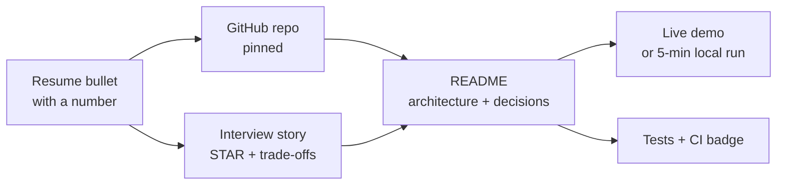
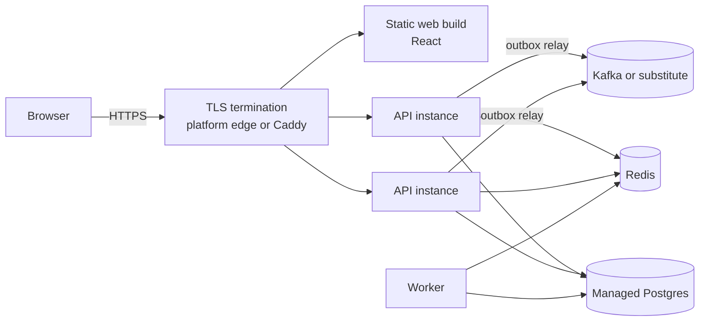
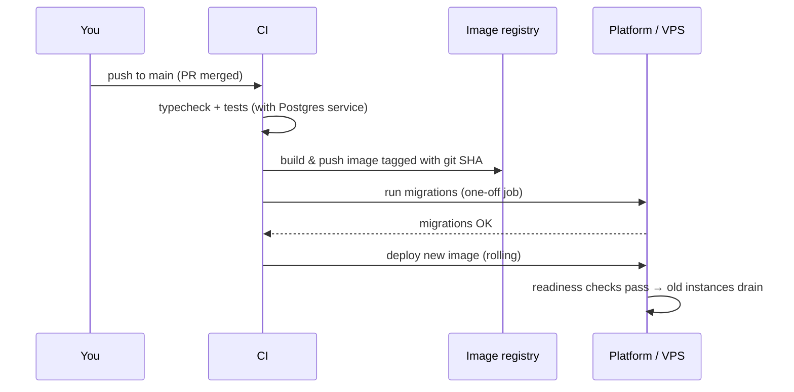

# 37 · Portfolio & Job Readiness

> You've built 30+ projects. Nobody hiring you will see any of them unless you package them: a live demo, a README that explains your thinking, resume bullets with real numbers, and stories you can tell under pressure. This module turns the work into evidence.

**Time:** ~4h · **Challenge:** 📝 Docs · **Prereqs:** [36 · Capstone: Event Ticketing](../36-capstone-ticketing/README.md) · **Services:** none

## What you'll learn

- What hiring teams actually look for in a junior backend/infra portfolio, and how to give it to them quickly
- How to choose a way to deploy the capstone publicly (PaaS, small VPS with Docker + a reverse proxy, or Kubernetes) and what each costs you in effort and risk
- How to handle managed data stores, secrets, domains, TLS, migrations and cost control for a public demo
- How to write a project README that a reviewer understands in one minute and respects after five
- How to turn modules into impact-focused resume bullets without inventing numbers
- How to set up your GitHub profile so it supports, not undermines, your resume
- How to tell project stories in interviews with STAR, and how to talk about trade-offs
- What to study next

---

## 1. What "job-ready" evidence looks like

Put yourself in the reviewer's chair. They have dozens of applications, a few minutes for each, and one question: *"If we hire this person, will they be productive on a backend team and grow quickly?"* They can't watch you work, so they look for **proxies**:

| Signal they look for | Weak evidence | Strong evidence |
|---|---|---|
| Can build real things | a list of technologies | a deployed project with a clear README and tests |
| Understands *why* | "used Redis" | "cached product reads with cache-aside and coalescing; 100 concurrent misses → 1 DB query" |
| Handles hard problems | tutorials | race conditions fixed, incident write-up, load test results |
| Writes code others can work with | one giant commit | small commits, PRs, layered architecture, CI |
| Communicates clearly | buzzword soup | a design doc with trade-offs; crisp interview stories |

Notice that everything in the right-hand column is something you already did in this course. You just need to make it **visible** and **easy to verify**.

Each piece points at the next. A bullet makes them click the repo; the README makes them believe the bullet; the demo and tests prove it; the interview lets you go deeper than any document can. A gap anywhere breaks the chain: a bullet claiming "high-performance" with no numbers, or a repo with no README, ends the conversation early.

> 💡 **Depth beats breadth.** One excellent, deployed, well-documented capstone plus a handful of solid smaller projects beats twenty half-finished repos. Pin the best six and let the rest be.

## 2. Deploying the capstone publicly

A live URL is the strongest single signal you can add, because it proves the whole system works outside your laptop: config, migrations, networking, TLS, the lot. It also gives you things to talk about ("the first deploy failed because the worker started before migrations ran...").

### 2.1 The three broad options

| Option | What it is | You manage | Good for | Watch out for |
|---|---|---|---|---|
| **PaaS** (Platform as a Service; Fly.io, Railway and Render are popular examples) | You push code or an image; the platform builds, runs, routes and gives you TLS | your app and its config | fastest path to a URL; less ops to learn | platform-specific config; pricing and free offerings change often; less control |
| **Small VPS + Docker Compose + reverse proxy** (e.g. Caddy) | One rented Linux server running your existing compose stack | everything: OS updates, firewall, backups, TLS (automated by the proxy) | reusing what you built in modules 00 and 26; learning real ops | you are the on-call; a single machine is a single point of failure |
| **Managed Kubernetes** | A cloud cluster running the manifests/Helm chart from modules 34–35 | cluster resources, manifests, ingress | showing k8s skills | usually overkill and the most expensive option for a demo |

There's no universally right answer. A sensible default for this capstone:

- Want the URL quickly and to focus on code? **PaaS.**
- Want to show ops skills and reuse your compose file? **VPS + Compose + Caddy.**
- Already deep into k8s and want to show it? Run it on a **local kind cluster**, record a short demo video, and keep the manifests in the repo. You get the credit without the bill.

> ⚠️ This lesson deliberately doesn't quote prices or free-tier limits. They change frequently. Before you commit, read the platform's current pricing page and docs (links in [Further reading](#further-reading)) and write down the date you checked.

### 2.2 What a deployed capstone looks like

The pieces map directly onto what you built:

- **API instances** are stateless (sessions in Redis, data in Postgres), which is exactly why you can run two. Module [29](../29-reliability-scaling/README.md) is why that matters.
- **Worker** is a separate process from the same image with a different start command (module [20](../20-background-jobs/README.md)).
- **TLS** is terminated at the edge: the platform does it for you, or Caddy obtains and renews certificates automatically.

### 2.3 Data stores: managed vs self-run

- **Postgres** holds the data you can't lose. Prefer a managed offering (your platform's, or a dedicated database provider): backups, point-in-time recovery and upgrades become someone else's job. If you self-run on a VPS, schedule `pg_dump` to off-server storage and **test a restore once**. A backup you've never restored is a hope, not a backup.
- **Redis** holds cache, sessions, rate-limit counters and queues. Losing the cache is fine; losing queued jobs or sessions is annoying. A small managed Redis or a container with AOF persistence is enough for a demo.
- **Kafka** is the heaviest piece to host. Three honest options: use a managed Kafka service; run a single-node KRaft broker on your VPS (fine for a demo, document that it isn't highly available); or, because your capstone publishes through an `EventPublisher` interface, run the demo with a lighter adapter (for example the outbox relay writing to a Redis stream) and **say so in the README**. That last option is a great interview talking point: it's separation of concerns paying off in real life.

### 2.4 Secrets and configuration

Your `config.ts` already reads everything from environment variables and fails fast (module [07](../07-validation-errors-config/README.md)). Deployment is where that discipline pays off:

- Secrets (`DATABASE_URL`, session secret, API keys) live in the platform's secret store, or in a root-only `.env` file on the VPS that is **not** in git.
- CI gets only the credentials it needs to deploy, stored as encrypted CI secrets.
- Generate fresh secrets for production. Never reuse the values from `.env.example` or your laptop.
- Know how to rotate: change the secret, redeploy, verify, revoke the old one. Writing this down is part of the challenge.

### 2.5 Domain and TLS

A platform subdomain is perfectly fine. A custom domain looks a little more polished and teaches you DNS: an `A`/`AAAA` record pointing at your server, or a `CNAME` to the platform's hostname. TLS certificates come from an ACME certificate authority such as Let's Encrypt, issued and renewed automatically by your platform or by Caddy. If you're ever renewing certificates by hand, something's misconfigured.

### 2.6 The deploy pipeline and migrations

Key ideas from module [26](../26-docker-ci-deploy/README.md):

- **Tag images with the git SHA**, not `latest`, so "what's running?" has an exact answer and rollback is "deploy the previous SHA".
- **Run migrations as a separate step before the new code starts**, and keep them backward compatible (expand/contract) so the old version still works while instances roll over.
- **Readiness checks** gate traffic; **graceful shutdown** drains in-flight requests. You built both.

### 2.7 Running a public demo responsibly

A public URL attracts bots within hours. Protect your wallet and your reputation:

- **Budget alerts or hard spending caps** wherever the provider offers them. Prefer options that scale to zero or have fixed monthly costs.
- **Rate limiting** on auth and write endpoints (module [19](../19-rate-limiting/README.md)) and request body limits.
- **No real personal data.** Seed demo events and offer a demo account; consider a nightly reset job.
- **Minimal observability**: structured logs you can search, a `/healthz` uptime check that emails you, and the metrics endpoint from module [24](../24-observability/README.md) if your platform can scrape it.
- **Plan to turn it off.** It's fine to take the demo down after your job search, as long as the README keeps screenshots or a short video.

More detail and a comparison table: [docs/deployment-options.md](docs/deployment-options.md).

## 3. Writing a project README that sells the work

The README is the landing page for your engineering judgment. Most reviewers read the first screen, glance at the diagram, and jump to whatever looks interesting. Design for that.

**Order matters.** Put what's most convincing first:

1. **Title + one-line tagline**: "Event ticketing API with concurrency-safe seat holds, Kafka events and a realtime seat map."
2. **Overview**: the problem, who it's for, what's technically interesting. Three to five sentences.
3. **Demo**: live link, a GIF or screenshot, demo credentials.
4. **Features**: user-visible capabilities, each with a hint of the *how*.
5. **Architecture**: a Mermaid diagram plus a walkthrough of one important request end to end.
6. **Tech stack**: grouped by layer, each with what it's *for*.
7. **Getting started**: exact commands from clone to green tests.
8. **Design decisions**: the choice, the alternatives, why, the cost you accepted.
9. **Testing**: what the tests prove, not just that they exist.
10. **What I'd do next**: honest limitations.

**Design decisions are the section that gets you interviews.** Anyone can list technologies. Few juniors write:

> **Seat holds use a conditional `UPDATE ... WHERE status = 'available'` instead of `SELECT ... FOR UPDATE`.** Both prevent double booking. The conditional update is one round trip and holds the row lock for microseconds, which matters when hundreds of users hit the same popular seats. The cost: the "why did it fail?" message needs a second query. Proven by a test firing 50 concurrent holds at one seat: exactly one succeeds.

That paragraph shows you understand the problem, know alternatives, measured it and accept trade-offs. Your capstone `DESIGN.md` (module 36) and your `DECISIONS.md` files from modules 22, 23 and 27 are full of these. Reuse them.

**Make it runnable in five minutes.** `git clone`, `make install`, `make up`, `make test`. If a reviewer tries and it fails, that's worse than no instructions.

**Screenshots and diagrams beat paragraphs.** A seat-map GIF and an architecture diagram communicate more in two seconds than any prose.

Template and checklist: [docs/project-readme.md](docs/project-readme.md).

## 4. Turning modules into resume bullets

A resume bullet is a compressed story: **what you did, how, and what it achieved**. A useful shape:

> **Action verb** + **what you built or changed** + **how (key technique/tech)** + **measurable result**

| ❌ Weak | ✅ Strong |
|---|---|
| Worked on a ticketing app using Node and Postgres. | Built an event ticketing API in TypeScript/Express with Postgres row-level concurrency control; 50 concurrent booking attempts on one seat yield exactly one sale. |
| Responsible for caching. | Added a Redis cache-aside layer with request coalescing and TTL jitter, collapsing 100 concurrent cache misses into a single database query. |
| Used Kafka. | Implemented a transactional outbox and idempotent Kafka consumers so order events survive broker outages without duplicates or losses. |

### Where honest numbers come from

You have more real numbers than you think. Every one of these is something you can **verify and explain**:

- **Test-proven invariants**: "50 concurrent requests, zero oversells" (modules 15, 16, 36).
- **Query counts**: "reduced queries per feed request from 41 to 2" (module 14 counts them for you).
- **EXPLAIN results**: "replaced a sequential scan over 100k rows with an index scan".
- **Load tests**: run the k6 script from module 29 against your app and record p95 latency and requests/s. Note the machine you ran it on.
- **Scope**: number of endpoints, tests, services, modules, migrations.

> ⚠️ **Never invent a number.** "Improved performance by 300%" with nothing behind it is the fastest way to lose an interviewer's trust. They *will* ask "how did you measure that?" A smaller true number you can explain in detail is far stronger.

### Framing course projects

Be upfront that these are personal/learning projects; put them under **Projects**, not **Experience**. What makes them credible is specificity: a reviewer can tell the difference between "followed a tutorial" and "fixed a deadlock by ordering lock acquisition by account id".

Pick the 3–4 strongest bullets for the capstone and 1–2 each for a few other projects. One page total for a student. More guidance and a verb list: [docs/resume-bullets.md](docs/resume-bullets.md).

## 5. Your GitHub profile

Reviewers who click through land on your profile. A five-minute tidy-up pays off:

- **Pin your best six repos**: the capstone first, then projects that show range (e.g. URL shortener, rate limiter, a Kafka/outbox project, the system design write-ups).
- **A profile README** (a repo named after your username) with two or three lines: who you are, what you're focused on, links.
- **Every pinned repo has a description, a README and topics.** No "my-project-final-v2".
- **Clean history**: meaningful commit messages, PRs with descriptions. The branch-per-module workflow you've used all course is exactly what real teams do. Your PR history is evidence.
- **No secrets, no `node_modules`, no `.env`** committed anywhere. Reviewers notice, and automated scanners definitely do.
- **CI badges** on the capstone show the tests run on every push.

If this WinterLearning repo is public, it's a great artifact on its own: it shows sustained, structured work over weeks. Consider extracting the capstone into its own repo so it can stand alone with its own README.

## 6. Talking about projects in interviews

Interviewers ask about projects to check three things: did you really build it, do you understand it beyond the surface, and can you communicate clearly?

### STAR

**S**ituation, **T**ask, **A**ction, **R**esult. Spend roughly 15% on situation and task, 60% on action, 25% on result and reflection. Say **"I"**, not "we", for what you did.

> **S:** In my ticketing capstone, I load-tested seat booking with 50 concurrent requests for the same seat. **T:** Exactly one should succeed; three succeeded. **A:** I reproduced it with a test, saw the read-then-write race in the logs, and compared fixes: `SELECT ... FOR UPDATE`, serializable isolation with retries, and a conditional update. I chose the conditional update because it's one statement with the shortest lock... **R:** The test now passes reliably; I added a unique constraint as a second safety net. **Reflection:** I now look for read-then-write patterns in code review.

### Going deeper: the "why" ladder

Good interviewers keep asking "why?" until you hit the edge of your knowledge. Prepare for three levels on your main decisions:

1. *What* did you do? "Cached product reads in Redis."
2. *Why that way?* "Cache-aside, because reads dominate and stale-for-60-seconds is acceptable for product details."
3. *What breaks it?* "A race between update and invalidation can re-cache stale data; I delete after commit and keep TTLs short so the window is bounded."

When you reach the edge, say so and reason out loud: "I haven't measured that, but I'd expect... and I'd verify by...". That's a strong answer, not a weak one.

### Talking about trade-offs

Every decision has a cost. Naming it shows seniority:

- "I chose sessions over JWTs because I needed instant revocation; the cost is a Redis lookup per request."
- "Kafka is overkill at demo scale. I used it to learn the patterns, and the `EventPublisher` interface means a smaller deployment can swap it out."

### Common project questions to prepare

- Walk me through the architecture.
- What was the hardest bug? How did you find it?
- How would this handle 100x traffic? What breaks first?
- What would you change if you started over?
- How do you know it works? (tests, load tests, monitoring)

You'll write three STAR stories and a 60-second pitch in the challenge. Practice them **out loud**, ideally recorded: written stories always sound different spoken. More in [docs/interview-stories.md](docs/interview-stories.md).

## 7. What to study next

You have the core. Directions that build naturally on it:

- **Data structures & algorithms practice**: many companies still run coding rounds. A steady routine of problems alongside applications helps.
- **System design depth**: revisit module [30](../30-system-design/README.md); practice designs aloud with a timer.
- **A cloud provider's fundamentals**: networking (VPCs, subnets, security groups), IAM, managed databases, object storage.
- **Infrastructure as code**: Terraform or a similar tool, so environments are reproducible.
- **Deeper Postgres**: replication, partitioning, vacuum, connection poolers.
- **Observability in practice**: OpenTelemetry end to end, dashboards, alerting on SLOs.
- **Another backend language**: Go, Java/Kotlin or Python broaden the roles you can apply for; the concepts transfer directly.
- **Contribute to open source**: even small doc or test PRs show you can work in someone else's codebase.

Pick one or two. Depth again beats breadth.

---

## Common mistakes

- **Unverifiable numbers.** "Increased efficiency by 70%." Measured how? Use numbers you can defend.
- **Technology lists instead of outcomes.** "Node, Express, Postgres, Redis, Kafka, Docker, K8s" says nothing about what you can do.
- **A README that's just the default template** or setup steps only, with no "why".
- **Instructions that don't work.** Test your Getting Started on a clean clone.
- **Leaving a public demo unprotected**: no rate limits, no budget alert, real-looking personal data, or a default password on the admin account.
- **Secrets in git history**, including old commits. Rotate first, then clean up.
- **"We" in interview stories**, so the interviewer can't tell what you did.
- **Memorized stories delivered robotically.** Know the beats, not the script.
- **Hiding limitations.** Interviewers trust candidates who name the weaknesses in their own work.

## In production

- **Hiring screens are fast and layered.** Often a recruiter or automated system filters resumes first, then an engineer skims your projects, then interviews go deep. Your resume must survive a quick keyword read *and* a skeptical engineer's read. Clear section headings and specific technical nouns help both.
- **Engineers read code.** For junior roles, someone may open your repo before or after an interview. Folder structure, tests and commit history are read as a preview of how you'd work on their team.
- **Real teams deploy the way you just planned to**: immutable images tagged by SHA, migrations as a separate step, readiness checks, rollbacks. Being able to say "I did this for my own project and here's what went wrong the first time" is valuable in interviews for any backend or platform role.
- **Cost awareness is a real skill.** Engineers who think about what infrastructure costs (and how to switch things off) are appreciated everywhere.

## Check yourself

1. Why is a design-decisions section more valuable than a tech-stack list?
   

Answer
It shows judgment: that you understood the problem, knew alternatives, chose deliberately and accepted a cost. A stack list only shows what you installed.

2. Your resume says "reduced latency by 40%". What must be true before you keep that bullet?
   

Answer
You actually measured it, can say how (tool, scenario, before/after, percentile) and can explain what change caused it. Otherwise replace it with a number you can defend.

3. Why run migrations as a separate step before rolling out new code, and why must they be backward compatible?
   

Answer
During a rolling deploy old and new versions run at the same time. Migrating first means new code finds the schema it needs; backward compatibility (expand/contract) means the old code still works until it's drained.

4. Kafka is expensive to host for a demo. Name a responsible way to deploy without it.
   

Answer
Swap the adapter behind the <code>EventPublisher</code> interface (e.g. outbox relay to a Redis stream) for the demo deployment and document the change in the README, keeping the Kafka integration tested locally.

5. In a STAR story, where should most of your time go, and why?
   

Answer
The Action (around 60%): that's where your decisions, technical depth and reasoning show, and where interviewers find things to dig into.

## Further reading

Platforms change, so these point at official documentation home pages. Check current docs and pricing yourself.

- Docker docs: https://docs.docker.com/
- Caddy docs: https://caddyserver.com/docs/
- Let's Encrypt docs: https://letsencrypt.org/docs/
- Fly.io docs: https://fly.io/docs/
- Railway docs: https://docs.railway.com/
- Render docs: https://render.com/docs
- Kubernetes docs: https://kubernetes.io/docs/home/
- GitHub docs (profiles, Actions, pinned repos): https://docs.github.com/
- Mermaid docs: https://mermaid.js.org/
- Deep dives in this module: [docs/deployment-options.md](docs/deployment-options.md) · [docs/project-readme.md](docs/project-readme.md) · [docs/resume-bullets.md](docs/resume-bullets.md) · [docs/interview-stories.md](docs/interview-stories.md)
- Course references: [glossary](../docs/glossary.md) · [docker cheat sheet](../docs/cheatsheets/docker.md) · [git cheat sheet](../docs/cheatsheets/git.md)

## ➡️ Next: [the challenge](CHALLENGE.md)
