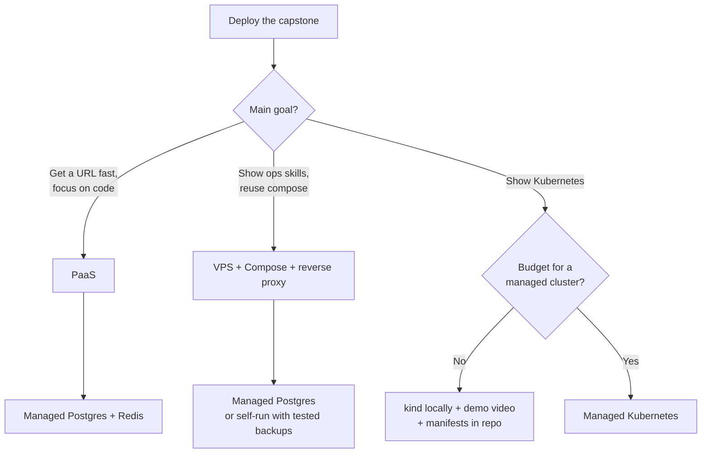

# Deployment options for a portfolio demo

> A decision guide, not a vendor comparison. Platforms, prices and free offerings change often: always confirm on the official docs and pricing pages, and note the date you checked in your `DEPLOY_PLAN.md`.

## The decision in one diagram

## Comparison

| | PaaS | VPS + Compose + Caddy | Managed Kubernetes | kind + video |
|---|---|---|---|---|
| Time to first URL | shortest | medium | longest | n/a (no public URL) |
| Ops you learn | little | a lot (Linux, firewall, backups, TLS) | k8s in the cloud | k8s locally |
| Reuses from this course | Dockerfile (26) | Dockerfile + compose (00, 26) | manifests + Helm (34, 35) | manifests + Helm |
| Who patches the OS | platform | you | provider (nodes may be yours) | nobody |
| Cost predictability | depends on plan and usage | usually a fixed monthly server fee | lowest predictability for small users | none |
| Single point of failure | platform handles it | yes, one machine | no | n/a |
| Risk of surprise bills | medium: set alerts/caps | low | higher | none |

## Checklist per option

### PaaS
- [ ] App deploys from your Dockerfile (portable) rather than a platform-only build config where possible
- [ ] Separate process/service for the worker (same image, different command)
- [ ] Managed Postgres and Redis attached; connection strings injected as secrets
- [ ] Release/pre-deploy command runs migrations, if the platform supports one; otherwise a CI step
- [ ] Health check path configured (`/readyz`)
- [ ] Budget alert or spending limit set
- [ ] Understand whether the app sleeps when idle (first request may be slow; mention it in the README)

### VPS + Docker Compose + Caddy
- [ ] SSH key login only, password login disabled, non-root user with sudo
- [ ] Firewall allows only 22, 80, 443
- [ ] Automatic security updates enabled
- [ ] Compose file with `restart: unless-stopped`, healthchecks, and **no** host ports for Postgres/Redis (only the proxy is public)
- [ ] Caddy in front with your domain; certificates issued and renewed automatically
- [ ] `.env` with production secrets readable only by the deploy user, not in git
- [ ] Nightly `pg_dump` copied off the server; one restore tested
- [ ] Deploy script: pull image by SHA → run migrate service → `docker compose up -d`

A minimal Caddyfile is about three lines: your domain, then `reverse_proxy api:3000`. Check the Caddy docs for current syntax.

### Kubernetes (managed or kind)
- [ ] Image pushed to a registry the cluster can pull from (or `kind load` locally)
- [ ] Secrets created from the command line or a secret manager, never committed
- [ ] Ingress + TLS (managed) or `port-forward` (kind)
- [ ] Migration Job runs before the Deployment rolls
- [ ] HPA and PDB from module 35 applied
- [ ] For kind: a 2–3 minute screen recording linked from the README

## Data stores at demo scale

| Store | Recommended for a demo | Notes |
|---|---|---|
| Postgres | managed | backups and upgrades handled; check backup retention on your plan |
| Redis | managed or a container with AOF | losing the cache is fine; losing queued jobs is not ideal |
| Kafka | managed, single-node KRaft on a VPS, or a substitute adapter | document the choice; single node means no HA |

## Things that bite on first deploy

- The app listens on `localhost` inside a container. Bind to `0.0.0.0`.
- The platform injects `PORT`; your `config.ts` must read it.
- Migrations didn't run, or ran after the new code started.
- The worker isn't running at all because only the web process was deployed.
- CORS: the frontend's production origin isn't in the allowed list.
- Cookies: `Secure` cookies need HTTPS; `SameSite` settings differ when frontend and API are on different domains.
- Timezones: servers run in UTC. Your `timestamptz` columns were the right call.
