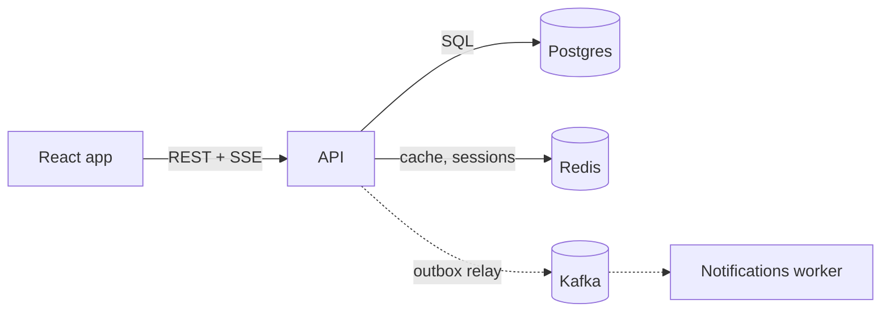

# Writing the project README

> The README is a product page for your engineering judgment. This guide expands section 3 of the lesson with a checklist, examples and anti-patterns.

## The one-minute test

Ask a friend (ideally an engineer) to read your README for **one minute**, then answer:

1. What does this project do?
2. What's technically interesting about it?
3. How would I run it?

If they can't answer all three, restructure. The first screen (title, tagline, overview, demo image) must carry questions 1 and 2.

## Section by section

| Section | Goal | Good sign | Bad sign |
|---|---|---|---|
| Title + tagline | say what it is in one line | "Event ticketing platform with concurrency-safe seat holds" | a pun name and nothing else |
| Overview | problem, audience, interesting parts | mentions the hard problems you solved | marketing adjectives ("blazing fast", "scalable") |
| Demo | prove it works | GIF of the seat map updating live; demo login | "coming soon" |
| Features | user-visible capabilities | each with a hint of how | a list of libraries |
| Architecture | the big picture | Mermaid diagram + one request walked through | a diagram with 20 boxes and no explanation |
| Tech stack | what's used for what | "Redis: cache, sessions, rate limiting" | badges only |
| Getting started | run it in five minutes | copy-paste commands, ports listed | "install the dependencies and run it" |
| Design decisions | show judgment | choice, alternatives, why, cost | none |
| Testing | prove correctness | "50 concurrent holds → exactly 1 succeeds" | "has tests" |
| What I'd do next | honesty and direction | specific limitations | "make it better" |

## Writing a design decision

Use this shape. Four to six sentences each.

```markdown
### Outbox table instead of publishing to Kafka inside the request
**Decision:** Orders and their events are written in one Postgres transaction; a relay publishes outbox rows to Kafka.
**Alternatives:** publish after commit (lost events if the publish fails), publish before commit (phantom events if the commit fails), CDC with Debezium (more infrastructure).
**Why:** guarantees every committed order produces an event, with no extra infrastructure beyond Postgres.
**Cost:** events are delayed by the relay's poll interval, and consumers must be idempotent because the relay can publish twice.
```

Good candidates from the course: sessions vs JWT (22), versioning strategy (23), cache-aside + coalescing (18), conditional update vs `FOR UPDATE` (15), 301 vs 302 (31), outbox (33), rate-limit algorithm (19), StatefulSet vs managed DB (35).

## Architecture diagrams that work

- 5–10 boxes. Group related things. Label arrows with *what* flows ("order events", "HTTPS").
- Show sync vs async differently (solid vs dotted arrows).
- Walk through **one** important flow in prose under the diagram: "A user holds a seat: ...".
- Mermaid renders natively on GitHub, so the diagram lives in the README as text and stays editable.



## Screenshots and GIFs

- Store images in the repo (`docs/images/`) so they don't disappear.
- Keep GIFs short (under ~10 seconds) and focused on one interaction.
- Crop out browser chrome and personal bookmarks.
- Add alt text.

## Anti-patterns

- **The wall of badges.** A few (CI, license) are fine; twenty is noise.
- **The setup novel.** If setup needs 30 steps, fix the setup (Makefile, compose), not the README.
- **Stale instructions.** Re-run Getting Started on a fresh clone before you apply anywhere.
- **Hiding that it's a learning project.** Say it was built as a capstone. Honesty reads as confidence.
- **Copy-pasted course text.** Write in your own words about *your* implementation.

## Final checklist

- [ ] Title and tagline say what it is
- [ ] Overview names the hard problems
- [ ] Demo link or GIF works
- [ ] Mermaid diagram renders on GitHub
- [ ] Getting Started works on a clean clone
- [ ] At least three design decisions with costs
- [ ] Testing section says what the tests prove
- [ ] Limitations are honest
- [ ] No secrets, no `.env`, no `node_modules` in the repo
