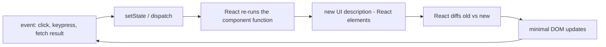
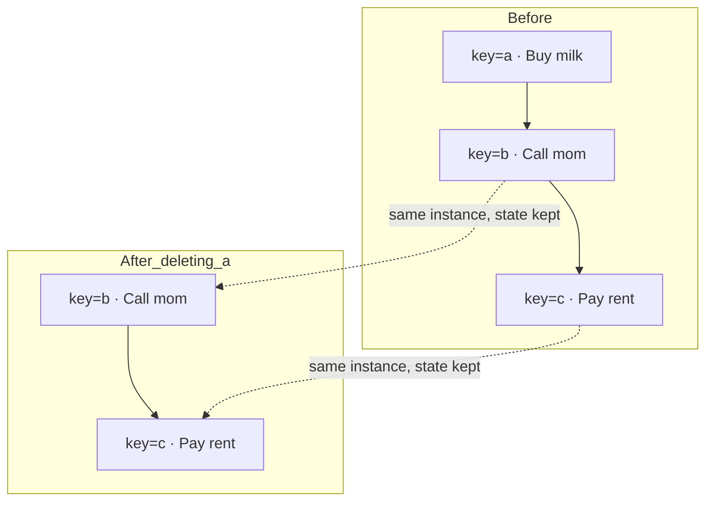
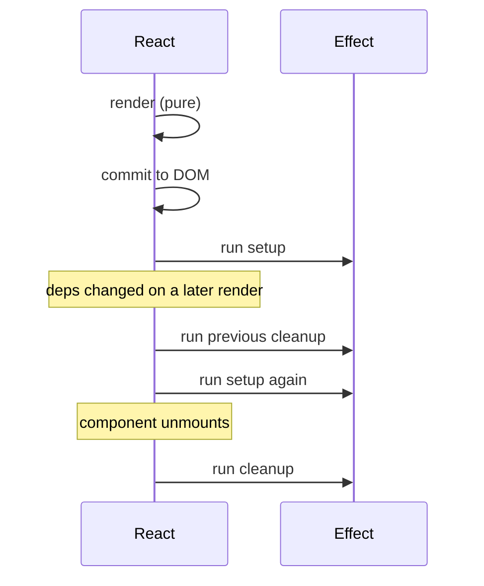
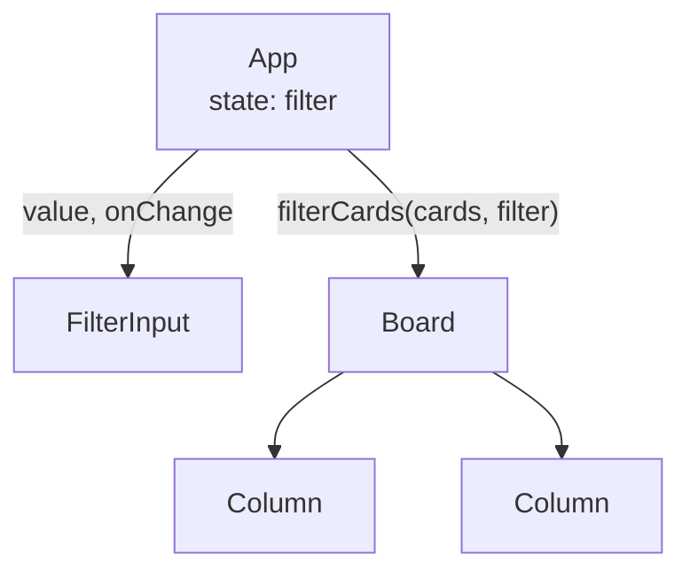
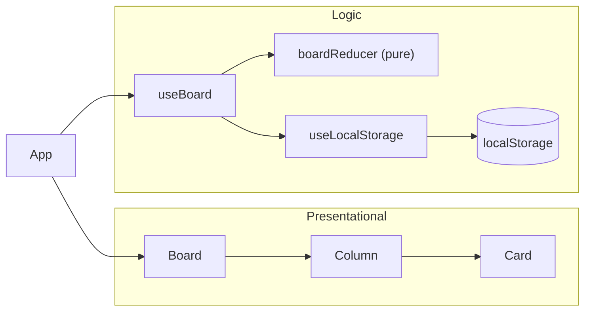

# R1 · React Fundamentals

> Even on a backend team you'll read, review and fix React code: the admin panel, the internal dashboard, the frontend that calls your API. React is "UI as a function of state". Once that idea clicks, the rest is details, and the habits that make backends clean (pure functions, explicit data flow, separation of concerns) are the same habits that make React code clean.

**Time:** ~6h · **Challenge:** 🧩 Scaffold · **Prereqs:** [02 · TypeScript Fundamentals](../02-typescript-fundamentals/README.md) · **Services:** none

## What you'll learn

- What a component is, how JSX compiles, and why React re-renders
- Props vs state, and the rule that state is **immutable** and owned by exactly one component
- Events, conditional rendering, lists and why **keys** matter
- Effects: what they're for (syncing with external systems), cleanup, dependency arrays, and when **not** to use one
- Lifting state up, controlled forms and derived values
- `useReducer` for state with rules, custom hooks for reusable logic, composition with `children`, and context (sparingly)
- What changed in React 19
- "Thinking in React": going from a mockup to a component tree
- Testing components the way users use them, with Testing Library

---

## 1. The mental model: UI = f(state)

On the backend, a request handler takes input and returns a response. A React component is similar: it takes input (**props** and **state**) and returns a description of the UI. React's job is to make the real DOM match that description.



You never write "find the `<li>` and change its text". You change state, and React re-runs your function and works out what changed. That's called **declarative** UI, and it removes a whole class of bugs where the screen and the data disagree.

Three consequences you need to internalize:

1. **A component function runs many times.** Every render calls it again from the top. Local variables are recreated each time. Anything that must survive between renders has to be state (or a ref).
2. **Rendering must be pure.** Given the same props and state, a component must return the same output and must not change anything outside itself during render (no `fetch`, no writing to `localStorage`, no mutating props). In development, `<StrictMode>` renders components twice specifically to flush out impure renders.
3. **State updates are requests, not assignments.** `setCount(5)` schedules a re-render. `count` in the current render stays what it was. That surprises everyone once.

## 2. Components and JSX

A component is a function that returns JSX. Its name must start with a capital letter (that's how JSX tells `<Card>` from `<div>`).

```tsx
interface GreetingProps {
  name: string;
  unread?: number;
}

export function Greeting({ name, unread = 0 }: GreetingProps) {
  return (
    <p className="greeting">
      Hello, {name}! {unread > 0 && <strong>{unread} new</strong>}
    </p>
  );
}
```

JSX is syntax sugar. With the modern "automatic runtime" (`"jsx": "react-jsx"` in `tsconfig.json`), the compiler turns it into function calls:

```ts
// <p className="greeting">Hello, {name}!</p>  becomes roughly:
jsx("p", { className: "greeting", children: ["Hello, ", name, "!"] });
```

So JSX produces plain objects ("React elements") that *describe* UI. Things to know:

- **`{}` embeds any JavaScript expression**: variables, function calls, ternaries. Not statements (`if`, `for`).
- Attributes are camelCased DOM properties: `className` (not `class`), `htmlFor` (not `for`), `onClick`, `aria-*` and `data-*` stay dashed.
- A component returns **one** root. Use a fragment `<>...</>` to group without adding a DOM node.
- `false`, `null`, `undefined` and `true` render nothing. **`0` renders "0"**, which is why `{items.length && <List />}` is a classic bug. Write `{items.length > 0 && <List />}`.
- Text in `{}` is escaped automatically, so React protects you from XSS by default. The escape hatch is called `dangerouslySetInnerHTML` for a reason.

## 3. Props: data flows down

Props are a component's arguments. They flow **one way**, from parent to child, and a child must never modify them.

```tsx
function Board({ cards }: { cards: Card[] }) {
  return <Column title="To do" cards={cards.filter((c) => c.columnId === "todo")} />;
}
```

How does a child affect the parent, then? The parent passes a **callback** down, and the child calls it to report what happened:

```tsx
function Card({ card, onRemove }: { card: Card; onRemove: (id: string) => void }) {
  return <button type="button" onClick={() => onRemove(card.id)}>Delete</button>;
}
```

Data down, events up. That's the whole communication model, and it makes data flow traceable: to find out where a value comes from, follow the props upward. This is the frontend version of dependency injection from [module 06](../06-layered-architecture/README.md): components receive what they need instead of reaching for globals.

### `children` and composition

Anything between a component's tags arrives as the `children` prop:

```tsx
function Panel({ title, children }: { title: string; children?: React.ReactNode }) {
  return (
    <section>
      <h2>{title}</h2>
      {children}
    </section>
  );
}

<Panel title="Done">
  <button type="button">Clear done</button>
</Panel>
```

`Panel` doesn't know or care what's inside it. This is **composition**, and it's React's main reuse tool. Instead of adding a `showClearButton` boolean prop (and then `showAddForm`, and then `addFormPlaceholder`...), the parent slots in whatever it needs. In the challenge, `Column` knows nothing about forms; `Board` passes the `AddCardForm` as a child of the "To do" column.

## 4. State with `useState`

State is data that changes over time and that the component **owns**:

```tsx
import { useState } from "react";

function Counter() {
  const [count, setCount] = useState(0);
  return (
    <button type="button" onClick={() => setCount(count + 1)}>
      Clicked {count} times
    </button>
  );
}
```

`useState(initial)` returns the current value and a setter. React stores the value outside your function, keyed by the component's position in the tree, and hands it back on every render.

### Hooks rules

Functions starting with `use` are **hooks**. React identifies each hook call by its *order* within the component, so:

- Call hooks only at the **top level** of a component or custom hook: never inside `if`, loops, or after an early `return`.
- Call them only from components or other hooks, never from plain functions.

Break that rule and React mixes up which state belongs to which hook. The `eslint-plugin-react-hooks` lint rules catch it.

### State is a snapshot

```tsx
function handleClick() {
  setCount(count + 1);
  setCount(count + 1);
  console.log(count); // still the OLD value
}
// Result: +1, not +2. Both calls computed "old count + 1".
```

Each render has its own `count` constant. To compute from the latest value, pass an **updater function**:

```tsx
setCount((c) => c + 1);
setCount((c) => c + 1); // +2: React applies updaters in order
```

Use the updater form whenever the next state depends on the previous one.

### Never mutate state

```tsx
// ❌ mutates the existing array: same reference, React sees "no change" and skips the render
cards.push(newCard);
setCards(cards);

// ✅ create a new array
setCards([...cards, newCard]);
setCards(cards.filter((c) => c.id !== id));
setCards(cards.map((c) => (c.id === id ? { ...c, title } : c)));
```

React decides whether something changed with `Object.is(old, new)`, a reference comparison. Mutation keeps the reference, so React can't see the change. Immutability also makes reducers testable and makes "undo" trivial. Learn these three patterns (spread to add, `filter` to remove, `map` to update) until they're automatic.

### Lazy initial state

`useState(expensive())` calls `expensive()` on *every* render and throws the result away after the first. Pass a function instead and React calls it once:

```tsx
const [board, setBoard] = useState(() => JSON.parse(localStorage.getItem("board") ?? "null") ?? EMPTY);
```

## 5. Events, conditionals and lists

### Events

```tsx
<button type="button" onClick={() => onMove(card.id, "done")}>Done →</button>
<input value={text} onChange={(e) => setText(e.target.value)} />
<form onSubmit={(e) => { e.preventDefault(); save(); }}>
```

- Pass a **function**, don't call it: `onClick={save}` or `onClick={() => save(id)}`, never `onClick={save()}` (that runs during render).
- A `<button>` inside a `<form>` defaults to `type="submit"`. Give non-submit buttons `type="button"` or they'll submit the form.
- Form submission reloads the page unless you call `e.preventDefault()`.

### Conditional rendering

```tsx
{error && <p role="alert">{error}</p>}
{cards.length === 0 ? <p>No cards</p> : <ul>...</ul>}
if (isLoading) return <Spinner />; // early return is fine (after all hooks!)
```

### Lists and keys

```tsx
<ul>
  {cards.map((card) => (
    <CardView key={card.id} card={card} />
  ))}
</ul>
```

The `key` tells React which item is which **between renders**. When the list changes, React matches old and new children by key: same key means "same component, update it", new key means "create", missing key means "destroy".



If you use the array **index** as key and delete the first item, every remaining item shifts down one index. React then thinks item 0 still exists but its props changed, so component state (a half-typed edit field, an open menu, focus) stays attached to the wrong row. Use a stable, unique id from your data. Index keys are only acceptable for static lists that never reorder.

Keys also have a useful trick: changing a component's `key` forces React to throw it away and mount a fresh one, which resets all its state. `<EditForm key={selectedId} />` gives you a clean form whenever the selection changes.

## 6. Effects: synchronizing with the outside world

Rendering must be pure. But apps need side effects: subscribe to a WebSocket, set a timer, write to `localStorage`, measure the DOM. `useEffect` runs code **after** React has committed the render to the screen:

```tsx
useEffect(() => {
  const id = setInterval(() => setNow(Date.now()), 1000); // setup
  return () => clearInterval(id);                          // cleanup
}, []);                                                      // dependencies
```



### The dependency array

| Dependencies | Setup runs |
|---|---|
| none: `useEffect(fn)` | after **every** render (rarely what you want) |
| `[]` | after the first render only (cleanup on unmount) |
| `[a, b]` | after the first render and whenever `a` or `b` changed (`Object.is`) |

The rule: **every value from the component that the effect reads must be in the array.** Don't lie to React by leaving one out to "make it run once". You'll get stale values, which are bugs that only appear later. If a dependency changes too often, fix that (move the value inside the effect, use an updater function, or memoize it), don't hide it.

### Cleanup is not optional

If an effect subscribes, it must unsubscribe. In development, StrictMode deliberately mounts, unmounts and re-mounts every component once, so a missing cleanup shows up immediately as duplicate listeners or double requests. That's a feature: in production, components mount and unmount constantly (routing, conditional UI), and forgotten listeners are memory leaks.

```tsx
useEffect(() => {
  function onStorage(e: StorageEvent) { /* ... */ }
  window.addEventListener("storage", onStorage);
  return () => window.removeEventListener("storage", onStorage); // same function reference
}, []);
```

### When NOT to use an effect

This is the most important part of this section. Effects are for syncing with systems **outside React**. Most of the effects beginners write are unnecessary and make code slower and buggier.

```tsx
// ❌ derived state via an effect: an extra render, and a frame where the two disagree
const [visible, setVisible] = useState<Card[]>([]);
useEffect(() => {
  setVisible(cards.filter((c) => c.title.includes(query)));
}, [cards, query]);

// ✅ just compute it during render
const visible = cards.filter((c) => c.title.includes(query));
```

| You want to... | Don't | Do |
|---|---|---|
| Compute a value from props/state | effect + setState | compute during render (`useMemo` only if it's measurably expensive) |
| React to a user action (submit, click) | set a flag, then act on it in an effect | do the work in the event handler |
| Reset state when a prop changes | effect that calls setState | give the component a `key` |
| Fetch data | raw `useEffect` + `fetch` in every component | a data library (TanStack Query, [module R2](../R2-react-data/README.md)) |
| Subscribe to a browser API, socket, timer | | ✅ effect with cleanup |
| Sync React state into `localStorage`, a chart library, the document title | | ✅ effect |

A good test: "is this code running *because the component is on screen*, or *because the user did something*?" The first is an effect. The second belongs in an event handler.

## 7. Lifting state up and controlled inputs

When two components need the same state, move it to their **closest common parent** and pass it down. In the challenge, the filter text is used by the search box *and* the board, so it lives in `App`:



`FilterInput` is now **stateless**: it displays `value` and reports changes through `onChange`. That makes it a **controlled input**: React state is the single source of truth for what's in the box.

```tsx
function FilterInput({ value, onChange }: { value: string; onChange: (v: string) => void }) {
  return (
    <label>
      Filter cards
      <input type="search" value={value} onChange={(e) => onChange(e.target.value)} />
    </label>
  );
}
```

Controlled inputs let you validate on every keystroke, transform input, reset the field after submit, and keep form state somewhere testable. The alternative is **uncontrolled** inputs (`defaultValue` + reading the value on submit with `FormData` or a ref), which is less code for simple forms and pairs well with React 19 form actions. Both are valid; just don't mix them on one input (React warns when an input switches from uncontrolled to controlled, usually because `value` started as `undefined`).

### One source of truth

Avoid storing the same information twice. If you keep `cards` and also `cardCount` in state, one day they'll disagree. Derive whatever you can:

```tsx
const visible = filterCards(cards, filter);   // derived
const isFiltering = filter.trim() !== "";     // derived
```

## 8. `useReducer`: state with rules

When state updates follow rules ("moving a card into the column it's already in is a no-op", "titles get trimmed"), scattering `setCards(...)` calls across components spreads those rules everywhere. A **reducer** collects every transition in one pure function:

```tsx
type Action =
  | { type: "card/added"; card: Card }
  | { type: "card/removed"; cardId: string };

function boardReducer(state: BoardState, action: Action): BoardState {
  switch (action.type) {
    case "card/added":
      return { ...state, cards: [...state.cards, action.card] };
    case "card/removed":
      return { ...state, cards: state.cards.filter((c) => c.id !== action.cardId) };
    default: {
      const unhandled: never = action; // compile error if you forget a case
      return unhandled;
    }
  }
}

const [board, dispatch] = useReducer(boardReducer, EMPTY_BOARD);
dispatch({ type: "card/removed", cardId: "42" });
```

Why backend engineers tend to love reducers:

- **It's a pure function.** You can unit-test every rule with plain `expect(reducer(state, action))`, no rendering. That's what `test/boardReducer.test.ts` does.
- **Actions describe *what happened*, the reducer decides *how state changes*.** It's the same separation as a route handler that calls a service. It's also the same idea as event sourcing: state = fold(events).
- **The discriminated union** (`type` field) plus the `never` check means TypeScript tells you about unhandled actions, exactly like the exhaustiveness checks from [module 02](../02-typescript-fundamentals/README.md).

Two rules make reducers work:

1. **No side effects inside.** No `fetch`, no `Date.now()`, no `crypto.randomUUID()`. Generate the id *before* dispatching and put it in the action. In development React may call your reducer twice; side effects would happen twice.
2. **Return the same object when nothing changed.** If you always return `{ ...state }`, React re-renders even for no-ops. Returning `state` itself lets React bail out.

Rule of thumb: `useState` for independent values; `useReducer` when several values change together or updates have rules worth testing.

## 9. Custom hooks: reusable stateful logic

A custom hook is a function whose name starts with `use` and which calls other hooks. It lets you extract stateful logic the way you'd extract a helper function:

```tsx
function useOnlineStatus(): boolean {
  const [online, setOnline] = useState(() => navigator.onLine);
  useEffect(() => {
    const update = () => setOnline(navigator.onLine);
    window.addEventListener("online", update);
    window.addEventListener("offline", update);
    return () => {
      window.removeEventListener("online", update);
      window.removeEventListener("offline", update);
    };
  }, []);
  return online;
}
```

Important: hooks share **logic**, not **state**. Two components calling `useOnlineStatus()` each get their own `useState`. (To share state, lift it up or use context.)

Custom hooks are also how you keep components thin. In the challenge, `useBoard()` hides the reducer and persistence behind a small API (`addCard`, `moveCard`...). Components call `addCard("Ship it")` and never know about actions or storage. It's a service layer for the UI.



## 10. Context, sparingly

Passing a prop through five layers that don't use it ("prop drilling") gets tedious. Context lets a parent make a value available to any descendant:

```tsx
const ThemeContext = createContext<"light" | "dark">("light");

function App() {
  return (
    <ThemeContext value="dark">   {/* React 19; older code writes <ThemeContext.Provider value="dark"> */}
      <Page />
    </ThemeContext>
  );
}

function Button() {
  const theme = useContext(ThemeContext);
  return <button className={theme}>...</button>;
}
```

Good uses: things that are truly global to a subtree and change rarely, like the theme, the current user, locale, or a dependency such as an API client. Why sparingly:

- **Every consumer re-renders when the value changes.** Putting fast-changing state (form input, the whole board) in context can re-render most of the app on every keystroke.
- **It hides data flow.** Props are explicit; context is an implicit dependency, like a global.
- Often **composition** solves drilling better: pass the rendered element (`children`) instead of the data it needs.

Context is not a state manager by itself. It's a transport. You still hold the state with `useState`/`useReducer` somewhere.

## 11. What changed in React 19

You'll meet both older and newer code at work, so recognize both:

| React 19 | Before |
|---|---|
| `ref` is a normal prop on function components | `forwardRef((props, ref) => ...)` wrapper |
| `<MyContext value={...}>` | `<MyContext.Provider value={...}>` |
| Ref callbacks can return a cleanup function | callback called again with `null` |
| **Actions**: `<form action={async (formData) => ...}>`, `useActionState`, `useFormStatus`, `useOptimistic` for pending states and optimistic UI | manual `isSubmitting` state |
| `use(promise)` / `use(context)`: read a resource during render (works with Suspense; can be called conditionally) | effects + state, or `useContext` |
| `<title>` and `<meta>` rendered anywhere are hoisted into `<head>` | libraries like react-helmet |
| `ReactDOM.render` and `propTypes` checks removed | still present, deprecated |

Also worth knowing: the **React Compiler** (a separate build plugin) memoizes components automatically, which reduces the need for hand-written `useMemo`/`useCallback`. Write straightforward code first; memoize only when you measure a problem.

## 12. Thinking in React

How do you turn a mockup into components? The process the React docs recommend, adapted:

1. **Break the UI into a component hierarchy.** Draw boxes. One component, one job (single responsibility, same as backend code). For the board: `App` → `FilterInput`, `Board` → `Column` → `Card`, plus `AddCardForm`.
2. **Build a static version first** with props only, no state. It's easy to test and forces you to design the props.
3. **Find the minimal state.** For each piece of data ask: does it change over time? Can it be computed from other state or props? Is it passed in by a parent? If it's computable or passed in, it's **not** state. For the board, the only state is the list of cards and the filter text. Visible cards, counts and "is filtering" are all derived.
4. **Decide where each piece of state lives**: the closest common parent of every component that reads it.
5. **Add inverse data flow**: pass callbacks down so children can request changes.

## 13. Testing components the way users use them

[Testing Library](https://testing-library.com/) is built on one principle: *the more your tests resemble the way your software is used, the more confidence they give you.* A user doesn't know your component's state or class names. They see a button named "Add card", type into a field labelled "New card title", and read the result.

```tsx
import { render, screen } from "@testing-library/react";
import userEvent from "@testing-library/user-event";

it("adds a card", async () => {
  const user = userEvent.setup();
  render(<App />);

  await user.type(screen.getByLabelText("New card title"), "Ship it");
  await user.click(screen.getByRole("button", { name: "Add card" }));

  const todo = screen.getByRole("region", { name: "To do" });
  expect(within(todo).getByRole("article", { name: "Ship it" })).toBeInTheDocument();
});
```

### Query priority

Prefer queries that reflect how people (and assistive technology) find things:

1. `getByRole(role, { name })`: buttons, headings, textboxes, regions... **use this most**.
2. `getByLabelText`: form fields.
3. `getByText`: non-interactive text.
4. `getByTestId`: last resort, when nothing user-visible identifies the element.

| Prefix | No match | Use for |
|---|---|---|
| `getBy` | throws | things that should be there |
| `queryBy` | returns `null` | asserting something is **absent** |
| `findBy` | waits (async), then throws | things that appear later (after a fetch) |

There's a pleasant side effect: if you can't find an element by role and name, a screen-reader user probably can't either. Writing role-based tests pushes you toward **accessible markup** (real `<button>`s, `<label>`s connected to inputs, headings, landmarks). That's why the challenge requires `aria-labelledby` on columns and cards: it gives them names.

### `userEvent` over `fireEvent`

`fireEvent.click` dispatches one DOM event. `userEvent.click` simulates the whole interaction a real user produces: pointer events, focus, then click. `user.type` fires keydown/keypress/input/keyup for every character. Always `await` user-event calls.

### Test behavior, not implementation

Don't assert on state values, hook internals, or how many times a component rendered. Assert on what the user can see and on the callbacks a component calls (`expect(onRemove).toHaveBeenCalledWith("c9")`). Then you can refactor `useState` into `useReducer` without touching a single test. Pure logic (reducers, `filterCards`) gets plain unit tests, exactly like backend services.

The test environment here is **jsdom**, a DOM implemented in Node. It's fast and good for behavior, but it doesn't do layout or real rendering. Visual checks and full-browser flows belong to tools like Playwright.

## Common mistakes

- Mutating state (`push`, `sort` in place, `obj.x = 1`) and wondering why nothing re-renders.
- Reading state right after setting it and expecting the new value.
- `onClick={handler()}` instead of `onClick={handler}`.
- Index as key in a list that can reorder or delete.
- `{count && <X />}` rendering a stray `0`.
- Effects for derived data, or effects that react to events instead of doing the work in the handler.
- Missing effect dependencies to "make it run once", leading to stale values.
- Missing cleanup: listeners and intervals pile up (StrictMode makes this visible in dev).
- Side effects inside reducers, state updaters or render (`Date.now()`, `localStorage`, ids).
- Duplicated state that drifts out of sync (`cards` and `cardCount`).
- `<button>` without `type="button"` inside a form.
- Putting everything in context "to avoid prop drilling" and re-rendering the whole app on every keystroke.
- Tests that query by CSS class or test id when a role and name exist.

## In production

- **Most production bugs in React apps are state bugs**: duplicated or stale state, effects firing at the wrong time. Teams that keep state minimal, derived values derived, and logic in pure reducers or hooks have far fewer of them.
- **Server state is different from UI state.** Data that lives on your backend (tasks, users) needs caching, refetching and invalidation. Teams use TanStack Query or similar instead of hand-written `useEffect` fetches. That's [module R2](../R2-react-data/README.md).
- **Accessibility is a requirement**, often a legal one. Semantic HTML and labelled controls get you most of the way, and role-based tests keep it from regressing.
- **Performance**: React is fast by default. Real problems usually come from huge lists (use virtualization), expensive renders high in the tree, or context values that change constantly. Measure with the React DevTools Profiler before reaching for `memo`.
- **Frameworks**: production apps often use a framework on top of React (Next.js, React Router, TanStack Start) for routing, server rendering and data loading. Vite + React, as in this module, is common for internal tools and SPAs that talk to a separate API, which is the setup you'd build in front of your own backend.

## Check yourself

1. Why does `cards.push(card); setCards(cards)` not update the screen?
   <details><summary>Answer</summary>React compares old and new state by reference (<code>Object.is</code>). <code>push</code> mutates the same array, so the reference is unchanged and React skips the render. Create a new array: <code>setCards([...cards, card])</code>.</details>
2. Name two situations where you should *not* use `useEffect`.
   <details><summary>Answer</summary>Computing values from props/state (compute during render instead) and responding to a user action (do it in the event handler). Also resetting state on prop change (use a <code>key</code>).</details>
3. What goes wrong if you use the array index as the `key` and delete the first item?
   <details><summary>Answer</summary>Every remaining item gets a new index, so React matches components to the wrong data. Component state (inputs, focus, open menus) stays with the position instead of the item.</details>
4. Why must a reducer never call `crypto.randomUUID()`?
   <details><summary>Answer</summary>Reducers must be pure: same input, same output. React may call them more than once (StrictMode does in dev), and impure reducers can't be tested deterministically. Generate the id before dispatching and pass it in the action.</details>
5. Why prefer `getByRole("button", { name: "Delete" })` over `getByTestId("delete-btn")`?
   <details><summary>Answer</summary>It finds the element the way a user or screen reader does, so the test survives refactors and also verifies the button is accessible (a real button with an accessible name).</details>

## Further reading

- React docs, Thinking in React: https://react.dev/learn/thinking-in-react
- React docs, You Might Not Need an Effect: https://react.dev/learn/you-might-not-need-an-effect
- React docs, Extracting State Logic into a Reducer: https://react.dev/learn/extracting-state-logic-into-a-reducer
- React 19 release post: https://react.dev/blog/2024/12/05/react-19
- Testing Library, guiding principles: https://testing-library.com/docs/guiding-principles
- Testing Library, which query should I use: https://testing-library.com/docs/queries/about#priority
- Deep dives in this module: [docs/effects-and-hooks.md](docs/effects-and-hooks.md) · [docs/testing-react.md](docs/testing-react.md) · [docs/react-cheatsheet.md](docs/react-cheatsheet.md)

## ➡️ Next: [the challenge](CHALLENGE.md)
