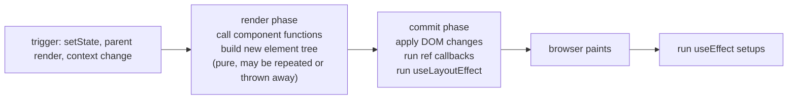
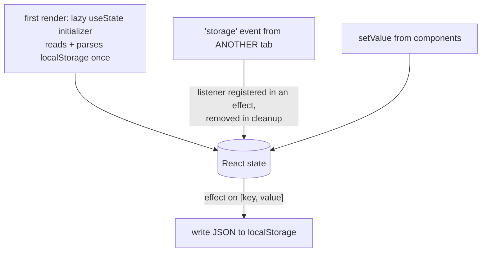

# Deep dive · Effects, refs and custom hooks

The lesson covered the rules. This page covers the *why* behind them and the patterns you'll see in real code reviews.

## How a render actually happens

React's work splits into two phases:



- The **render phase** may run more than once for a single update and may be abandoned (StrictMode, concurrent rendering, Suspense). That's why render must be pure: React assumes it can call your function as often as it likes.
- The **commit phase** happens once per update. Only then is the DOM up to date.
- `useEffect` runs **after paint**, so it never blocks the user from seeing the update. `useLayoutEffect` runs after the DOM change but **before** paint. Use it only to measure layout and synchronously adjust (tooltips that must not flicker). It blocks painting, so default to `useEffect`.

### What triggers a re-render

1. The component's own state changed (`setState` with a value that isn't `Object.is`-equal to the current one).
2. Its parent re-rendered. By default, **children re-render when their parent does**, even if their props didn't change. That's usually fine: rendering is cheap, DOM updates are what's expensive, and React only touches the DOM where output differs.
3. A context it reads changed.

Props changing is *not* a separate trigger: props only change because a parent re-rendered.

## Effects as synchronization

A helpful way to think about an effect: it describes **how to start syncing** something with the current props/state (setup) and **how to stop** (cleanup). React decides when.

```tsx
function ChatRoom({ roomId }: { roomId: string }) {
  useEffect(() => {
    const connection = createConnection(roomId);
    connection.connect();
    return () => connection.disconnect();
  }, [roomId]);
  // ...
}
```

When `roomId` changes from `"general"` to `"random"`, React runs the old cleanup (disconnect from general) and then the new setup (connect to random). You don't write "on change" logic. You write "how to be connected to *this* room", and the dependency array tells React when "this room" changed.

That framing also explains StrictMode's mount → unmount → mount in development: if setup + cleanup + setup leaves things in a different state than a single setup, your cleanup is incomplete.

## Race conditions in effects

The classic data-fetching bug:

```tsx
useEffect(() => {
  fetch(`/api/users/${id}`).then((r) => r.json()).then(setUser);
}, [id]);
```

The user clicks user 1, then quickly user 2. Request 2 returns first, then request 1 arrives and overwrites the screen with the wrong user. The fix is to ignore stale responses in cleanup:

```tsx
useEffect(() => {
  const controller = new AbortController();
  fetch(`/api/users/${id}`, { signal: controller.signal })
    .then((r) => r.json())
    .then(setUser)
    .catch((err) => {
      if (err.name !== "AbortError") setError(err);
    });
  return () => controller.abort();
}, [id]);
```

Add loading states, error states, caching, retries and deduplication and you've written half a data library. That's why [module R2](../../R2-react-data/README.md) uses TanStack Query instead.

## Stale closures

Every render creates new functions that "close over" that render's props and state:

```tsx
function Ticker() {
  const [count, setCount] = useState(0);
  useEffect(() => {
    const id = setInterval(() => setCount(count + 1), 1000); // ❌ `count` is forever 0
    return () => clearInterval(id);
  }, []); // the lint rule would flag the missing `count`
}
```

The interval callback was created during the first render, so it sees `count === 0` forever, and the counter sticks at 1. Options:

- **Updater function** (best here): `setCount((c) => c + 1)`. No dependency on `count` at all.
- Add `count` to dependencies: works, but recreates the interval every second.
- A ref holding the latest value, for callbacks you can't recreate (see below).

## Refs: values that survive renders without causing them

`useRef(initial)` returns a mutable `{ current }` object that stays the same across renders. Changing `ref.current` does **not** trigger a render.

Two uses:

1. **DOM access**: `<input ref={inputRef} />` then `inputRef.current?.focus()` in an event handler or effect.
2. **Instance variables**: a timer id, the previous value, the latest callback, a value an effect needs to read without depending on it.

```tsx
// Focus the input after a successful submit
const inputRef = useRef<HTMLInputElement>(null);
function handleSubmit() {
  save();
  inputRef.current?.focus();
}
```

Rules: don't read or write `ref.current` **during render** (it makes render impure and its value isn't tracked). Read and write it in event handlers and effects. In React 19, function components receive `ref` as a regular prop, so passing a ref to your own `<TextField ref={...}>` no longer needs `forwardRef`.

## Memoization: `useMemo`, `useCallback`, `memo`

- `useMemo(() => compute(a, b), [a, b])` caches a computed value between renders.
- `useCallback(fn, [deps])` caches a function identity (it's `useMemo(() => fn, deps)`).
- `memo(Component)` skips re-rendering a component when its props are shallow-equal to last time.

They're optimizations, and they only work together: `memo(Child)` is useless if the parent passes a new inline object or arrow function every render. When do they matter?

| Situation | Worth it? |
|---|---|
| Filtering 50 cards | No. It's microseconds. |
| Filtering 50,000 rows on every keystroke | `useMemo`, or better, do it on the server |
| A function passed to an effect's dependency array in another component | `useCallback`, so the effect doesn't re-run each render |
| A context value object | `useMemo`, or every consumer re-renders on every provider render |
| A huge subtree re-rendering on unrelated state changes | `memo` on the subtree, or move the state down closer to where it's used |

With the React Compiler enabled, most of this happens automatically. Without it, measure first with the Profiler.

## Designing custom hooks

Good custom hooks look like good backend functions:

- **Name them after what they provide**, not how: `useOnlineStatus`, `useBoard`, `useLocalStorage`, not `useEffectForStorage`.
- **Return a small, stable API.** A tuple for "value + setter" hooks (`[value, setValue]`, like `useState`), an object when there are more members (`{ cards, addCard, moveCard }`).
- **Stable functions.** If consumers might put your returned functions in dependency arrays, keep their identity stable (`useCallback`, or return React's own setter, which is already stable).
- **Hide the mechanism.** `useBoard` consumers don't know it uses a reducer and localStorage. Swap localStorage for an API later and no component changes.
- **Test them** with `renderHook` from Testing Library when the logic is non-trivial, and keep the really important rules in pure functions you can test without React at all.

### Anatomy of `useLocalStorage`

The challenge hook combines most of this page:



Two subtle points worth noticing when you implement it:

- The `storage` event fires only in **other** tabs/windows of the same origin, never in the tab that made the change. That's what makes the effect safe from loops.
- Writing to storage belongs in an effect (or an event handler), **not inside a state updater function**. Updaters must be pure; StrictMode calls them twice to make sure.
