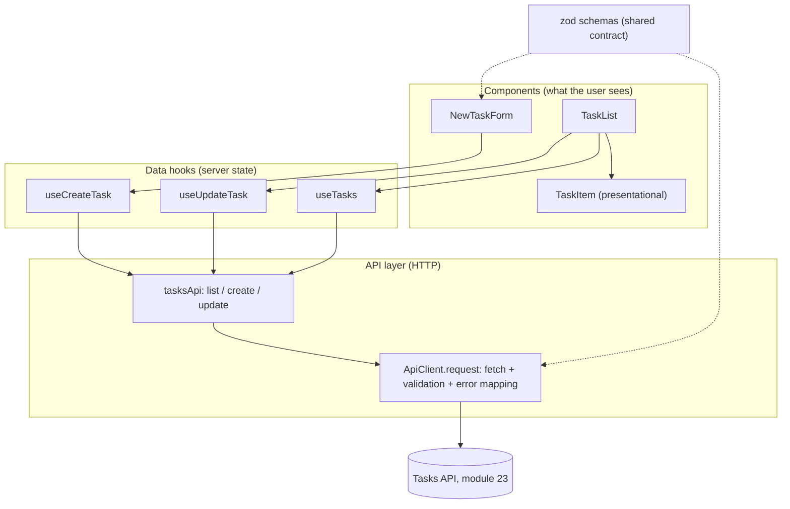
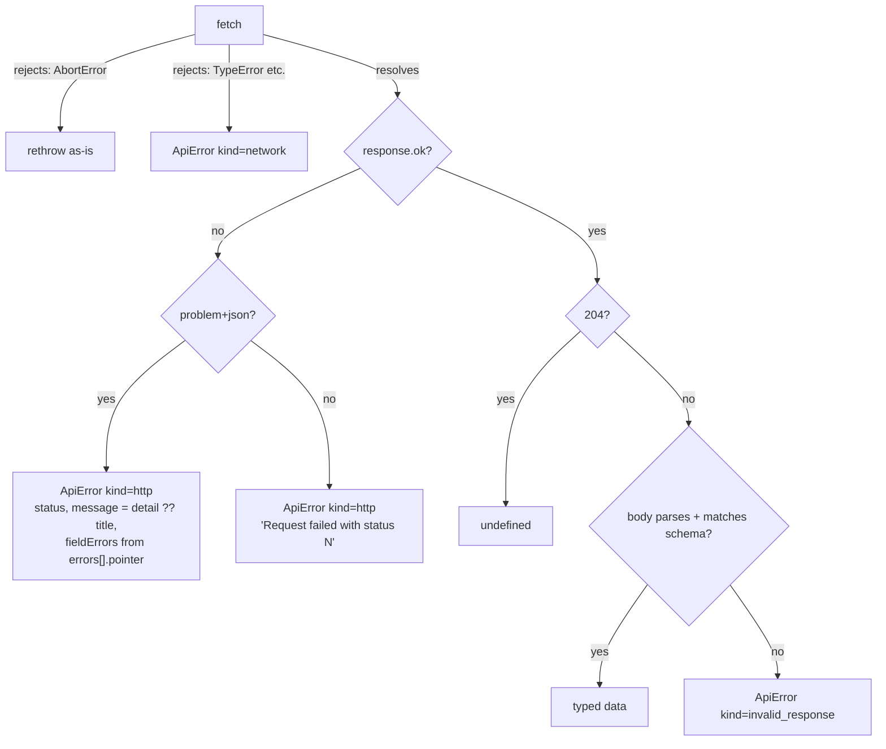
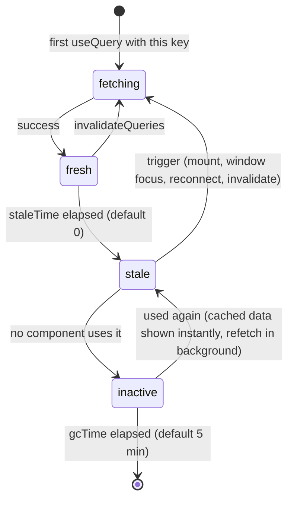
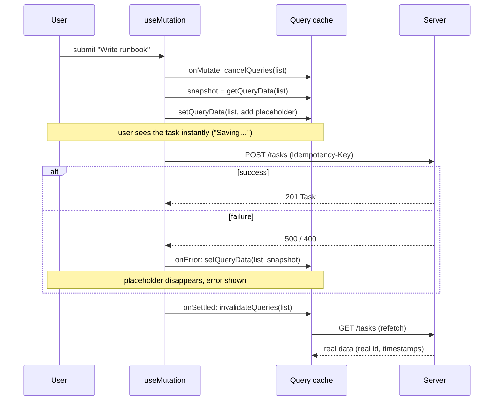
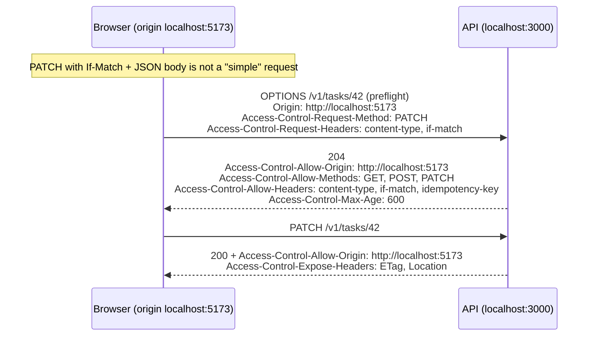

# R2 · React + Your API

> A backend is only as good as the experience of the clients calling it. Building the frontend for your own API teaches you what makes an API pleasant to consume: stable error shapes, cursors, idempotency keys, ETags and CORS. It also teaches you that "fetch in a `useEffect`" falls apart the moment real users, slow networks and concurrent edits show up.

**Time:** ~6h · **Challenge:** 🛠️ Build · **Prereqs:** [R1 · React Fundamentals](../R1-react-fundamentals/README.md), [23 · API Design](../23-api-design/README.md) · **Services:** none

## What you'll learn

- Why **server state** is different from UI state, and why hand-rolled fetching breaks
- A frontend **API client layer**: typed requests, response validation, error mapping (separation of concerns on the frontend)
- TanStack Query: **queries, cache keys, staleness, mutations, invalidation**
- **Optimistic updates** with rollback, and when not to use them
- Loading, error and empty states that users can actually recover from
- Cursor pagination with **infinite queries** ("Load more")
- Forms validated with **shared zod schemas**, plus server-side field errors
- Environment config in Vite, and **CORS** from the backend's side
- **Error boundaries**: what they catch and what they don't

---

## 1. Server state is not UI state

In [R1](../R1-react-fundamentals/README.md) all state lived in the browser: the board belonged to the user's tab, and React state was the source of truth. Data from your API is different:

| | UI state | Server state |
|---|---|---|
| Examples | filter text, open modal, form draft | tasks, users, orders |
| Source of truth | the component | the **server** (the browser holds a *copy*) |
| Can change without you | no | yes: other users, other tabs, background jobs |
| Can be stale | no | always, a little |
| Needs | `useState` / `useReducer` | caching, refetching, deduplication, invalidation, retries, cancellation |

Here's the fetching code everyone writes first:

```tsx
function TaskList() {
  const [tasks, setTasks] = useState<Task[]>([]);
  useEffect(() => {
    fetch("/v1/projects/p1/tasks").then((r) => r.json()).then((body) => setTasks(body.data));
  }, []);
  return <ul>{tasks.map(/* ... */)}</ul>;
}
```

Count the problems:

1. **No loading state**: the user sees "no tasks" while the request is in flight.
2. **No error handling**: a 500 or a network failure leaves an empty list forever. `fetch` doesn't even reject on 404/500.
3. **Race conditions**: if the input changes (another project), a slow old response can overwrite a fast new one.
4. **No caching**: navigate away and back, and you fetch again with a spinner, even though you had the data a second ago.
5. **No deduplication**: three components needing tasks make three identical requests.
6. **No refetching**: the data never updates when a teammate changes it.
7. **No typing or validation**: `body.data` is `any`. If the backend renames a field, you find out from a user's bug report.
8. **HTTP details leak into the component**: URLs, status codes and JSON parsing live in UI code.

Problems 1–6 are what a **server-state library** solves. Problems 7–8 are solved by an **API client layer**. This module builds both.

## 2. Layering the frontend

You spent modules 06–09 separating routes, controllers, services and repositories. The frontend deserves the same discipline:



| Layer | Knows about | Doesn't know about |
|---|---|---|
| `api/client.ts` | `fetch`, `Response`, status codes, JSON, problem details | tasks, React |
| `api/tasks.ts` | endpoints, headers like `Idempotency-Key`/`If-Match`, schemas | React, caching |
| `hooks/*` | TanStack Query, cache keys, optimistic updates | URLs, `fetch` |
| `components/*` | rendering, user interaction, loading/error/empty states | HTTP, cache internals |

The rule that matters: **components never call `fetch`**, and **nothing above the client sees a `Response`**. That gives you the same benefits as on the backend: you can test each layer alone, swap the transport (a fake in tests, a different base URL per environment), and change an endpoint in one place.

The hooks get the API through **context** (`TasksApiProvider`), not through a module-level import. `main.tsx` is the **composition root**: it reads config, builds the real client, and provides it. Tests provide one wired to a fake. That's dependency injection, exactly as in [module 06](../06-layered-architecture/README.md), and it's the "sparingly" use of context from R1: a dependency that never changes, so it never triggers re-renders.

## 3. The API client: one place for HTTP

A good client turns the messy reality of HTTP into two outcomes: **typed data** or **one error type**.

```ts
const task = await client.request(`/v1/tasks/${id}`, { schema: TaskSchema });
// task: Task  (validated at runtime, typed at compile time)
// or it throws ApiError { kind, status?, message, fieldErrors }
```

### `fetch` has sharp edges

- `fetch` **only rejects on network failure** (offline, DNS, CORS blocked, connection reset). A 404 or 500 *resolves* with `response.ok === false`. Forgetting this is the most common frontend HTTP bug.
- Reading the body (`response.json()`) can itself fail: a proxy or load balancer may answer with an HTML error page.
- You must set `Content-Type: application/json` yourself and `JSON.stringify` the body.
- Cancelled requests reject with an `AbortError`. That isn't a failure, it's someone (often TanStack Query) saying "never mind".

### Mapping errors

Module 23's API returns errors as [RFC 9457 Problem Details](../23-api-design/README.md):

```json
{
  "type": "https://api.wl.example/problems/validation-error",
  "title": "Validation Failed",
  "status": 400,
  "detail": "Request validation failed",
  "errors": [{ "pointer": "/title", "detail": "Title must be unique in this project" }]
}
```

The client maps every failure into an `ApiError`:



Now components can branch on meaning (`error.isConflict`, `error.fieldErrors.title`, `error.kind === "network"`) instead of on raw status codes and JSON shapes. It's the client-side mirror of the central error handler from [module 05](../05-express-basics/README.md).

### Validate responses, too

TypeScript types vanish at runtime. `await response.json() as Task` is a *promise* you make to the compiler, not a check. Running the response through `TaskSchema.safeParse` catches contract drift (a renamed field, a number that became a string) at the boundary, with a clear error, instead of as `undefined is not a function` three components later. Some teams validate only in development for speed; validating everywhere is cheap for normal payload sizes.

## 4. TanStack Query: queries

TanStack Query (formerly React Query) is a **cache for server state** plus the logic to keep it fresh. You describe *what* data you need and *how to fetch it*; it handles when.

```tsx
const query = useQuery({
  queryKey: ["tasks", "detail", taskId],
  queryFn: ({ signal }) => api.get(taskId, signal),
});

if (query.isPending) return <Spinner />;
if (query.isError) return <ErrorMessage error={query.error} />;
return <TaskView task={query.data} />;
```

### Query keys are cache addresses

The key identifies the data. Same key, same cache entry, wherever in the app it's used, so two components using `["tasks", "list", "p1"]` share one request and one result. Keys are arrays compared **by value**, and they match by **prefix**:

```ts
export const taskKeys = {
  all: ["tasks"] as const,                                        // everything about tasks
  lists: () => [...taskKeys.all, "list"] as const,                // every task list
  list: (projectId: string) => [...taskKeys.lists(), projectId] as const, // one project's list
};

queryClient.invalidateQueries({ queryKey: taskKeys.all });          // hits all of the above
queryClient.invalidateQueries({ queryKey: taskKeys.list("p1") });   // only project p1
```

Put **every input of the `queryFn`** in the key (project id, filters, page size if it changes results). If the key doesn't change, TanStack Query thinks it's the same data. A query-key factory like the one above keeps keys consistent across files.

### The cache lifecycle



Two settings people mix up:

- **`staleTime`**: how long data is considered fresh. Fresh data is served from cache with no refetch. Default `0`: always refetch in the background when a trigger happens. Raise it (e.g. 30s) for data that doesn't change every second.
- **`gcTime`**: how long *unused* data stays in memory before being garbage-collected. Default 5 minutes.

With stale data, TanStack Query shows the cached value **immediately** and refetches in the background (stale-while-revalidate). That's why navigating back to a page is instant.

### Status flags

| Flag | Meaning |
|---|---|
| `isPending` | no data yet (first load) |
| `isError` / `error` | the last fetch failed |
| `isSuccess` / `data` | we have data |
| `isFetching` | a request is in flight (including background refetches, while showing old data) |
| `isRefetching` | `isFetching` and not the first load |

Show a full spinner only for `isPending`. For background refetches, keep showing data (maybe a subtle indicator). A list that flashes to a spinner every time the window regains focus feels broken.

### Retries and cancellation

Queries retry failed requests 3 times with exponential backoff by default. Retrying a 404 or 400 is pointless, so `lib/queryClient.ts` retries only network errors and 5xx. And the `signal` passed to `queryFn` is aborted when a query becomes irrelevant (the key changed, the component unmounted), which fixes the race condition from section 1 for free, *if* you pass it on to `fetch`.

## 5. Mutations and invalidation

Reads are queries. Writes are **mutations**:

```tsx
const queryClient = useQueryClient();
const createTask = useMutation({
  mutationFn: (input: NewTask) => api.create(projectId, input, crypto.randomUUID()),
  onSuccess: () => queryClient.invalidateQueries({ queryKey: taskKeys.list(projectId) }),
});

createTask.mutate({ title: "Ship it", priority: "high", dueDate: null });
createTask.isPending; createTask.isError; createTask.error; createTask.reset();
```

After a write, the cached list is out of date. You have two ways to fix it:

| Strategy | How | Good when |
|---|---|---|
| **Invalidate** | `invalidateQueries(key)` marks it stale and refetches active queries | the server computes things (ids, ordering, derived fields), or many queries are affected. Simple and always correct. |
| **Update from the response** | `setQueryData(key, old => ...)` with the server's returned entity | the response contains everything you need. Saves a round trip. |

In the challenge, `useUpdateTask` writes the PATCH response straight into the cache: the server returns the full task including its **new version**, so no refetch is needed. `useCreateTask` invalidates, because a new item changes pagination and ordering.

### Idempotency keys and concurrency on the client

Module 23 made the API safe against two real-world problems. The frontend has to hold up its end:

- **`Idempotency-Key`** on POST: generate one per *user intent* (per submit). If the request is retried (by a flaky network, by TanStack Query's mutation `retry`, or by a double-click that slipped through), the same key means the server creates the task once. A new submit gets a new key.
- **`If-Match: "<version>"`** on PATCH: "change this only if it's still the version I saw". If someone else changed it, the server answers **412 Precondition Failed** instead of silently overwriting their work. The UI should explain what happened and refetch, which is what the challenge's conflict handling does.

## 6. Optimistic updates

Waiting 300ms for the server before showing a new task makes an app feel sluggish. An **optimistic update** shows the expected result immediately and reconciles when the server answers:



```ts
useMutation({
  mutationFn: ({ input, idempotencyKey }) => api.create(projectId, input, idempotencyKey),
  onMutate: async (vars) => {
    await queryClient.cancelQueries({ queryKey: listKey });       // 1. no stale refetch may land on top
    const previous = queryClient.getQueryData(listKey);           // 2. snapshot
    queryClient.setQueryData(listKey, (old) => addPlaceholder(old, vars)); // 3. optimistic write (immutably!)
    return { previous };                                          // 4. becomes `context`
  },
  onError: (_err, _vars, context) => queryClient.setQueryData(listKey, context?.previous), // rollback
  onSettled: () => queryClient.invalidateQueries({ queryKey: listKey }),                  // re-sync
});
```

Each step exists for a reason:

1. **`cancelQueries`**: a background refetch started before the mutation would return the old list and wipe out your placeholder.
2. **Snapshot**: so a failure restores *exactly* the previous state.
3. **Immutable write**: the cache follows the same rule as React state. Mutating cached objects in place breaks change detection.
4. **`onSettled` invalidate**: the placeholder has a fake id and client-side timestamps. Refetching swaps in the real entity and picks up other users' changes.

**When not to be optimistic**: when failure is likely or costly (payments, anything with complex server-side validation), when the server decides important parts of the result, or when an "undo" would confuse users. A spinner on the button is honest. The challenge makes *create* optimistic (cheap, rarely fails, easy to roll back) and *update* non-optimistic (concurrency conflicts are a real possibility).

React 19 also has a built-in `useOptimistic` hook for optimistic UI tied to Actions. It's handy for local, form-level optimism; with TanStack Query, the cache-based approach above keeps every component that reads the list consistent.

## 7. Cursor pagination with infinite queries

Module 23's list endpoint returns pages with an opaque cursor:

```json
{ "data": [ /* 10 tasks */ ], "page": { "limit": 10, "nextCursor": "eyJvZmZzZXQiOjEwfQ" } }
```

`useInfiniteQuery` stores **all loaded pages** under one key and knows how to fetch the next one:

```ts
useInfiniteQuery({
  queryKey: taskKeys.list(projectId),
  queryFn: ({ pageParam, signal }) => api.list({ projectId, cursor: pageParam, limit: 10 }, signal),
  initialPageParam: null as string | null,
  getNextPageParam: (lastPage) => lastPage.page.nextCursor ?? undefined, // undefined = no more pages
  select: (data) => data.pages.flatMap((p) => p.data),                    // components get Task[]
});
// -> data, fetchNextPage(), hasNextPage, isFetchingNextPage, isFetchNextPageError
```

The cache holds `{ pages: TaskPage[], pageParams: (string | null)[] }`. That's the shape your optimistic update and `setQueryData` calls must preserve. `select` transforms what *components* see without changing what's *cached*.

Why cursors and not `?page=3`? With offsets, inserting a task while someone is paging shifts everything, so they see duplicates or skip items. A cursor marks a position in the ordering, which stays valid. (Module 23 covers this from the server side.) On invalidation, TanStack Query refetches the loaded pages in sequence, so the list stays consistent.

"Load more" buttons are more accessible and predictable than infinite scroll. If you do want auto-loading, trigger `fetchNextPage` from an `IntersectionObserver` on a sentinel element, and keep a button as a fallback.

## 8. Loading, error and empty states

Every data-driven component has at least four states, and users see all of them:

| State | Show | Don't |
|---|---|---|
| Loading (first time) | a placeholder or "Loading…", ideally a skeleton the size of the content | a blank area, or an empty-state message ("No tasks") before data arrives |
| Error | what went wrong in plain words, plus a way out (**Retry**) | a stack trace, "Error: [object Object]", or nothing |
| Empty | why it's empty and what to do ("Create the first one above") | a blank list |
| Data | the data; background refetches subtly | a full-page spinner on every background refetch |

Partial failures matter too. If page 3 fails to load, keep pages 1–2 on screen and show the error next to the "Load more" button. Throwing away what the user was reading is worse than the failure itself.

Accessibility: loading text in `role="status"` and errors in `role="alert"` get announced by screen readers. Disable buttons while their action is pending (and change their label: "Adding…") so double submits don't happen.

## 9. Forms with shared zod schemas

The backend validates every request with zod ([module 07](../07-validation-errors-config/README.md)). The frontend should validate the **same rules** before sending, so users get instant feedback. If both sides import one schema, they can't drift:

```ts
// schemas/task.ts (in a monorepo: packages/contracts, imported by api AND web)
export const NewTaskSchema = z.object({
  title: z.string().trim().min(1, "Title is required").max(200, "Title must be 200 characters or fewer"),
  priority: z.enum(["low", "medium", "high"]),
  dueDate: z.string().regex(/^\d{4}-\d{2}-\d{2}$/, "Due date must look like YYYY-MM-DD").nullable(),
});
export type NewTask = z.output<typeof NewTaskSchema>;
```

```tsx
const result = NewTaskSchema.safeParse({ ...values, dueDate: values.dueDate || null });
if (!result.success) {
  const { fieldErrors } = z.flattenError(result.error); // { title?: string[], ... }
  setErrors({ title: fieldErrors.title?.[0] });
  return;
}
createTask.mutate({ input: result.data, idempotencyKey: crypto.randomUUID() });
```

Notes:

- **`z.input` vs `z.output`**: the form holds raw input; the schema returns normalized output (trimmed title). Send the *output* to the API.
- **Client validation is UX, server validation is security.** Anyone can call your API with curl. The server must still validate everything, and its errors must reach the user. The challenge maps the problem's `errors[].pointer` to `fieldErrors` and shows them under the same fields as client errors, e.g. "Title must be unique in this project", which only the server can know.
- **Accessible errors**: `aria-invalid` on the control and `aria-describedby` pointing at the message, so screen readers read the error with the field.
- Libraries like React Hook Form or TanStack Form (with a zod resolver) handle touched/dirty state and large forms. For a three-field form, plain state plus the schema is clearer, and it's what those libraries do underneath.

## 10. Environment config in Vite

The frontend needs to know where the API is. Vite reads `.env`, `.env.local`, `.env.[mode]` files and exposes variables **prefixed with `VITE_`** on `import.meta.env`:

```bash
# .env.local (gitignored)
VITE_API_URL=http://localhost:3000
VITE_PROJECT_ID=demo
```

Critical difference from the backend: **these values are inlined into the JavaScript bundle at build time.** Anyone can open DevTools and read them. So:

- **Never put secrets in `VITE_` variables** (API keys with write access, database URLs, signing secrets). If the browser needs to call something secret, put a backend in between.
- A build is tied to its config. To deploy the same build to staging and production, either build once per environment or load a small `config.json` at runtime.
- Keep a single `config.ts` that reads `import.meta.env`, validates it with zod and exports typed config, the same rule as "only `config.ts` reads `process.env`" on the backend.

## 11. CORS, from the backend's side

Your frontend runs on `http://localhost:5173`, the API on `http://localhost:3000`. Different port means different **origin**, and browsers block JavaScript from reading cross-origin responses unless the server opts in. That's CORS (Cross-Origin Resource Sharing), and it's configured **on the API**, not in React.



- **Preflight**: for anything beyond a "simple" request (methods other than GET/HEAD/POST, a JSON `Content-Type`, custom headers like `Idempotency-Key` or `If-Match`), the browser first sends an `OPTIONS` request asking permission. Our API triggers preflights for almost everything, so the server must answer `OPTIONS` correctly.
- **`Access-Control-Allow-Origin`**: an explicit allowlist of origins. `*` is fine for public, cookie-less APIs, but **cannot** be combined with credentials (cookies).
- **`Access-Control-Expose-Headers`**: by default JavaScript can read only a few "safe" response headers. To read `ETag`, `Location` or rate-limit headers from the frontend, expose them.
- **CORS is not security for your API.** It protects *users' browsers* from malicious sites reading responses with the user's credentials. curl, Postman and servers ignore it entirely. Authentication and authorization still do the real work ([module 22](../22-auth/README.md), [module 25](../25-security/README.md)).
- A CORS failure shows up in the browser as a network error (`TypeError: Failed to fetch`) with details only in the console. That's why the client maps it to `kind: "network"`.

In development you can sidestep CORS entirely with Vite's dev-server proxy, so the browser only ever talks to one origin. See [docs/env-and-cors.md](docs/env-and-cors.md) for both the Express configuration and the proxy setup.

## 12. Error boundaries

TanStack Query turns *fetch* errors into state (`query.error`). But what if a component throws while **rendering**, say on unexpected data? Without a boundary, React unmounts the whole tree and the user sees a blank page.

An **error boundary** catches errors thrown during rendering (and in lifecycle methods/effects) of its children and renders a fallback instead:

```tsx
<ErrorBoundary fallback={({ error, reset }) => <CrashScreen error={error} onRetry={reset} />}>
  <TaskList projectId={projectId} />
</ErrorBoundary>
```

They're still class components in React 19 (`getDerivedStateFromError` + `componentDidCatch`); the provided `ErrorBoundary.tsx` shows the pattern. What they **don't** catch: errors in event handlers, in async code (`setTimeout`, a rejected promise in a click handler), or in the boundary itself. Handle those where they happen and put them into state.

Place boundaries at meaningful granularity: one around the whole app (last resort), and others around independent widgets so one broken panel doesn't take the page down. Report caught errors to an error tracker in `componentDidCatch`. (TanStack Query can also *throw* query errors to the nearest boundary with `throwOnError`, useful when a page can't work at all without its data.)

## Common mistakes

- Treating `fetch` as rejecting on HTTP errors and never checking `response.ok`.
- `fetch` + `useEffect` + `useState` per component: no caching, races, no retries.
- Query keys that omit an input of the `queryFn`, so different data shares one cache entry.
- Copying query data into `useState` "to edit it", so it never updates again. Keep server state in the cache, and only *drafts* in local state.
- Mutating cached data in place in `setQueryData`.
- Optimistic updates without `cancelQueries` (a refetch overwrites them) or without rollback.
- Forgetting to invalidate after a mutation: the UI shows stale data until a reload.
- Showing "No tasks" while the first request is still loading.
- Generating a new idempotency key on every *retry* instead of per *submission*.
- Secrets in `VITE_` variables.
- "Fixing" CORS in the frontend (there's no such thing) or with `Access-Control-Allow-Origin: *` plus credentials (browsers reject it).
- Expecting an error boundary to catch errors from event handlers or promises.

## In production

- **Request waterfalls** are the most common frontend performance problem: component A fetches, renders B, which fetches, renders C... Fetch in parallel, prefetch on hover (`queryClient.prefetchQuery`), or let a router load data before rendering.
- **The backend shapes the frontend's options.** Stable error codes, problem details with field pointers, cursors, idempotency keys and ETags are what made this module's frontend robust. When you design APIs, design them for the client.
- **Real-time updates**: polling (`refetchInterval`), WebSockets/SSE that call `invalidateQueries` or `setQueryData` on events. The cache model stays the same, only the trigger changes. The [capstone](../36-capstone-ticketing/README.md) does this for its seat map.
- **Generated clients**: many teams generate the API client and types from an OpenAPI spec (openapi-typescript, orval) or share zod schemas in a monorepo, so the contract has one source of truth.
- **Observability on the frontend**: error trackers (Sentry etc.) fed from error boundaries and failed mutations, plus correlation ids (module 24's `X-Request-Id`) shown in error UIs so support can find the backend logs.

## Check yourself

1. `fetch` resolved but the server returned 500. What does your code see, and what should the client layer do?
   <details><summary>Answer</summary>The promise resolves with <code>response.ok === false</code> and <code>status === 500</code>; <code>fetch</code> only rejects on network failure. The client should read the problem body if there is one and throw a typed <code>ApiError</code> so callers handle every failure the same way.</details>
2. What's the difference between `staleTime` and `gcTime`?
   <details><summary>Answer</summary><code>staleTime</code> is how long cached data counts as fresh (no refetch on mount/focus). <code>gcTime</code> is how long unused data stays in memory before being garbage-collected.</details>
3. Why call `cancelQueries` at the start of an optimistic update?
   <details><summary>Answer</summary>An in-flight refetch started before the mutation would resolve with the old server list and overwrite the optimistic entry.</details>
4. When would you update the cache from a mutation response instead of invalidating?
   <details><summary>Answer</summary>When the response contains the complete, authoritative entity (like a PATCH that returns the updated task with its new version) and nothing else in the cache depends on it, so a refetch would be a wasted round trip.</details>
5. Your React app on `localhost:5173` gets `TypeError: Failed to fetch` calling the API on `:3000`, but curl works. What's going on and where do you fix it?
   <details><summary>Answer</summary>Most likely CORS: the browser's preflight or response lacks the right <code>Access-Control-Allow-*</code> headers. Fix it on the API (allow the origin, methods and headers like <code>If-Match</code>/<code>Idempotency-Key</code>), or use the Vite dev proxy in development.</details>

## Further reading

- TanStack Query docs, overview: https://tanstack.com/query/latest/docs/framework/react/overview
- TanStack Query, optimistic updates: https://tanstack.com/query/latest/docs/framework/react/guides/optimistic-updates
- TanStack Query, infinite queries: https://tanstack.com/query/latest/docs/framework/react/guides/infinite-queries
- MDN, Using the Fetch API: https://developer.mozilla.org/en-US/docs/Web/API/Fetch_API/Using_Fetch
- MDN, Cross-Origin Resource Sharing (CORS): https://developer.mozilla.org/en-US/docs/Web/HTTP/CORS
- Vite, Env Variables and Modes: https://vite.dev/guide/env-and-mode
- React docs, error boundaries: https://react.dev/reference/react/Component#catching-rendering-errors-with-an-error-boundary
- zod docs: https://zod.dev
- Deep dives in this module: [docs/tanstack-query-in-depth.md](docs/tanstack-query-in-depth.md) · [docs/env-and-cors.md](docs/env-and-cors.md) · [docs/react-data-cheatsheet.md](docs/react-data-cheatsheet.md)

## ➡️ Next: [the challenge](CHALLENGE.md)
