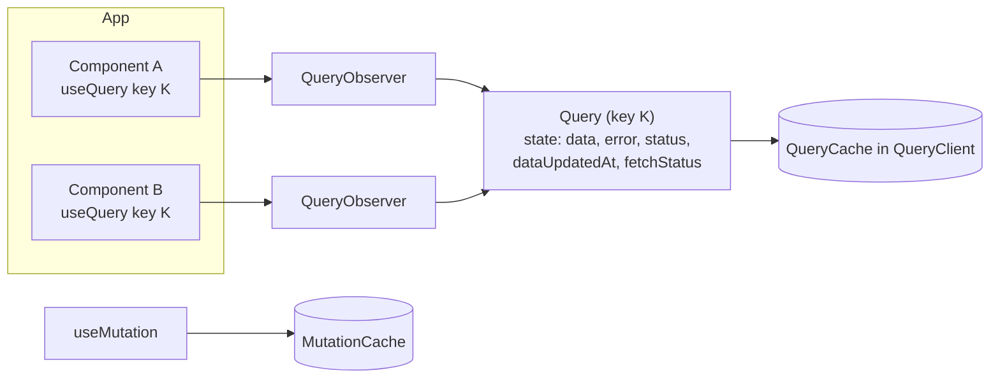
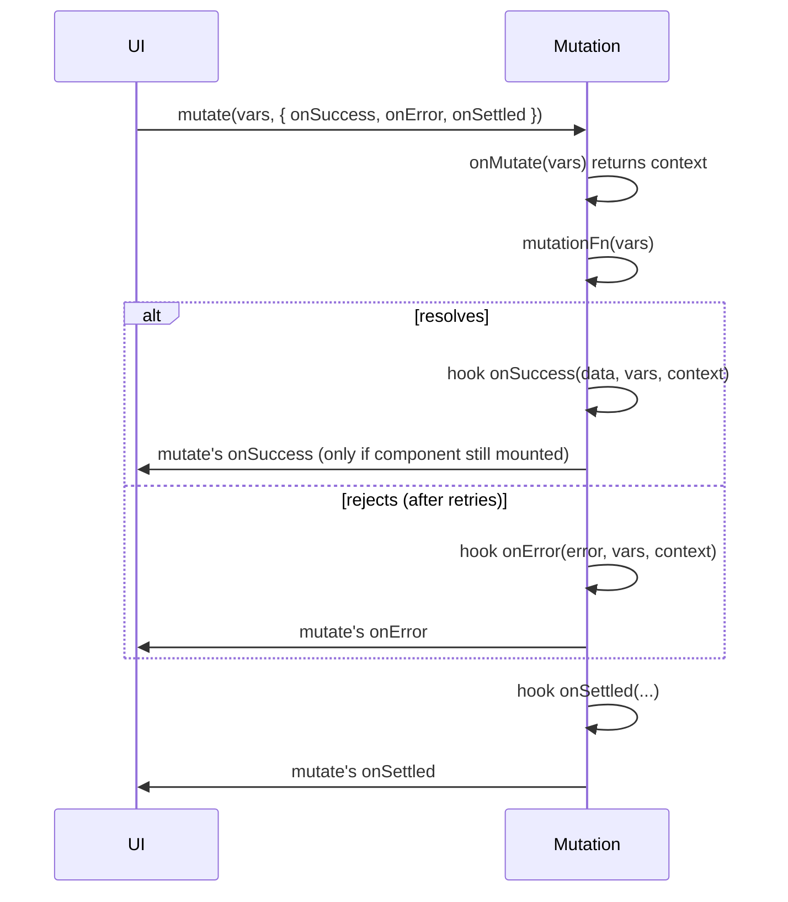

# Deep dive · TanStack Query in depth

The lesson covered the core API. This page explains what happens inside the cache, so you can reason about bugs instead of guessing.

## The pieces



- The **QueryClient** owns a **QueryCache**: a map from serialized query keys to **Query** objects.
- Each `useQuery` call creates an **observer** subscribed to one Query. Many observers can share one Query, which is why two components with the same key cause one request.
- A Query has two independent status axes:
  - `status`: `pending` (no data yet) | `error` | `success`. *What do we have?*
  - `fetchStatus`: `fetching` | `paused` (offline) | `idle`. *Is a request running?*
  That's why `isPending && fetchStatus === "idle"` is possible: no data and not fetching (for example, a disabled query, or offline).

## When does a query fetch?

A query fetches when an observer mounts and there's no data, **or** when its data is stale and one of these triggers happens:

| Trigger | Option | Default |
|---|---|---|
| a new observer mounts | `refetchOnMount` | true |
| the window regains focus | `refetchOnWindowFocus` | true |
| the network reconnects | `refetchOnReconnect` | true |
| a timer | `refetchInterval` | off |
| `invalidateQueries` matches it | | always (if active) |
| `refetch()` is called | | always |

"Stale" is decided by `staleTime`. With the default `0`, every trigger refetches. That surprises people in development: switch tabs, come back, see a request. It's intentional: it keeps data fresh without you writing any code. Set `staleTime` per query according to how fast the data actually changes.

## Structural sharing

When a refetch returns data that's deeply equal to what's cached, TanStack Query keeps the **old object references**. Where only one item changed, only that item (and its ancestors) get new references. Components that depend on unchanged parts don't see new props, and effects depending on them don't re-run. It's the same idea as returning the same `state` from a no-op reducer in R1.

## `select`

`select` transforms data per observer, without changing the cache:

```ts
useInfiniteQuery({ ..., select: (data) => data.pages.flatMap((p) => p.data) });
useQuery({ queryKey: taskKeys.list(p), queryFn, select: (tasks) => tasks.filter((t) => t.status === "done") });
```

- Components get exactly the shape they need.
- The result is memoized: `select` re-runs only when the data (or the `select` function's identity) changes. Define it outside the component or wrap it in `useCallback` if it's expensive.
- Cache writes (`setQueryData`, optimistic updates) still use the **raw** cached shape, here `{ pages, pageParams }`. Mixing up the selected shape and the cached shape is a classic bug.

## Mutations: lifecycle and callbacks



Two places for callbacks, with a convention:

- **In `useMutation({...})`**: logic that must *always* run, regardless of who triggered the mutation: cache updates, rollback, invalidation.
- **In `mutate(vars, {...})`**: UI reactions specific to *this* call site: reset a form, close a modal, navigate. These don't fire if the component unmounted in the meantime, which is what you want for UI.

If a hook callback returns a promise, the mutation waits for it. Returning `invalidateQueries(...)` from `onSettled` keeps `isPending` true until fresh data has arrived, so the button doesn't re-enable while the list still shows the old state.

## Optimistic updates: two styles

**1. Through the cache** (the challenge's approach): write the expected result into the query cache in `onMutate`, roll back in `onError`, invalidate in `onSettled`. Every component reading that key sees the optimistic state. Best when several components show the same data.

**2. Through the UI only**: don't touch the cache; render `mutation.variables` as an extra pending row while `mutation.isPending`:

```tsx
{createTask.isPending && <TaskRow task={{ ...createTask.variables.input, id: "pending" }} pending />}
```

Simpler (no rollback needed: when the mutation ends, the extra row disappears and the invalidated list takes over), but only that component sees the optimistic item. Good for a single list.

### Concurrent optimistic mutations

If the user fires two optimistic mutations quickly, the first one's `onSettled` invalidation can refetch and overwrite the second one's optimistic entry while it's still in flight. Mitigations: only invalidate when no other mutation for that key is pending (`queryClient.isMutating({ mutationKey })`), or give mutations a `mutationKey` and use `scope` to run them serially.

## Infinite queries under the hood

The cache entry for an infinite query is:

```ts
{ pages: [page0, page1, page2], pageParams: [null, "cursorA", "cursorB"] }
```

- `fetchNextPage()` calls `queryFn` with `getNextPageParam(lastPage)` and appends.
- On refetch (invalidation, focus), it refetches **every loaded page in order**, starting from `initialPageParam` and recomputing each next param from the fresh page. That keeps cursors consistent, but means refetching 20 loaded pages is 20 sequential requests. `maxPages` caps how many pages are kept.
- `hasNextPage` is `getNextPageParam(lastPage) !== undefined`, which is why the challenge converts `null` to `undefined`.

## Testing with TanStack Query

- **A fresh `QueryClient` per test.** A shared client leaks cached data between tests.
- **`retry: false`** in tests. Otherwise a deliberate failure takes several seconds of backoff before the error appears.
- **Mock at the network boundary** (a stubbed `fetch` or MSW), not by mocking hooks. Then tests exercise the real client, real hooks and real cache, as in `test/helpers/fakeApi.ts`.
- Use `findBy*` / `waitFor` for anything that depends on a request resolving.
- To assert "no refetch happened", count requests on the fake server, as `TaskList.test.tsx` does for the update case.

## DevTools

`@tanstack/react-query-devtools` shows every query, its key, status, staleness and data, and lets you trigger refetches and invalidations by hand. Worth adding to any real project (it's excluded from production builds by default).
