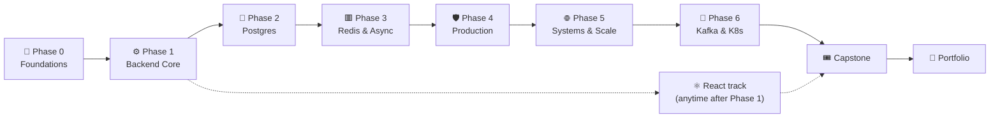

<div align="center">

# ❄️ WinterLearning

**A self-paced, job-ready sprint from "I know some JavaScript" to backend & infrastructure engineer.**

Express · TypeScript · Postgres · Redis · Kafka · Kubernetes · System Design · React


</div>

---

## 📈 Progress

<!-- PROGRESS:START -->
  

```
░░░░░░░░░░░░░░░░░░░░░░░░░░░░░░  0%  (0/40 modules · ~0/287h)
```

**👉 Up next:** [00 · Dev Environment & Workflow](00-dev-environment/README.md) (🛠️ Build, ~3h)
<!-- PROGRESS:END -->

> Run `npm run progress -- <id>` after finishing a module. It runs that module's tests and, if they pass, ticks it off here.

---

## 🧭 What this is

Every top-level folder is a **self-contained module**: a lesson, deeper docs, a hands-on challenge with its own project and tests, progressive hints, and interview questions. You work through them in order, from absolute basics up to a production-style capstone.

Two threads run through the whole thing:

1. **Clean code at the small scale.** Separation of concerns, layered architecture, dependency injection, testable design. From module 06 on, every app is built this way.
2. **System design at the large scale.** Caching, queues, concurrency, consistency, scaling, observability, event streaming, orchestration. Each topic is learned by building it, then tied together in the system design module and the capstone.

## 🗺️ Roadmap



Each phase ends with a **🏁 checkpoint**: a small project built from scratch with no scaffold, combining everything in that phase. Checkpoints are where it actually clicks.

<!-- ROADMAP:START -->
### Phase 0 · Foundations  `0/5`

| Status | # | Module | Challenge | Est. | Services |
|:--:|:--:|---|---|:--:|:--:|
| 👉 next | `00` | [Dev Environment & Workflow](00-dev-environment/README.md) | 🛠️ Build | 3h | 🐘 🟥 |
| ⬜ | `01` | [The JavaScript Runtime](01-js-runtime/README.md) | 🐛 Debug | 5h | — |
| ⬜ | `02` | [TypeScript Fundamentals](02-typescript-fundamentals/README.md) | 🧩 Scaffold | 6h | — |
| ⬜ | `03` | [HTTP Fundamentals](03-http-fundamentals/README.md) | 🛠️ Build | 5h | — |
| ⬜ | `04` | [Checkpoint: Foundations](04-checkpoint-foundations/README.md) | 🛠️ Build | 5h | — |

### Phase 1 · Backend Core  `0/6`

| Status | # | Module | Challenge | Est. | Services |
|:--:|:--:|---|---|:--:|:--:|
| ⬜ | `05` | [Express Basics](05-express-basics/README.md) | 🧩 Scaffold | 6h | — |
| ⬜ | `06` | [Layered Architecture & Separation of Concerns](06-layered-architecture/README.md) | 🐛 Debug | 7h | — |
| ⬜ | `07` | [Validation, Errors & Config](07-validation-errors-config/README.md) | 🧩 Scaffold | 6h | — |
| ⬜ | `08` | [TypeScript for Backends](08-typescript-for-backends/README.md) | 🐛 Debug | 6h | — |
| ⬜ | `09` | [Testing Backends](09-testing/README.md) | 🛠️ Build | 7h | 🐘 |
| ⬜ | `10` | [Checkpoint: Backend Core](10-checkpoint-backend-core/README.md) | 🛠️ Build | 8h | — |

### Phase 2 · Postgres  `0/6`

| Status | # | Module | Challenge | Est. | Services |
|:--:|:--:|---|---|:--:|:--:|
| ⬜ | `11` | [SQL Fundamentals](11-sql-fundamentals/README.md) | 🛠️ Build | 7h | 🐘 |
| ⬜ | `12` | [Data Modeling & Migrations](12-data-modeling/README.md) | 🛠️ Build | 6h | 🐘 |
| ⬜ | `13` | [Postgres from Node](13-node-postgres/README.md) | 🧩 Scaffold | 7h | 🐘 |
| ⬜ | `14` | [Query Performance](14-query-performance/README.md) | 🐛 Debug | 7h | 🐘 |
| ⬜ | `15` | [Transactions & Concurrency](15-transactions-concurrency/README.md) | 🐛 Debug | 7h | 🐘 |
| ⬜ | `16` | [Checkpoint: Postgres](16-checkpoint-postgres/README.md) | 🛠️ Build | 8h | 🐘 |

### Phase 3 · Redis & Async Work  `0/5`

| Status | # | Module | Challenge | Est. | Services |
|:--:|:--:|---|---|:--:|:--:|
| ⬜ | `17` | [Redis Fundamentals](17-redis-fundamentals/README.md) | 🛠️ Build | 5h | 🟥 |
| ⬜ | `18` | [Caching](18-caching/README.md) | 🧩 Scaffold | 6h | 🐘 🟥 |
| ⬜ | `19` | [Rate Limiting](19-rate-limiting/README.md) | 🛠️ Build | 5h | 🟥 |
| ⬜ | `20` | [Background Jobs & Queues](20-background-jobs/README.md) | 🧩 Scaffold | 6h | 🟥 |
| ⬜ | `21` | [Checkpoint: Redis](21-checkpoint-redis/README.md) | 🛠️ Build | 7h | 🐘 🟥 |

### Phase 4 · Production Readiness  `0/6`

| Status | # | Module | Challenge | Est. | Services |
|:--:|:--:|---|---|:--:|:--:|
| ⬜ | `22` | [Authentication & Authorization](22-auth/README.md) | 🛠️ Build | 8h | 🐘 🟥 |
| ⬜ | `23` | [API Design](23-api-design/README.md) | 🛠️ Build | 6h | — |
| ⬜ | `24` | [Observability](24-observability/README.md) | 🐛 Debug | 6h | — |
| ⬜ | `25` | [Web Security](25-security/README.md) | 🐛 Debug | 6h | 🐘 |
| ⬜ | `26` | [Docker, CI & Deployment](26-docker-ci-deploy/README.md) | 🛠️ Build | 6h | 🐘 |
| ⬜ | `27` | [Checkpoint: Production Readiness](27-checkpoint-production/README.md) | 🛠️ Build | 8h | 🐘 🟥 |

### Phase 5 · Systems & Scale  `0/4`

| Status | # | Module | Challenge | Est. | Services |
|:--:|:--:|---|---|:--:|:--:|
| ⬜ | `28` | [Real-time Systems](28-realtime/README.md) | 🛠️ Build | 6h | 🟥 |
| ⬜ | `29` | [Reliability & Scaling](29-reliability-scaling/README.md) | 🛠️ Build | 7h | — |
| ⬜ | `30` | [System Design](30-system-design/README.md) | 📝 Docs | 10h | — |
| ⬜ | `31` | [Checkpoint: URL Shortener (end-to-end)](31-checkpoint-url-shortener/README.md) | 🛠️ Build | 10h | 🐘 🟥 |

### React Track  `0/2`

| Status | # | Module | Challenge | Est. | Services |
|:--:|:--:|---|---|:--:|:--:|
| ⬜ | `R1` | [React Fundamentals](R1-react-fundamentals/README.md) | 🧩 Scaffold | 6h | — |
| ⬜ | `R2` | [React + Your API](R2-react-data/README.md) | 🛠️ Build | 6h | — |

### Phase 6 · Event Streaming & Orchestration  `0/4`

| Status | # | Module | Challenge | Est. | Services |
|:--:|:--:|---|---|:--:|:--:|
| ⬜ | `32` | [Kafka Fundamentals](32-kafka-fundamentals/README.md) | 🧩 Scaffold | 7h | 📨 |
| ⬜ | `33` | [Event-Driven Architecture](33-event-driven-architecture/README.md) | 🐛 Debug | 7h | 🐘 📨 |
| ⬜ | `34` | [Kubernetes Fundamentals](34-kubernetes-fundamentals/README.md) | 🛠️ Build | 7h | — |
| ⬜ | `35` | [Kubernetes in Practice](35-kubernetes-in-practice/README.md) | 🐛 Debug | 7h | — |

### Phase 7 · Capstone & Portfolio  `0/2`

| Status | # | Module | Challenge | Est. | Services |
|:--:|:--:|---|---|:--:|:--:|
| ⬜ | `36` | [Capstone: Event Ticketing Platform](36-capstone-ticketing/README.md) | 🛠️ Build | 35h | 🐘 🟥 📨 |
| ⬜ | `37` | [Portfolio & Job Readiness](37-portfolio/README.md) | 📝 Docs | 4h | — |
<!-- ROADMAP:END -->

**Legend:** 🛠️ Build: you write it from (nearly) nothing · 🧩 Scaffold: fill in the TODOs in a working skeleton · 🐛 Debug: a realistic app with planted bugs; fix them from symptom reports · 📝 Docs: written deliverables (designs, plans)  
**Services:** 🐘 Postgres · 🟥 Redis · 📨 Kafka (run with `make up`, Docker required)

---

## 📦 Anatomy of a module

```
06-layered-architecture/
├── README.md        📖 the lesson: read this first
├── docs/            📚 deep dives + a cheat sheet for the topic
├── CHALLENGE.md     🎯 the task, acceptance criteria, stretch goals
├── HINTS.md         💡 progressive hints (open one at a time)
├── INTERVIEW.md     🎤 interview questions to answer in your own words
├── module.json      🏷️ metadata used by the progress script and CI
└── challenge/       🧪 a standalone project with its own package.json, tests and Makefile
```

Every `challenge/` has the same commands:

| Command | What it does |
|---|---|
| `make install` | install dependencies |
| `make up` / `make down` | start / stop the module's services (Postgres, Redis, Kafka) in Docker |
| `make test` | run the acceptance tests. **Green = done.** |
| `make dev` | run the app with hot reload |
| `make reset` | wipe containers/volumes and reinstall |

Services always use the same host ports, so they never clash with anything installed locally: **Postgres → 5433**, **Redis → 6380**, **Kafka → 9092**.

## 🔁 The loop for each module

```mermaid
flowchart LR
  A[📖 Read the lesson] --> B[🌿 git switch -c module/NN-slug]
  B --> C[🧪 make test: red]
  C --> D[⌨️ Code until green]
  D --> E[🔀 Open a PR, CI runs]
  E --> F[👀 Self-review / ask Claude to review]
  F --> G[✅ npm run progress -- NN]
  G --> H[🎤 Answer INTERVIEW.md]
  H --> I[📝 Add a LOG.md entry]
  I --> J[🔍 Compare with the solutions branch]
```



Full details are in **[docs/WORKFLOW.md](docs/WORKFLOW.md)**: branching, PRs, CI, getting a code review, and using solutions without spoiling yourself.

### 🔐 Solutions

Reference solutions live on the **`solutions`** branch, never on `main`. Each module there has a `SOLUTION.md` walkthrough (design decisions and alternatives) and model answers in `INTERVIEW.md`.

```bash
git fetch origin solutions
git diff main origin/solutions -- 06-layered-architecture/     # compare after you finish
git show origin/solutions:06-layered-architecture/SOLUTION.md  # read the walkthrough
```

Rule of thumb: struggle for at least 30 minutes, then use **HINTS.md**, and only look at solutions **after** your tests pass (or when you're truly stuck).

---

## 🧰 Prerequisites

- **Node 22** (`nvm use`; the repo includes `.nvmrc`)
- **Docker Desktop** (or OrbStack/Colima) for Postgres, Redis and Kafka
- **Git** and a GitHub account (CI runs on your PRs)
- From Phase 6: **kind** or **minikube**, `kubectl` and `helm`
- Optional: `psql`, `redis-cli`, `k6`, a REST client (curl, HTTPie, Bruno)

## ⏱️ Pacing

Module estimates add up to **~290 hours** (plan for more: reading, stretch goals and getting stuck all count). No deadlines; this is self-paced and it's fine if it runs into the semester. Suggested rhythms:

| Pace | Hours/week | Duration |
|---|---|---|
| 🔥 Full sprint (break) | 35–40 | ~10–12 weeks |
| ⚖️ Steady | 15–20 | ~4 months |
| 🎓 During semester | 6–10 | as long as it takes |

Do the React track (`R1`, `R2`) whenever you want a change of pace after Phase 1. A suggested week-by-week plan is in [docs/SCHEDULE.md](docs/SCHEDULE.md).

## 📚 Reference

| | |
|---|---|
| 📓 [LOG.md](LOG.md) | your learning log: two lines per session |
| 🔁 [docs/WORKFLOW.md](docs/WORKFLOW.md) | branch → PR → review → progress |
| 🗓️ [docs/SCHEDULE.md](docs/SCHEDULE.md) | suggested pacing |
| 📖 [docs/glossary.md](docs/glossary.md) | every term used in the course, in one place |
| 🧾 [docs/cheatsheets/](docs/cheatsheets/) | git · docker · typescript · http · sql · redis · kafka · kubectl |

## 🏆 What you'll have at the end

- 30+ working projects covering the backend/infra fundamentals interviewers actually ask about
- A **production-style capstone** (event ticketing: concurrency-safe bookings, caching, queues, Kafka events, realtime updates, observability, Docker + Kubernetes, React frontend) with a design doc
- Written system designs for five classic problems
- Interview answers in your own words for every topic
- A deploy plan, a polished project README and resume bullets (module 37)

<div align="center">

*Built for one winter. Useful for a career.* ❄️

</div>
