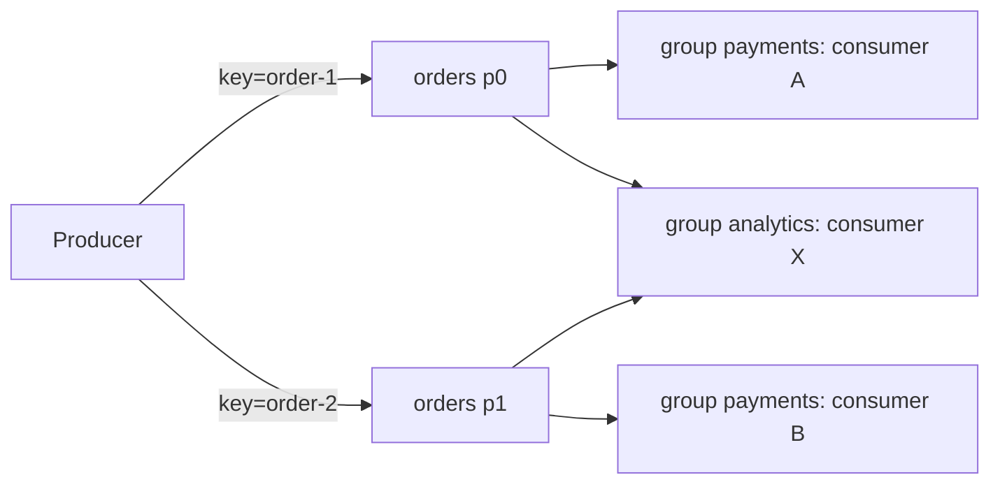

# Kafka cheat sheet (KRaft + kafkajs)

> Topics, partitions, consumer groups, the CLI tools and kafkajs snippets. Taught in [32 · Kafka Fundamentals](../../32-kafka-fundamentals/README.md) and [33 · Event-Driven Architecture](../../33-event-driven-architecture/README.md).

## Core concepts in one table

| Term | Meaning |
|---|---|
| **Topic** | named, append-only log of records (`orders.v1`) |
| **Partition** | one ordered shard of a topic; the unit of parallelism and ordering |
| **Offset** | a record's position within a partition (0, 1, 2, ...) |
| **Key** | decides the partition (same key → same partition → ordered) |
| **Producer** | appends records; `acks` controls durability |
| **Consumer group** | consumers sharing work; each partition goes to exactly one member |
| **Committed offset** | where a group resumes after restart or rebalance |
| **Lag** | latest offset minus committed offset: how far behind a group is |
| **Retention** | how long records are kept (time/size), independent of consumption |
| **Compaction** | keep only the latest record per key (changelog topics) |
| **Replication / ISR** | copies across brokers; in-sync replicas can take over as leader |
| **KRaft** | Kafka's built-in metadata quorum (no ZooKeeper) |



## Local broker (this repo)

`apache/kafka:3.9.0`, single KRaft node, host port **9092**. Apps use `KAFKA_BROKERS=localhost:9092`.

```bash
make up
docker compose logs -f kafka
```

The CLI tools live in `/opt/kafka/bin` inside the image:

```bash
docker compose exec kafka /opt/kafka/bin/kafka-topics.sh --bootstrap-server localhost:9092 --list
```

## CLI commands (prefix each with `docker compose exec kafka /opt/kafka/bin/`)

```bash
kafka-topics.sh --bootstrap-server localhost:9092 --create --topic orders.v1 --partitions 3 --replication-factor 1
kafka-topics.sh --bootstrap-server localhost:9092 --describe --topic orders.v1
kafka-topics.sh --bootstrap-server localhost:9092 --delete --topic orders.v1

kafka-console-producer.sh --bootstrap-server localhost:9092 --topic orders.v1 \
  --property parse.key=true --property key.separator=:
# then type:  order-1:{"type":"OrderPlaced","total":4200}

kafka-console-consumer.sh --bootstrap-server localhost:9092 --topic orders.v1 --from-beginning \
  --property print.key=true --property print.partition=true --property print.offset=true

kafka-consumer-groups.sh --bootstrap-server localhost:9092 --list
kafka-consumer-groups.sh --bootstrap-server localhost:9092 --describe --group payments   # shows LAG per partition
kafka-consumer-groups.sh --bootstrap-server localhost:9092 --group payments --topic orders.v1 \
  --reset-offsets --to-earliest --execute      # replay (group must be stopped)

kafka-configs.sh --bootstrap-server localhost:9092 --alter --entity-type topics --entity-name users.v1 \
  --add-config cleanup.policy=compact
```

## kafkajs

```ts
import { Kafka, logLevel } from "kafkajs";
const kafka = new Kafka({ clientId: "orders-api", brokers: (process.env.KAFKA_BROKERS ?? "localhost:9092").split(","), logLevel: logLevel.WARN });

// producer
const producer = kafka.producer({ idempotent: true });   // no duplicates from producer retries
await producer.connect();
await producer.send({
  topic: "orders.v1",
  acks: -1,                                             // wait for all in-sync replicas
  messages: [{
    key: order.id,                                      // ordering per order
    value: JSON.stringify({ orderId: order.id, total: order.totalCents }),
    headers: { "event-type": "OrderPlaced", "event-version": "1" },
  }],
});

// consumer with manual commits (at-least-once)
const consumer = kafka.consumer({ groupId: "payments" });
await consumer.connect();
await consumer.subscribe({ topics: ["orders.v1"], fromBeginning: true });
await consumer.run({
  autoCommit: false,
  eachMessage: async ({ topic, partition, message }) => {
    await handle(message);                              // must be idempotent
    await consumer.commitOffsets([{ topic, partition, offset: (Number(message.offset) + 1).toString() }]);
  },
});

// shutdown
for (const sig of ["SIGTERM", "SIGINT"]) process.once(sig, async () => { await consumer.disconnect(); await producer.disconnect(); });
```

Note the `+ 1`: the committed offset is the **next** record to read.

## Delivery semantics

| Semantics | How you get it | Risk |
|---|---|---|
| At-most-once | commit **before** processing | crash = message lost |
| At-least-once | commit **after** processing | crash = message redelivered → make handlers idempotent |
| "Exactly-once" (effectively) | at-least-once + idempotent consumer (inbox/dedupe table), or Kafka transactions within Kafka | still need care at the edges |

## Choosing partitions & keys

- Ordering is only guaranteed **within a partition**. Key by the entity whose events must stay in order (orderId, userId).
- More partitions = more parallel consumers, but more overhead. Consumers beyond the partition count sit idle.
- Changing the partition count later remaps keys to new partitions (breaks per-key ordering across the change).
- Hot keys (one huge customer) create hot partitions.

## Gotchas

- Consuming does not delete records; retention does. Many groups can read the same topic independently.
- A poison message (always throws) blocks its partition forever unless you retry N times and send it to a dead-letter topic.
- Long processing inside `eachMessage` can exceed the session timeout → rebalance → redelivery storms. Keep handlers fast or use `heartbeat()`.
- `fromBeginning` only applies when the group has **no** committed offset yet.
- Inside Docker, the broker's advertised listener must be reachable from the client. "Connects then fails" is usually a listener/advertised address mismatch.
- Version your event schemas (`event-version` header, `.v1` topics) and only make backward-compatible changes in place.
